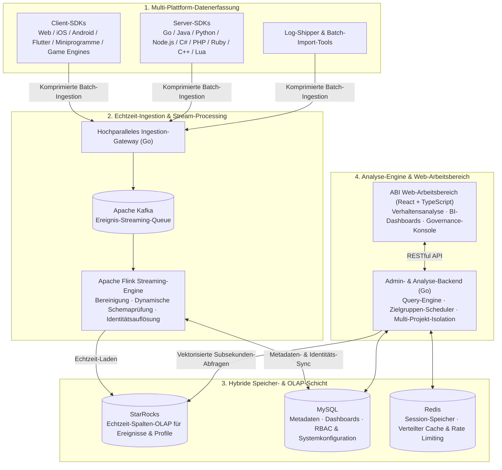

# ABI — Unternehmensplattform für Nutzerverhaltensanalyse (UBA) & BI

**All-in-One Self-Hosted Plattform für Produktanalytik, Customer 360 & Business Intelligence**

Vereint **Multi-Plattform-Ereigniserfassung · Echtzeit-Stream-Processing · Vektorisierte Subsekunden-OLAP · 7 Verhaltensanalysemodelle · Interaktive BI-Dashboards · Enterprise-RBAC**

  <strong>🌐 Sprache / Langue / Language:</strong>
  <a href="README.md">简体中文</a> ·
  <a href="README.zh-TW.md">繁體中文</a> ·
  <a href="README.en.md">English</a> ·
  <a href="README.ja.md">日本語</a> ·
  <a href="README.ko.md">한국어</a> ·
  <a href="README.es.md">Español</a> ·
  <a href="README.pt.md">Português</a> ·
  <a href="README.de.md"><b>Deutsch</b></a> ·
  <a href="README.fr.md">Français</a> ·
  <a href="README.ru.md">Русский</a> ·
  <a href="README.vi.md">Tiếng Việt</a> ·
  <a href="README.th.md">ไทย</a> ·
  <a href="README.id.md">Bahasa Indonesia</a>

  
  
  
  
  
  

  <a href="#features">Kernfunktionen</a> •
  <a href="#scenarios">Anwendungsbereiche</a> •
  <a href="#screenshots">Screenshots</a> •
  <a href="#architecture">Architektur</a> •
  <a href="#sdks">SDK-Ökosystem</a> •
  <a href="#contact">Lizenzierung & Kontakt</a>

 

---

## ✨ Kernfunktionen

**ABI (AnyLink Behavioral Intelligence)** ist eine unternehmensgerechte Plattform für **Nutzerverhaltensanalyse (User Behavior Analytics, UBA) und Business Intelligence (BI)**, maßgeschneidert für Teams aus Produktwachstum, Marketing/Betrieb und Datentechnik. Sie bietet einen lückenlosen geschlossenen Workflow — von der plattformübergreifenden Ereigniserfassung und der Echtzeit-Streaming-Ingestion bis hin zur Self-Service-Verhaltenserkennung, Zielgruppensegmentierung und Management-Dashboards — mit voller Unterstützung für private Cloud- und On-Premise-Bereitstellung sowie vollständiger Datensouveränität.

| Funktionsbereich | Wesentliche Merkmale |
| :--- | :--- |
| **📊 7 Self-Service-Analysemodelle** | Integrierte **Ereignisanalyse** (Multi-Metriken-Aggregation, benutzerdefinierte Formeln, Vorperiodenvergleiche, mehrdimensionale Aufschlüsselungen), **Funnel-Analyse** (Konversions- und Drop-Off-Diagnose), **Retention-Analyse** (tägliche/wöchentliche/monatliche Kohortenmatrizen), **Pfadanalyse** (Vorwärts- und Rückwärts-Sankey-Flussdiagramme der User Journey), **Verteilungsanalyse**, **Intervallanalyse** (Time-to-Convert Boxplots) und **Nutzerattributanalyse**. |
| **🎯 Customer 360 & Zielgruppen-Engine** | Echtzeit-Geräteübergreifende Identitätsauflösung (Identity Resolution), die anonyme Besucher und authentifizierte Konten zu einem ganzheitlichen Nutzerprofil verknüpft; umfasst **360-Grad-Zeitleisten für Einzelnutzer**, **visuelle regelbasierte Nutzersegmente**, **CSV-Listenimporte**, **1-Klick-Speicherung von Segmenten direkt aus Diagrammen** sowie **geplante Nutzertags**. |
| **🧩 Interaktive BI-Dashboards** | Strukturierung von Arbeitsbereichen über Multi-Space-Ordner, responsive Drag-and-Drop-Rasterlayouts, Visualisierungs-Widgets mit Modellenmix, dashboardweite dynamische Datums- und Filterüberschreibungen sowie feingranulare Teamfreigaben. |
| **🔌 Metadaten- & Tracking-Governance** | Zentrale Verwaltung von Projekten, Zeitzonen, Ereignisschemata, Eigenschaftslexika und Geschäftsmetriken; enthält einen **interaktiven SDK-Onboarding-Playground** (Live-Validierung von Tracking-Payloads ohne Verunreinigung der Produktionsdaten) sowie Echtzeit-Ingestion- und Fehlerprotokolle. |
| **🔐 Unternehmenssicherheit & Globale i18n** | Feingranulare RBAC-Rechteverwaltung über Menüs, Routen und Aktionsschaltflächen hinweg mit strikter Datenisolation auf Projektebene und Audit-Protokollierung; native Unterstützung für **13 globale Sprachen** (darunter Deutsch, Englisch, vereinfachtes/traditionelles Chinesisch, Japanisch, Französisch, Spanisch, Portugiesisch, Koreanisch, Russisch, Vietnamesisch, Thailändisch und Bahasa Indonesia), Hell-/Dunkel-Themes und Anti-Leak-Wasserzeichen auf dem Bildschirm. |

---

## 🌍 Wichtigste Anwendungsbereiche

- **Produktwachstum & Mobile Apps (Web / iOS / Android / Miniprogramme)**: Feature-Adoption präzise messen, Abbrüche im Onboarding-Funnel lokalisieren, Kohorten-Retention-Kurven verfolgen und reale Navigationspfade der Nutzer analysieren.
- **E-Commerce & Digitaler Handel**: Lückenlose End-to-End-Attribution von Produktimpressionen und Warenkorb-Hinzufügungen bis hin zu Kasse und Zahlung herstellen, bei gleichzeitiger Segmentierung von High-LTV-VIP-Käufern und abwanderungsgefährdeten Nutzern.
- **Gaming-Studios & Globale Publisher**: Hochvolumige Telemetriedaten über Unity, Unreal, Cocos und Spieleserver hinweg erfassen, um Tutorial-Abschlussraten, Level-Intervalle, tägliche Retention und Monetarisierungsstufen fundiert auszuwerten.
- **Self-Hosted Unternehmens-Dateninfrastruktur**: Bereitstellung in der eigenen Cloud oder On-Premise-Umgebung für vollständige Daten-Compliance und -Souveränität, Multi-Mandanten-Isolation und weltweite Zusammenarbeit über Zeitzonen hinweg.

---

## 📸 Screenshots der Produktmodule

### 1. Arbeitsbereich Ereignisanalyse & BI-Dashboards für Führungskräfte

Ein intuitiver No-Code-Analysearbeitsbereich für Produktmanager und Analysten: links Metriken, Filter und Dimensionen konfigurieren, rechts interaktive Diagramme und Drilldown-Tabellen auswerten und Erkenntnisse direkt an geteilte Dashboards anheften.

<table>
  <tr>
    <td width="50%" valign="top">
      
      
<b>BI-Dashboard-Arbeitsbereich</b>: Drag-and-Drop-Rasterlayout, Ordnerstruktur für Arbeitsbereiche und globale Datumsfilterung

    </td>
    <td width="50%" valign="top">
      
      
<b>Funnel-Analyse</b>: Konfigurierbare Konversionsfenster mit schrittweisen Einblicken in Konversionen und Abbrüche

    </td>
  </tr>
</table>

### 2. Kohorten-Retention & Nutzerpfadanalyse

Maßgeschneiderte Visualisierungen für Retention-Tracking und die Erkennung von Nutzerflüssen, angetrieben von einer hochleistungsfähigen vektorisierten OLAP-Engine.

<table>
  <tr>
    <td width="50%" valign="top">
      
      
<b>Retention-Analyse</b>: Multi-Kohorten-Abklingkurven kombiniert mit einer täglichen Kohorten-Heatmap-Matrix

    </td>
    <td width="50%" valign="top">
      
      
<b>Pfadanalyse</b>: Vorwärts- und Rückwärts-Sankey-Diagramme über mehrere Schritte mit Ranglisten der häufigsten Übergänge

    </td>
  </tr>
</table>

### 3. Customer 360 Zeitleiste & Visuelle Zielgruppensegmentierung

Nahtloser Drilldown von aggregierten KPIs auf individuelle Ereignisströme einzelner Nutzer oder Erstellung dynamischer Nutzersegmente und Tags für zielgerichtete modulübergreifende Analysen.

<table>
  <tr>
    <td width="50%" valign="top">
      
      
<b>Nutzer 360 & Ereignis-Zeitleiste</b>: Verknüpfte Identitäten, Profilattribute und chronologischer Verhaltensstrom

    </td>
    <td width="50%" valign="top">
      
      
<b>Zielgruppensegmentierung</b>: Kombination von Profileigenschaften und Verhaltensregeln mit sofortiger Mengenvorschau und geplanter Aktualisierung

    </td>
  </tr>
</table>

### 4. Metadaten-Governance, Live-SDK-Onboarding & Granulare RBAC

Saubere Datenkataloge pflegen, Ereignis-Tracking-Payloads interaktiv validieren und den Teamzugriff mit unternehmensweiten Berechtigungen steuern.

<table>
  <tr>
    <td width="50%" valign="top">
      
      
<b>Ereignis- & Schema-Governance</b>: Anzeigenamen, Status-Aktivierung und Eigenschaftslexika zentral verwalten

    </td>
    <td width="50%" valign="top">
      
      
<b>Interaktiver Onboarding-Leitfaden</b>: JSON-Payloads in Sekundenschnelle in der Vorschau prüfen und Live-Validierungen durchführen

    </td>
  </tr>
</table>

<b>🔍 Zum Aufklappen klicken: Unternehmensrollen & granularer RBAC-Berechtigungsbaum für Menüs und Schaltflächen</b>

 

<b>Granulare RBAC-Autorisierung</b>: Visueller Berechtigungsbaum über Module, Seiten und Aktionsschaltflächen innerhalb der Benutzeroberfläche

---

## 🏗️ Technische Architektur

ABI basiert auf einer modernen, Cloud-nativen **4-Schichten-Datenplattform-Architektur**, die ein hochparalleles Ingestion-Gateway, Echtzeit-Stream-Processing, eine vektorisierte spaltenbasierte OLAP-Engine und einen entkoppelten Web-Analysearbeitsbereich vereint.

### 1. High-Level-Architekturdiagramm

### 2. Übersicht der Architekturschichten

- **Datenerfassungsschicht**: Produktionsreife SDKs für Web, Mobilgeräte, Spiele-Engines und Backend-Sprachen mit lokalem Puffer, Batch-Komprimierung und Live-Validierungstools.
- **Echtzeit-Ingestion- & Streaming-Schicht**: Ein dediziertes Go-Ingestion-Gateway übernimmt Authentifizierung und Traffic-Pufferung in Kafka, während Apache Flink Ereignisse kontinuierlich bereinigt, dynamische Schemata durchsetzt, GeoIP-Standortdaten anreichert und geräteübergreifende Nutzeridentitäten auflöst.
- **Speicher- & OLAP-Schicht**: StarRocks ermöglicht analytische Abfragen im Subsekundenbereich über riesige Ereignistabellen, Nutzerprofile und Zielgruppenkohorten hinweg; MySQL speichert Metadaten, Dashboard-Layouts und RBAC-Konfigurationen; Redis verwaltet aktive Sitzungen und Rate Limits.
- **Service- & Anwendungsschicht**: Das Go-Backend kompiliert visuelle Abfragebedingungen in sicheres, parametrisiertes analytisches SQL mit strikter Projektisolation und bedient ein responsives Analyse- und Dashboard-Frontend auf Basis von React + TypeScript + ECharts.

### 3. Zusammenfassung des Technologie-Stacks

| Schicht | Kerntechnologien | Rolle |
| :--- | :--- | :--- |
| **Frontend-Arbeitsbereich** | React · TypeScript · Vite · Tailwind CSS · ECharts | Visueller Abfrage-Builder, interaktive Diagramme, Drag-and-Drop-Dashboards & Administrationskonsole |
| **Backend-Dienste** | Go · Gin · GORM | Admin-API, analytischer SQL-Compiler, Zielgruppen-Scheduler & hochparalleles Ingestion-Gateway |
| **Stream-Processing** | Java · Apache Flink · Apache Kafka | Echtzeit-Ereignis-ETL, Live-Metadaten-Sync, Identitätsauflösung & Rohdaten-Archivierung |
| **Speicher & OLAP** | StarRocks · MySQL · Redis | Vektorisierte spaltenorientierte OLAP-Datenbank, relationaler Metadatenspeicher & verteilter Cache |
| **Bereitstellung** | Docker · Docker Compose · Nginx | Containerisierte 1-Befehl-Bereitstellung oder skalierbares privates Cloud-Cluster-Rollout |

---

## 📦 Multi-Plattform-SDK-Ökosystem

Umfassende Datenerfassungs-SDKs mit vollständiger Dokumentation und interaktiven Beispielen — erkunden Sie die **[Vollständige SDK-Suite & Integrationsdokumentation](abi.sdk/README.de.md)**:

- **Web & Cross-Platform**: JavaScript / TypeScript Web SDK, App-to-WebView H5 Bridge, WeChat Miniprogramm, React Native
- **Native Mobilgeräte**: iOS (`Swift`), Android (`Kotlin`), Flutter (`Dart`)
- **Game Engines**: Unity (`C#`), Unreal Engine / Cocos2d-x (`C/C++`), Cocos Creator / Egret / LayaAir, Cocos2d-Lua
- **Server-Sprachen**: Go, Java, Python, Node.js, C# (`.NET`), PHP, Ruby, Lua
- **HTTP & Log-Ingestion**: Standardisierte HTTP RESTful Batch-Ingestion-API, Echtzeit-Logfile-Shipper und einsatzbereite Log-Collector-Vorlagen

---

## 📬 Kommerzielle Lizenzierung & Kaufanfragen

ABI ist für **kommerzielle Lizenzierung, vollständige Quellcode-Lieferung, Unterstützung bei der privaten / On-Premise-Bereitstellung und individuelle Unternehmensentwicklung** verfügbar.  
Wenn Sie daran interessiert sind, ABI zu erwerben, eine Live-Demo anzufordern oder Optionen für Unternehmenslizenzen zu besprechen, kontaktieren Sie uns gerne per E-Mail:

- **Kauf- & Geschäftskontakt**: **[baidushanxivip@gmail.com](mailto:baidushanxivip@gmail.com)**

---

**[简体中文](README.md)** · **[繁體中文](README.zh-TW.md)** · **[English](README.en.md)** · **[日本語](README.ja.md)** · **[한국어](README.ko.md)** · **[Español](README.es.md)** · **[Português](README.pt.md)** · **[Deutsch](README.de.md)** · **[Français](README.fr.md)** · **[Русский](README.ru.md)** · **[Tiếng Việt](README.vi.md)** · **[ไทย](README.th.md)** · **[Bahasa Indonesia](README.id.md)**

Schlagwörter: Nutzerverhaltensanalyse, UBA, Produktanalyse, Business Intelligence, BI-Dashboard, Self-Hosted Analytics, Event Tracking SDK, Funnel-Analyse, Kohorten-Retention, Sankey-Nutzerpfade, Customer 360, Zielgruppensegmentierung, CDP, StarRocks OLAP, Apache Flink, Enterprise RBAC

