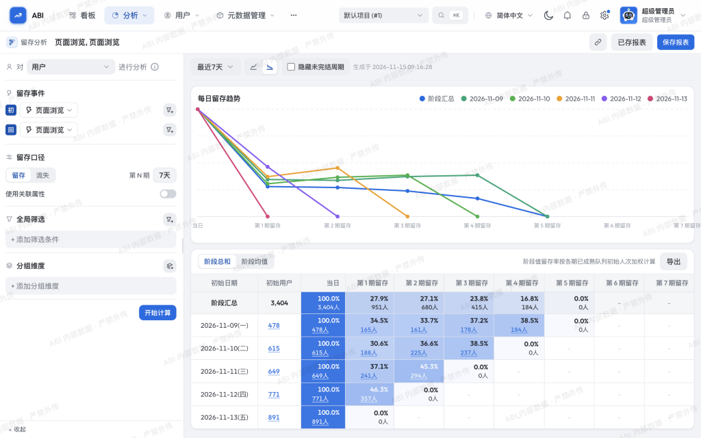
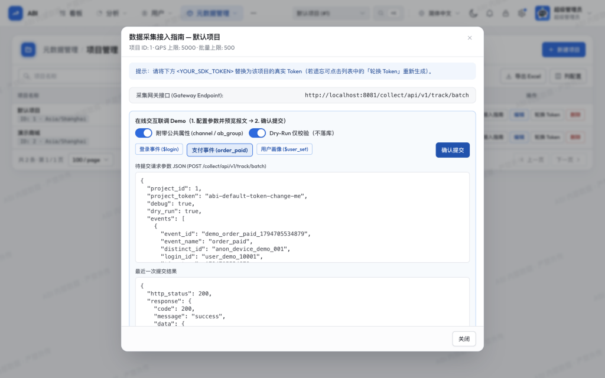
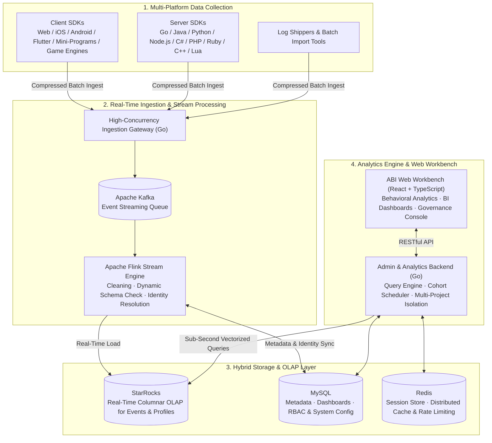

# ABI — Enterprise User Behavior Analytics (UBA) & BI Platform

**All-in-One Self-Hosted Product Analytics, Customer 360 & Business Intelligence Platform**

Unifying **Multi-Platform Event Tracking · Real-Time Stream Processing · Sub-Second OLAP · 7 Behavioral Analytics Models · Interactive BI Dashboards · Enterprise RBAC**

  <strong>🌐 Language / 语言 / 言語:</strong>
  <a href="README.md">简体中文</a> ·
  <a href="README.en.md"><b>English</b></a> ·
  <a href="README.ja.md">日本語</a>

  
  
  
  
  
  

  <a href="#features">Core Features</a> •
  <a href="#scenarios">Use Cases</a> •
  <a href="#screenshots">Screenshots</a> •
  <a href="#architecture">Architecture</a> •
  <a href="#sdks">SDK Ecosystem</a> •
  <a href="#contact">Purchase & Contact</a>

 

---

## ✨ Core Features

**ABI (AnyLink Behavioral Intelligence)** is an enterprise-ready **User Behavior Analytics (UBA) and Business Intelligence (BI)** platform built for product growth, operations, and data engineering teams. It delivers a complete closed-loop workflow—from multi-platform event collection and real-time streaming ingestion to self-service behavioral exploration, audience segmentation, and executive dashboards—with full support for private / on-premise deployment and data sovereignty.

| Capability Domain | Key Highlights |
| :--- | :--- |
| **📊 7 Self-Service Analytics Models** | Built-in **Event Analysis** (multi-metric aggregation, custom formulas, period-over-period comparison, multi-dimensional breakdowns), **Funnel Analysis** (conversion & drop-off diagnostics), **Retention Analysis** (daily/weekly/monthly cohort matrices), **Path Analysis** (forward/reverse user journey Sankey flows), **Distribution Analysis**, **Interval Analysis** (time-to-convert box plots), and **User Attribute Analysis**. |
| **🎯 Customer 360 & Audience Engine** | Real-time cross-device identity resolution linking anonymous visitors and authenticated accounts into a unified user profile; includes **Single-User 360 Timelines**, **Visual Rule-Based Cohorts**, **CSV List Imports**, **One-Click Cohort Saving from Charts**, and **Scheduled User Tags**. |
| **🧩 Interactive BI Dashboards** | Organize workspaces with multi-space folders, responsive drag-and-drop grid layouts, mixed-model visualization widgets, dashboard-wide dynamic date & filter overrides, and granular team sharing. |
| **🔌 Metadata & Tracking Governance** | Centrally manage projects, timezones, event schemas, property dictionaries, and business metrics; features an **Interactive SDK Onboarding Playground** (live payload validation without polluting production data) plus real-time ingestion & error logs. |
| **🔐 Enterprise Security & Global i18n** | Fine-grained RBAC across menus, routes, and action buttons with strict project-level data isolation and audit logging; native **English, Simplified Chinese, and Japanese** localization, Light/Dark themes, and anti-leak screen watermarks. |

---

## 🌍 Key Use Cases

- **Product Growth & Mobile Apps (Web / iOS / Android / Mini-Programs)**: Measure feature adoption, pinpoint onboarding funnel drop-offs, track cohort retention curves, and explore real user navigation flows.
- **E-Commerce & Digital Retail**: Connect end-to-end attribution from product impressions and cart additions to checkout and payment, while segmenting high-LTV VIP buyers and churn-risk users.
- **Gaming Studios & Global Publishers**: Collect high-volume telemetry across Unity, Unreal, Cocos, and game servers to analyze tutorial completion, stage intervals, daily retention, and monetization tiers.
- **Self-Hosted Enterprise Data Infrastructure**: Deploy inside your own cloud or on-premise environment for full data privacy compliance, multi-business-unit isolation, and cross-timezone global collaboration.

---

## 📸 Product Module Screenshots

### 1. Event Analysis Workbench & Executive BI Dashboards

An intuitive, no-code exploration workspace designed for product managers and analysts: configure metrics, filters, and breakdowns on the left, inspect interactive charts and drill-down tables on the right, and pin insights directly onto shared dashboards.

<table>
  <tr>
    <td width="50%" valign="top">
      
      
<b>BI Dashboard Workspace</b>: Drag-and-drop grid layout, workspace folders, and global date filtering

    </td>
    <td width="50%" valign="top">
      
      
<b>Funnel Analysis</b>: Configurable conversion windows with step-by-step conversion & drop-off insights

    </td>
  </tr>
</table>

### 2. Cohort Retention & User Journey Path Analysis

Purpose-built visualizations for retention tracking and user flow discovery, powered by a high-speed vectorized OLAP engine.

<table>
  <tr>
    <td width="50%" valign="top">
      
      
<b>Retention Analysis</b>: Multi-cohort retention decay curves paired with a daily cohort heatmap matrix

    </td>
    <td width="50%" valign="top">
      
      
<b>Path Analysis</b>: Forward & reverse multi-step Sankey diagrams with top transition rankings

    </td>
  </tr>
</table>

### 3. Customer 360 Timeline & Visual Audience Segmentation

Drill down seamlessly from aggregate KPIs to individual user event streams, or build dynamic user segments and tags for targeted cross-model analysis.

<table>
  <tr>
    <td width="50%" valign="top">
      
      
<b>User 360 & Event Timeline</b>: Linked identities, profile attributes, and chronological behavior stream

    </td>
    <td width="50%" valign="top">
      
      
<b>Audience Segmentation</b>: Combine profile traits & behavioral rules with instant size preview and scheduled refresh

    </td>
  </tr>
</table>

### 4. Metadata Governance, Live SDK Onboarding & Granular RBAC

Maintain clean data dictionaries, validate event tracking payloads interactively, and govern team access with enterprise-grade permissions.

<table>
  <tr>
    <td width="50%" valign="top">
      
      
<b>Event & Schema Governance</b>: Manage display names, active status toggles, and property dictionaries

    </td>
    <td width="50%" valign="top">
      
      
<b>Interactive Onboarding Guide</b>: Preview JSON payloads and run live validation checks in seconds

    </td>
  </tr>
</table>

<b>🔍 Click to expand: Enterprise Role & Granular Menu/Button RBAC Permission Tree</b>

 

<b>Granular RBAC Authorization</b>: Visual permission tree across modules, pages, and in-page action buttons

---

## 🏗️ Technical Architecture

ABI adopts a modern, cloud-native **4-layer data platform architecture** combining a high-concurrency ingestion gateway, real-time stream processing, a vectorized columnar OLAP engine, and a decoupled web workbench.

### 1. High-Level Architecture Diagram

### 2. Architectural Layers Overview

- **Data Collection Layer**: Production-grade SDKs across web, mobile, game engines, and backend languages with local buffering, batch compression, and live validation tools.
- **Real-Time Ingestion & Streaming Layer**: A dedicated Go ingestion gateway handles authentication and traffic buffering into Kafka, while Apache Flink continuously cleanses events, enforces dynamic schemas, enriches GeoIP location data, and resolves cross-device user identities.
- **Storage & OLAP Layer**: StarRocks powers sub-second analytical queries across massive event tables, user profiles, and audience cohorts; MySQL stores metadata, dashboard layouts, and RBAC configurations; Redis manages active sessions and rate limits.
- **Service & Application Layer**: The Go backend compiles visual query conditions into safe, parameterized analytical SQL with strict project isolation, serving a responsive React + TypeScript + ECharts analytics and dashboard frontend.

### 3. Technology Stack Summary

| Layer | Core Technologies | Role |
| :--- | :--- | :--- |
| **Frontend Workbench** | React · TypeScript · Vite · Tailwind CSS · ECharts | Behavioral query builder, interactive charts, drag-and-drop dashboards & admin console |
| **Backend Services** | Go · Gin · GORM | Admin API, analytical SQL compiler, audience scheduler & high-throughput ingestion gateway |
| **Stream Processing** | Java · Apache Flink · Apache Kafka | Real-time event ETL, live metadata sync, identity resolution & raw event archival |
| **Storage & OLAP** | StarRocks · MySQL · Redis | Vectorized columnar OLAP database, relational metadata store & distributed cache |
| **Deployment** | Docker · Docker Compose · Nginx | One-command containerized deployment or scalable private cloud cluster rollout |

---

## 📦 Multi-Platform SDK Ecosystem

Comprehensive data collection SDKs with full trilingual documentation (English, Simplified Chinese, Japanese) and interactive examples — browse the **[Full SDK Suite & Integration Docs](abi.sdk/README.en.md)**:

- **Web & Cross-Platform**: JavaScript / TypeScript Web SDK, App-to-WebView H5 Bridge, WeChat Mini-Program, React Native
- **Native Mobile**: iOS (`Swift`), Android (`Kotlin`), Flutter (`Dart`)
- **Game Engines**: Unity (`C#`), Unreal Engine / Cocos2d-x (`C/C++`), Cocos Creator / Egret / LayaAir, Cocos2d-Lua
- **Server-Side Languages**: Go, Java, Python, Node.js, C# (`.NET`), PHP, Ruby, Lua
- **HTTP & Log Ingestion**: Standard HTTP RESTful batch ingestion API, real-time log file shipper, and ready-to-use log collector templates

---

## 📬 Commercial Licensing & Purchase Inquiries

ABI is available for **commercial licensing, full source-code delivery, private / on-premise deployment assistance, and custom enterprise development**.  
If you are interested in purchasing ABI, requesting a live demo, or discussing enterprise licensing options, please reach out via email:

- **Purchase & Business Contact**: **[baidushanxivip@gmail.com](mailto:baidushanxivip@gmail.com)**

---

**[简体中文](README.md)** · **[English](README.en.md)** · **[日本語](README.ja.md)**

Keywords: User Behavior Analytics, UBA, Product Analytics, Business Intelligence, BI Dashboard, Self-Hosted Analytics, Event Tracking SDK, Funnel Analysis, Cohort Retention, User Journey Sankey, Customer 360, Audience Segmentation, CDP, StarRocks OLAP, Apache Flink, Enterprise RBAC

