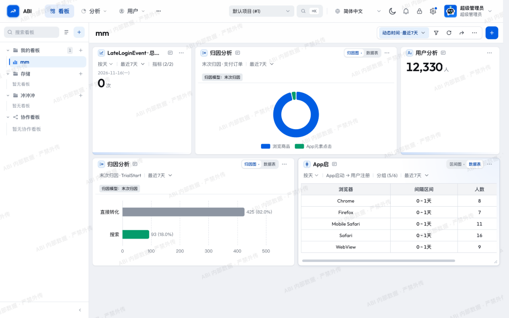
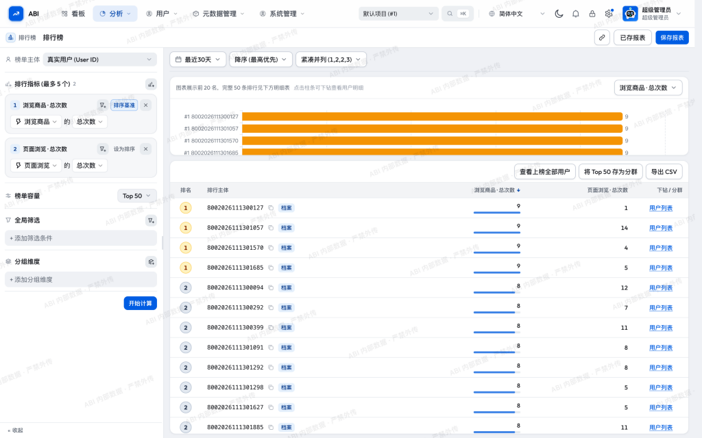
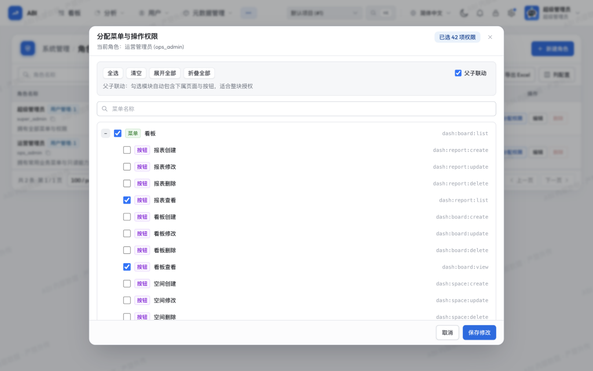
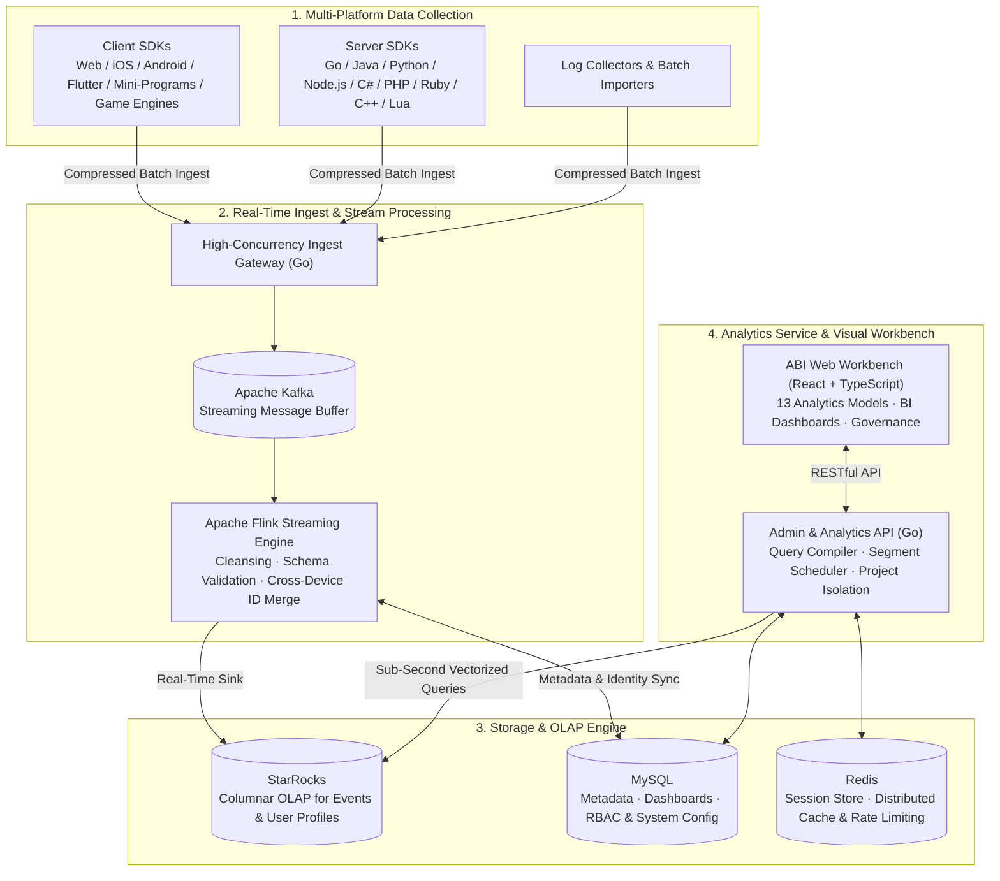

# ABI — Enterprise User Behavior Analytics (UBA) & Business Intelligence (BI) Platform

**An all-in-one, self-hosted analytics platform built for product growth, lifecycle operations, game publishing, and data teams**

Unifying **Cross-Platform Event Tracking · Real-Time Streaming ETL · High-Speed OLAP · 13 Behavioral & Growth Models · Self-Service SQL · Interactive BI Dashboards · Enterprise RBAC**

  <strong>🌐 Language / 语言 / 言語:</strong>
  <a href="README.md">简体中文</a> ·
  <a href="README.zh-TW.md">繁體中文</a> ·
  <a href="README.en.md"><b>English</b></a> ·
  <a href="README.ja.md">日本語</a> ·
  <a href="README.ko.md">한국어</a> ·
  <a href="README.es.md">Español</a> ·
  <a href="README.pt.md">Português</a> ·
  <a href="README.de.md">Deutsch</a> ·
  <a href="README.fr.md">Français</a> ·
  <a href="README.ru.md">Русский</a> ·
  <a href="README.vi.md">Tiếng Việt</a> ·
  <a href="README.th.md">ไทย</a> ·
  <a href="README.id.md">Bahasa Indonesia</a>

  
  
  
  
  
  
  

  <a href="#features">Core Features</a> •
  <a href="#models">13 Analytics Models</a> •
  <a href="#scenarios">Use Cases</a> •
  <a href="#screenshots">Screenshots</a> •
  <a href="#architecture">Architecture</a> •
  <a href="#sdks">Multi-Platform SDKs</a> •
  <a href="#contact">Licensing & Contact</a>

 

---

## ✨ Core Features

**ABI (AnyLink Behavioral Intelligence)** is an out-of-the-box, enterprise-grade **User Behavior Analytics (UBA)** and **Business Intelligence (BI)** platform. It connects the entire analytics lifecycle — from multi-platform event instrumentation and real-time stream processing to self-service exploration, SQL querying, customer segmentation, and collaborative BI dashboards — with full support for private cloud and on-premise deployment.

| Module | Capabilities |
| :--- | :--- |
| **📊 13 Self-Service Analytics Models** | Includes **Event Analysis** (multi-metric formulas, YoY/MoM, anomaly detection & quadrant views), **Funnel**, **Retention**, **User Path**, **Distribution**, **Interval**, and **User Property Analysis**, plus **Multi-Touch Attribution**, **LTV & ROI**, **User Lifecycle**, **PCU/ACU Concurrency**, **TopN Ranklist**, and **Self-Service SQL Sandbox**. |
| **🎯 Customer 360° & Segmentation** | Unifies anonymous device IDs and authenticated user accounts across platforms; provides **Customer 360° profiles & behavioral timelines**, **rule-based dynamic segments**, **offline batch imports**, **one-click segment saving from charts**, and **scheduled dynamic user tags**. |
| **🧩 All-Model Interactive BI Dashboards** | Multi-workspace folder organization, drag-and-drop grid layouts supporting **all 13 analytics models**, dashboard-wide time/filter synchronization, compact chart modes, and team sharing. |
| **🔌 Metadata & Tracking Governance** | Centralized multi-project, multi-timezone event dictionaries, property schemas, and business metrics; built-in **Live SDK Debug Playground** for payload validation, plus ingestion & error observability logs. |
| **🔐 Enterprise RBAC & Global UX** | Fine-grained user, role, and **Menu / Page / Button RBAC** permissions, strict project-level data isolation, and audit logs; native **13-language UI**, Light/Dark themes, and anti-leakage screen watermarks. |

---

## 🧠 13 Behavioral & Data Science Analytics Models

| Category | Models | Key Capabilities |
| :--- | :--- | :--- |
| **Core Behavior** | **Event / User Property Analysis** | Multi-metric formulas, period-over-period comparisons, multi-dimensional breakdowns, anomaly detection, and quadrant analysis |
| **Conversion & Retention** | **Funnel / Retention / Interval Analysis** | Multi-step conversion & drop-off diagnostics, cohort retention heatmaps & decay curves, conversion time-to-complete distributions |
| **Flow & Distribution** | **User Path / Distribution Analysis** | Forward & reverse multi-step Sankey flow diagrams, top journey rankings, and frequency/amount/duration bucket distributions |
| **Growth & Attribution** | **Attribution / TopN Ranklist Analysis** | First-touch, last-touch, linear, position-based (U-shaped), and time-decay attribution; real-time multi-metric TopN user leaderboards |
| **Monetization & Lifecycle** | **LTV & ROI / Lifecycle Analysis** | Cumulative cohort LTV growth curves, CAC payback lines & ROI milestones; New, Retained, Resurrected, and Churned user stage trends |
| **Real-Time & Ad-Hoc** | **Concurrency (PCU/ACU) / Self-Service SQL** | Peak Concurrent Users (PCU) & Average Concurrent Users (ACU) tracking; tenant-isolated read-only SQL sandbox with templates & instant charting |

---

## 🌍 Typical Use Cases

- **Web, Mobile & Mini-Program Product Growth**: Measure feature adoption, diagnose onboarding & activation funnels, and optimize retention curves and user navigation paths.
- **E-Commerce & Digital Retail Operations**: Attribute conversions across ad channels and touchpoints, track CAC payback and LTV cohorts, and target high-value VIPs or churn-risk segments.
- **Game Development & Global Publishing**: Monitor real-time PCU/ACU concurrency, top-spender leaderboards, tutorial drop-offs, and cohort monetization across game engines and server SDKs.
- **Enterprise Private Data Platform**: Containerized delivery for air-gapped or private cloud environments requiring strict data sovereignty, multi-tenant isolation, and global multi-timezone collaboration.

---

## 📸 Module Screenshots

### 1. Event Analysis Workbench & All-Model BI Dashboards

A zero-code exploration workspace for product managers, growth teams, and analysts: select metrics, filters, and dimensions on the left to render interactive charts and drill-down tables instantly, and pin any of the 13 models to live BI dashboards.

<table>
  <tr>
    <td width="50%" valign="top">
      
      
<b>BI Dashboard Workspace</b>: Multi-model drag-and-drop layout, workspace folders, and global time/filter sync

    </td>
    <td width="50%" valign="top">
      
      
<b>Funnel Analysis</b>: Configurable conversion windows to pinpoint step-by-step conversion and drop-off

    </td>
  </tr>
</table>

### 2. Cohort Retention & User Path Exploration

Dedicated visual models for tracking long-term engagement and discovering high-converting user journeys.

<table>
  <tr>
    <td width="50%" valign="top">
      
      
<b>Retention Analysis</b>: Multi-period retention decay curves and daily/weekly/monthly cohort heatmaps

    </td>
    <td width="50%" valign="top">
      
      
<b>User Path Analysis</b>: Forward and reverse Sankey flow diagrams with top-journey rankings

    </td>
  </tr>
</table>

### 3. Attribution, LTV & ROI, Lifecycle, and TopN Ranklist

Quantify channel contribution, track CAC payback timelines, monitor user lifecycle transitions, and rank top contributors.

<table>
  <tr>
    <td width="50%" valign="top">
      
      
<b>Attribution Analysis</b>: First-touch, last-touch, linear, U-shaped, and decay models for channel ROI

    </td>
    <td width="50%" valign="top">
      
      
<b>LTV & ROI Analysis</b>: Cumulative cohort LTV curves, CAC breakeven line, and milestone tables

    </td>
  </tr>
  <tr>
    <td width="50%" valign="top">
      
      
<b>Lifecycle Analysis</b>: Track New, Retained, Resurrected, and Churned user stage trends

    </td>
    <td width="50%" valign="top">
      
      
<b>TopN Ranklist Analysis</b>: Real-time multi-metric rankings with direct user profile drill-down

    </td>
  </tr>
</table>

### 4. Real-Time Concurrency (PCU/ACU) & Self-Service SQL Sandbox

Built for both live-ops concurrency monitoring and flexible ad-hoc SQL exploration inside a tenant-isolated sandbox.

<table>
  <tr>
    <td width="50%" valign="top">
      
      
<b>Concurrency Analysis (PCU/ACU)</b>: Track Peak and Average Concurrent Users with peak-to-average ratios

    </td>
    <td width="50%" valign="top">
      
      
<b>Self-Service SQL</b>: Tenant-isolated read-only SQL sandbox, preset templates, and instant charting

    </td>
  </tr>
</table>

### 5. Customer 360° Profiles & Audience Segmentation

Drill down seamlessly from aggregate metrics to individual user timelines, and build reusable audience segments for cross-model comparison.

<table>
  <tr>
    <td width="50%" valign="top">
      
      
<b>Customer 360° & Timeline</b>: Unified identity graph, user properties, and chronological event stream

    </td>
    <td width="50%" valign="top">
      
      
<b>Audience Segments</b>: Rule-based user cohorts with real-time size preview and scheduled refresh

    </td>
  </tr>
</table>

### 6. Metadata Governance, Live SDK Playground & RBAC Permissions

Maintain clean event schemas, validate tracking payloads in real time, and govern team access with granular RBAC controls.

<table>
  <tr>
    <td width="50%" valign="top">
      
      
<b>Metadata Governance</b>: Manage display names, active status, and associated property schemas

    </td>
    <td width="50%" valign="top">
      
      
<b>Live SDK Playground</b>: Interactive payload inspection and test-event validation

    </td>
  </tr>
</table>

<b>🔍 Click to expand: Enterprise RBAC Role & Menu/Button Permission Tree</b>

 

<b>RBAC Permission Management</b>: Visual tree-based authorization across modules, pages, and action buttons

---

## 🏗️ Technical Architecture

ABI adopts a decoupled four-tier architecture — **High-Concurrency Ingest Gateway + Real-Time Stream Processing + Vectorized Columnar OLAP + Modern Decoupled Web Workbench** — delivering both high-throughput event ingestion and sub-second interactive queries.

### 1. Architecture Overview

### 2. Layer Responsibilities

- **Data Collection Layer**: Cross-platform SDKs for web, mobile, game engines, and backend servers, plus log watchers and batch importers with local buffering and compressed batching.
- **Ingest & Stream Processing Layer**: A dedicated Go ingest gateway handles authentication and traffic spikes, buffered by Kafka; Apache Flink performs real-time data cleansing, dynamic schema validation, GeoIP enrichment, and cross-device identity resolution.
- **Storage & OLAP Layer**: StarRocks columnar vectorized storage powers sub-second event, funnel, retention, attribution, LTV, and cohort queries; MySQL stores metadata, dashboard layouts, and RBAC rules; Redis handles caching and rate limiting.
- **Analytics & Presentation Layer**: The Go backend compiles visual query builders and read-only SQL sandboxes into tenant-isolated OLAP queries, while the React + TypeScript + ECharts frontend provides an intuitive workbench and drag-and-drop BI experience.

### 3. Tech Stack Summary

| Layer | Technologies | Responsibilities |
| :--- | :--- | :--- |
| **Frontend Workbench** | React · TypeScript · Vite · Tailwind CSS · ECharts | 13 self-service analytics models, visualizations, drag-and-drop dashboards, 13-language UI |
| **Backend Services** | Go · Gin · GORM | Admin API, multi-model SQL query compiler, segment scheduling, high-throughput ingest gateway |
| **Stream Processing** | Java · Apache Flink · Apache Kafka | Real-time ETL, dynamic metadata sync, identity resolution, raw event archival |
| **Storage & OLAP** | StarRocks · MySQL · Redis | Real-time columnar OLAP analytics, relational metadata/config store, distributed cache |
| **Deployment** | Docker · Docker Compose · Nginx | Single-node containerized quickstart and horizontally scalable private-cloud clusters |

---

## 📦 Multi-Platform Data Collection Ecosystem

Comprehensive cross-platform SDKs with documentation in 13 languages and interactive examples — see **[SDK Documentation & Source Directory](abi.sdk/README.en.md)**:

- **Web & Cross-Platform**: JavaScript / TypeScript Web SDK, App H5 WebView Bridge, WeChat Mini-Program, React Native
- **Native Mobile**: iOS (Swift), Android (Kotlin), Flutter (Dart)
- **Game Engines**: Unity (C#), Unreal Engine / Cocos2d-x (C/C++), Cocos Creator / Egret / LayaAir, Cocos2d-Lua
- **Backend Languages**: Go, Java, Python, Node.js, C# (.NET), PHP, Ruby, Lua
- **Universal API & Import Tools**: Standard HTTP RESTful batch ingestion API, real-time log file tailer, and log collector templates

---

## 📬 Commercial Licensing & Inquiries

ABI is available for **enterprise commercial licensing, full source-code delivery, private deployment, and custom development**.  
To request a live demo, pricing details, or commercial licensing, please contact us via email:

- **Sales & Licensing Email**: **[baidushanxivip@gmail.com](mailto:baidushanxivip@gmail.com)**

---

**[简体中文](README.md)** · **[繁體中文](README.zh-TW.md)** · **[English](README.en.md)** · **[日本語](README.ja.md)** · **[한국어](README.ko.md)** · **[Español](README.es.md)** · **[Português](README.pt.md)** · **[Deutsch](README.de.md)** · **[Français](README.fr.md)** · **[Русский](README.ru.md)** · **[Tiếng Việt](README.vi.md)** · **[ไทย](README.th.md)** · **[Bahasa Indonesia](README.id.md)**

Keywords: User Behavior Analytics (UBA), Product Analytics, Business Intelligence (BI), Event Tracking, Funnel Analysis, Cohort Retention, Multi-Touch Attribution, LTV & ROI, Lifecycle Analysis, PCU/ACU Concurrency, Self-Service SQL, User Path Sankey, Customer 360, Audience Segmentation, StarRocks OLAP, Apache Flink, Self-Hosted Analytics Platform

