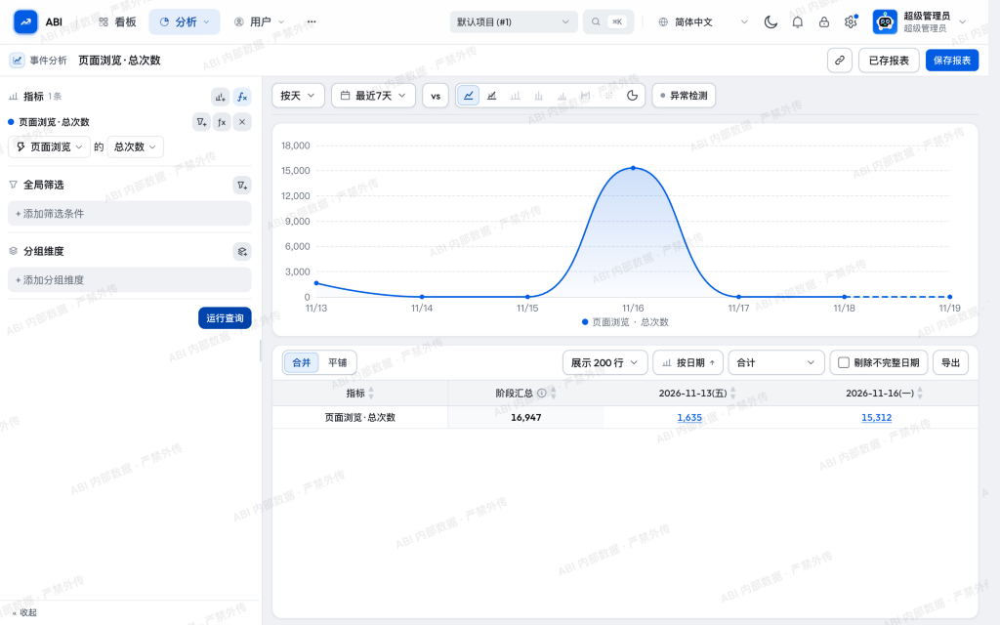
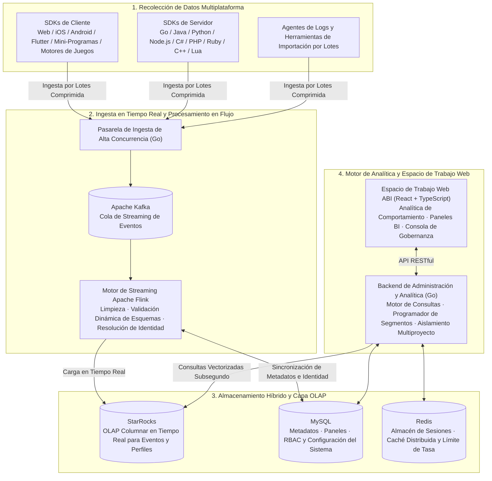

# ABI — Plataforma Empresarial de Análisis de Comportamiento de Usuarios (UBA) y Business Intelligence (BI)

**Plataforma todo en uno autohospedada para analítica de producto, Customer 360 y Business Intelligence**

Unificando **Captura de eventos multiplataforma · Procesamiento en flujo en tiempo real · OLAP subsegundo · 13 Modelos de Análisis · SQL Autoservicio · Paneles BI interactivos · RBAC empresarial**

  <strong>🌐 Idioma / Language:</strong>
  <a href="README.md">简体中文</a> ·
  <a href="README.zh-TW.md">繁體中文</a> ·
  <a href="README.en.md">English</a> ·
  <a href="README.ja.md">日本語</a> ·
  <a href="README.ko.md">한국어</a> ·
  <a href="README.es.md"><b>Español</b></a> ·
  <a href="README.pt.md">Português</a> ·
  <a href="README.de.md">Deutsch</a> ·
  <a href="README.fr.md">Français</a> ·
  <a href="README.ru.md">Русский</a> ·
  <a href="README.vi.md">Tiếng Việt</a> ·
  <a href="README.th.md">ไทย</a> ·
  <a href="README.id.md">Bahasa Indonesia</a>

  
  
  
  
  
  

  <a href="#features">Funcionalidades Principales</a> •
  <a href="#scenarios">Casos de Uso</a> •
  <a href="#screenshots">Capturas de Pantalla</a> •
  <a href="#architecture">Arquitectura</a> •
  <a href="#sdks">Ecosistema de SDKs</a> •
  <a href="#contact">Compra y Contacto</a>

 

---

## ✨ Funcionalidades Principales

**ABI (AnyLink Behavioral Intelligence)** es una plataforma empresarial lista para producción de **Análisis de Comportamiento de Usuarios (User Behavior Analytics, UBA) y Business Intelligence (BI)** diseñada para equipos de crecimiento de producto, operaciones e ingeniería de datos. Proporciona un flujo de trabajo de ciclo cerrado integral: desde la recolección de eventos multiplataforma y la ingesta en streaming en tiempo real hasta la exploración de comportamiento en autoservicio, la segmentación de audiencias y paneles ejecutivos, con soporte completo para despliegue privado/on-premise y soberanía total sobre los datos.

| Área de Capacidad | Aspectos Destacados |
| :--- | :--- |
| **📊 7 Modelos de Análisis en Autoservicio** | Incluye **Análisis de Eventos** (agregación multimétrica, fórmulas personalizadas, comparación interperíodo, desgloses multidimensionales), **Análisis de Embudo** (diagnóstico de conversión y abandono), **Análisis de Retención** (matrices de cohortes diarias/semanales/mensuales), **Análisis de Rutas** (diagramas de Sankey para recorridos de usuarios directos e inversos), **Análisis de Distribución**, **Análisis de Intervalos** (gráficos de caja para tiempo de conversión) y **Análisis de Atributos de Usuario**. |
| **🎯 Customer 360 y Motor de Audiencias** | Resolución de identidad multidispositivo en tiempo real que vincula visitantes anónimos y cuentas autenticadas en un perfil unificado; incluye **Líneas de Tiempo de Usuario Único 360**, **Segmentos Visuales Basados en Reglas**, **Importación de Listas CSV**, **Guardado de Segmentos con un Clic desde Gráficos** y **Etiquetas de Usuario Programadas**. |
| **🧩 Paneles BI Interactivos** | Organización de espacios de trabajo con carpetas multiespacio, cuadrículas adaptables de arrastrar y soltar, widgets de visualización multimodelo, sustitución dinámica global de fechas y filtros para todo el panel, y colaboración granular en equipo. |
| **🔌 Gobernanza de Metadatos y Rastreo** | Gestión centralizada de proyectos, zonas horarias, esquemas de eventos, diccionarios de propiedades y métricas de negocio; incluye un **Área de Pruebas Interactiva de Integración de SDK** (validación de carga útil en tiempo real sin contaminar datos de producción) y registros de ingesta y errores en vivo. |
| **🔐 Seguridad Empresarial e i18n Global** | Control de acceso basado en roles (RBAC) de grano fino en menús, rutas y botones de acción con aislamiento estricto de datos por proyecto y registro de auditoría; soporte nativo para **13 idiomas globales** (incluidos español, inglés, portugués, chino simplificado/tradicional, japonés, coreano, alemán, francés, ruso, vietnamita, tailandés e indonesio), temas claro/oscuro y marcas de agua antitemas en pantalla. |

---

## 🌍 Casos de Uso Clave

- **Crecimiento de Producto y Aplicaciones Móviles (Web / iOS / Android / Mini-Programas)**: Medir la adopción de funcionalidades, localizar puntos de abandono en embudos de onboarding, rastrear curvas de retención por cohorte y explorar flujos reales de navegación de usuarios.
- **Comercio Electrónico y Retail Digital**: Conectar la atribución de extremo a extremo desde impresiones de productos y adiciones al carrito hasta el checkout y pago, segmentando clientes VIP de alto LTV y usuarios con riesgo de churn.
- **Estudios de Videojuegos y Publishers Globales**: Recopilar telemetría de alto volumen en Unity, Unreal, Cocos y servidores de juego para analizar la finalización de tutoriales, intervalos de niveles, retención diaria y niveles de monetización.
- **Infraestructura de Datos Empresarial Autohospedada**: Desplegar dentro de su propia nube privada o entorno on-premise para el cumplimiento de privacidad de datos, aislamiento multiunidad de negocio y colaboración global en múltiples zonas horarias.

---

## 📸 Capturas de Pantalla de Módulos del Producto

### 1. Espacio de Trabajo de Análisis de Eventos y Paneles BI Ejecutivos

Un entorno de exploración intuitivo y sin código diseñado para gestores de producto y analistas: configure métricas, filtros y desgloses a la izquierda, inspeccione gráficos interactivos y tablas de profundización a la derecha, y fije hallazgos directamente en paneles compartidos.

<table>
  <tr>
    <td width="50%" valign="top">
      
      
<b>Espacio de Trabajo de Paneles BI</b>: Diseño en cuadrícula de arrastrar y soltar, carpetas de espacio de trabajo y filtrado global de fechas

    </td>
    <td width="50%" valign="top">
      
      
<b>Análisis de Embudo</b>: Ventanas de conversión configurables con detalles paso a paso de conversión y abandono

    </td>
  </tr>
</table>

### 2. Retención de Cohortes y Análisis de Rutas de Recorrido de Usuario

Visualizaciones creadas específicamente para el seguimiento de la retención y el descubrimiento de flujos de usuarios, impulsadas por un motor OLAP vectorizado de alta velocidad.

<table>
  <tr>
    <td width="50%" valign="top">
      
      
<b>Análisis de Retención</b>: Curvas de decaimiento de retención multicoorte combinadas con una matriz de mapa de calor de cohortes diarias

    </td>
    <td width="50%" valign="top">
      
      
<b>Análisis de Rutas</b>: Diagramas de Sankey multipaso directos e inversos con clasificación de transiciones más frecuentes

    </td>
  </tr>
</table>

### 3. Atribución, LTV & ROI, Ciclo de Vida y Ranking TopN

<table>
  <tr>
    <td width="50%" valign="top">
      
      
<b>Attribution</b>: First-touch, last-touch, linear, U-shaped & decay models

    </td>
    <td width="50%" valign="top">
      
      
<b>LTV & ROI</b>: Cumulative LTV growth curves, CAC payback line & milestone matrix

    </td>
  </tr>
  <tr>
    <td width="50%" valign="top">
      
      
<b>Lifecycle</b>: New, Retained, Resurrected & Churned user stage trends

    </td>
    <td width="50%" valign="top">
      
      
<b>TopN Ranklist</b>: Real-time multi-metric user leaderboard with profile drill-down

    </td>
  </tr>
</table>

### 4. Concurrencia (PCU/ACU) y SQL Autoservicio

<table>
  <tr>
    <td width="50%" valign="top">
      
      
<b>Concurrency (PCU/ACU)</b>: Peak & Average Concurrent Users with peak-to-average ratios

    </td>
    <td width="50%" valign="top">
      
      
<b>Self-Service SQL</b>: Tenant-isolated read-only SQL sandbox, templates & instant charts

    </td>
  </tr>
</table>

### 5. Línea de Tiempo Customer 360 y Segmentación Visual de Audiencias

Profundice sin problemas desde los KPIs agregados hasta los flujos de eventos de usuarios individuales, o cree segmentos dinámicos y etiquetas de usuario para análisis cruzados específicos.

<table>
  <tr>
    <td width="50%" valign="top">
      
      
<b>Usuario 360 y Línea de Tiempo de Eventos</b>: Identidades vinculadas, atributos de perfil y flujo de comportamiento cronológico

    </td>
    <td width="50%" valign="top">
      
      
<b>Segmentación de Audiencias</b>: Combinación de rasgos de perfil y reglas de comportamiento con vista previa instantánea del tamaño y actualización programada

    </td>
  </tr>
</table>

### 6. Gobernanza de Metadatos, Integración Interactiva de SDK y RBAC Granular

Mantenga diccionarios de datos limpios, valide cargas útiles de rastreo de eventos de forma interactiva y gobierne el acceso del equipo con permisos de nivel empresarial.

<table>
  <tr>
    <td width="50%" valign="top">
      
      
<b>Gobernanza de Eventos y Esquemas</b>: Gestión de nombres para mostrar, alternancia de estado activo y diccionarios de propiedades

    </td>
    <td width="50%" valign="top">
      
      
<b>Guía Interactiva de Integración</b>: Vista previa de cargas útiles JSON y comprobaciones de validación en vivo en segundos

    </td>
  </tr>
</table>

<b>🔍 Haga clic para expandir: Árbol de Permisos RBAC Empresarial para Roles, Menús y Botones Granulares</b>

 

<b>Autorización RBAC Granular</b>: Árbol visual de permisos en módulos, páginas y botones de acción en página

---

## 🏗️ Arquitectura Técnica

ABI adopta una **arquitectura moderna y nativa de la nube en 4 capas para plataformas de datos**, combinando una pasarela de ingesta de alta concurrencia, procesamiento en flujo en tiempo real, un motor OLAP columnar vectorizado y un espacio de trabajo web desacoplado.

### 1. Diagrama de Arquitectura de Alto Nivel

### 2. Resumen de las Capas de Arquitectura

- **Capa de Recolección de Datos**: SDKs listos para producción para entornos web, móviles, motores de juegos y lenguajes de backend con almacenamiento en búfer local, compresión por lotes y herramientas de validación en vivo.
- **Capa de Ingesta y Streaming en Tiempo Real**: Una pasarela de ingesta dedicada en Go gestiona la autenticación y el almacenamiento en búfer del tráfico hacia Kafka, mientras Apache Flink limpia eventos continuamente, aplica esquemas dinámicos, enriquece datos de geolocalización GeoIP y resuelve identidades de usuario multidispositivo.
- **Capa de Almacenamiento y OLAP**: StarRocks impulsa consultas analíticas subsegundo sobre tablas masivas de eventos, perfiles de usuario y segmentos de audiencia; MySQL almacena metadatos, diseños de paneles y configuraciones de RBAC; Redis gestiona sesiones activas y límites de tasa.
- **Capa de Servicios y Aplicación**: El backend en Go compila condiciones de consulta visual en SQL analítico seguro y parametrizado con un estricto aislamiento de proyectos, sirviendo a un frontend ágil de analítica y paneles en React + TypeScript + ECharts.

### 5. Resumen del Stack Tecnológico

| Capa | Tecnologías Principales | Rol |
| :--- | :--- | :--- |
| **Espacio de Trabajo Frontend** | React · TypeScript · Vite · Tailwind CSS · ECharts | Constructor de consultas de comportamiento, gráficos interactivos, paneles de arrastrar y soltar y consola de administración |
| **Servicios Backend** | Go · Gin · GORM | API de administración, compilador de SQL analítico, programador de audiencias y pasarela de ingesta de alto rendimiento |
| **Procesamiento en Flujo** | Java · Apache Flink · Apache Kafka | ETL de eventos en tiempo real, sincronización de metadatos en vivo, resolución de identidades y archivado de eventos sin procesar |
| **Almacenamiento y OLAP** | StarRocks · MySQL · Redis | Base de datos OLAP columnar vectorizada, almacén relacional de metadatos y caché distribuida |
| **Despliegue** | Docker · Docker Compose · Nginx | Despliegue en contenedores con un solo comando o implementación escalable en clúster de nube privada |

---

## 📦 Ecosistema de SDKs Multiplataforma

SDKs completos de recolección de datos con documentación multilingüe y ejemplos interactivos — consulte la **[Suite Completa de SDKs y Documentación de Integración](abi.sdk/README.es.md)**:

- **Web y Multiplataforma**: SDK Web para JavaScript / TypeScript, puente H5 App-to-WebView, Mini-Programas de WeChat, React Native
- **Móvil Nativo**: iOS (`Swift`), Android (`Kotlin`), Flutter (`Dart`)
- **Motores de Juegos**: Unity (`C#`), Unreal Engine / Cocos2d-x (`C/C++`), Cocos Creator / Egret / LayaAir, Cocos2d-Lua
- **Lenguajes del Lado del Servidor**: Go, Java, Python, Node.js, C# (`.NET`), PHP, Ruby, Lua
- **Ingesta HTTP y de Logs**: API RESTful HTTP estándar de ingesta por lotes, agente de envío de archivos de log en tiempo real y plantillas de recolectores de logs listas para usar

---

## 📬 Licencias Comerciales y Consultas de Compra

ABI está disponible para **licencias comerciales, entrega de código fuente completo, asistencia para despliegue privado / on-premise y desarrollo empresarial personalizado**.  
Si está interesado en adquirir ABI, solicitar una demostración en vivo o consultar opciones de licenciamiento empresarial, comuníquese por correo electrónico:

- **Contacto Comercial y de Compras**: **[baidushanxivip@gmail.com](mailto:baidushanxivip@gmail.com)**

---

**[简体中文](README.md)** · **[繁體中文](README.zh-TW.md)** · **[English](README.en.md)** · **[日本語](README.ja.md)** · **[한국어](README.ko.md)** · **[Español](README.es.md)** · **[Português](README.pt.md)** · **[Deutsch](README.de.md)** · **[Français](README.fr.md)** · **[Русский](README.ru.md)** · **[Tiếng Việt](README.vi.md)** · **[ไทย](README.th.md)** · **[Bahasa Indonesia](README.id.md)**

Palabras clave: Análisis de Comportamiento de Usuarios, UBA, Analítica de Producto, Business Intelligence, Paneles BI, Analítica Autohospedada, SDK de Rastreo de Eventos, Análisis de Embudo, Retención de Cohortes, Rutas de Usuario Sankey, Customer 360, Segmentación de Audiencias, CDP, StarRocks OLAP, Apache Flink, RBAC Empresarial

