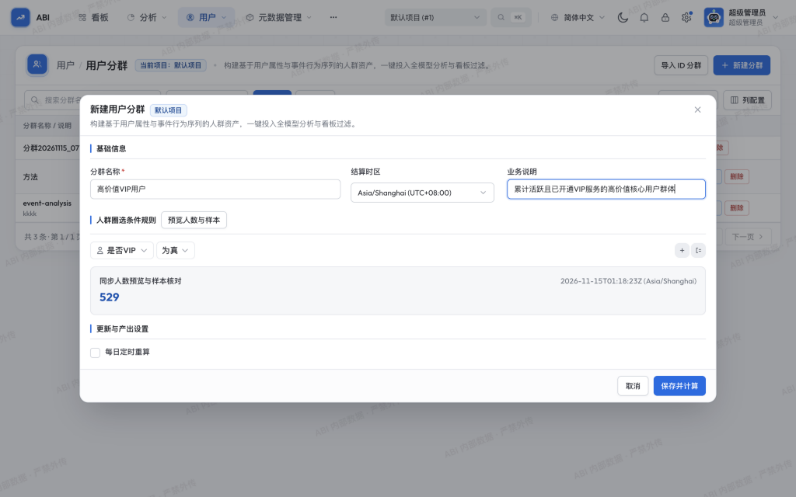
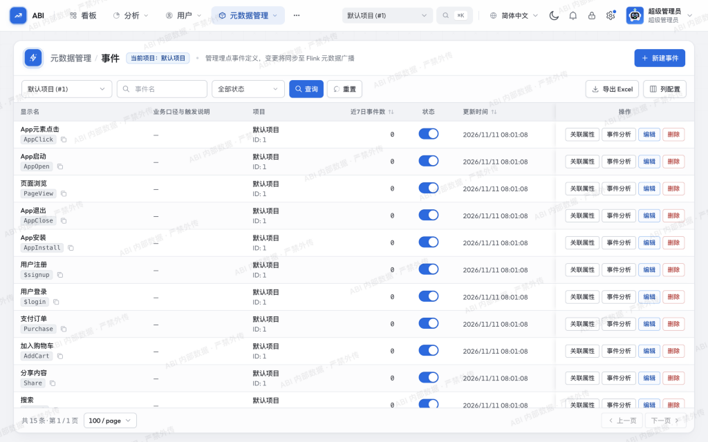
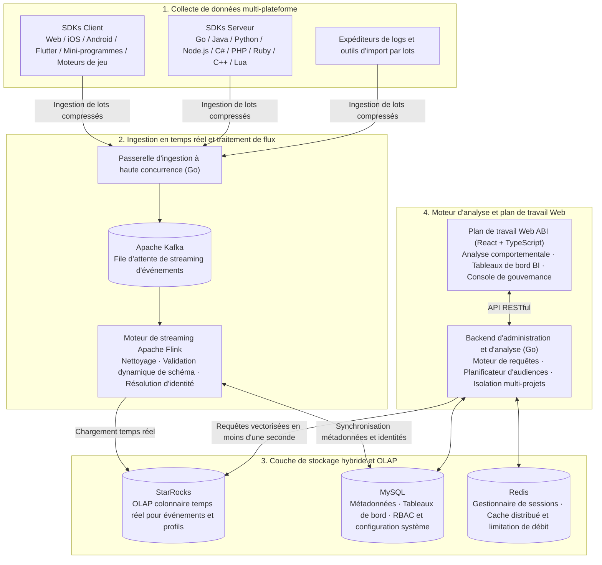

# ABI — Plateforme d'analyse du comportement utilisateur (UBA) et de BI d'entreprise

**Plateforme tout-en-un auto-hébergée d'analyse produit, Customer 360 et Business Intelligence**

Unifie **Collecte multi-plateforme · Traitement de flux temps réel · Moteur OLAP en moins d'une seconde · 13 Modèles d'Analyse · SQL Libre-Service · Tableaux de bord BI interactifs · RBAC d'entreprise**

  <strong>🌐 Sprache / Langue / Language:</strong>
  <a href="README.md">简体中文</a> ·
  <a href="README.zh-TW.md">繁體中文</a> ·
  <a href="README.en.md">English</a> ·
  <a href="README.ja.md">日本語</a> ·
  <a href="README.ko.md">한국어</a> ·
  <a href="README.es.md">Español</a> ·
  <a href="README.pt.md">Português</a> ·
  <a href="README.de.md">Deutsch</a> ·
  <a href="README.fr.md"><b>Français</b></a> ·
  <a href="README.ru.md">Русский</a> ·
  <a href="README.vi.md">Tiếng Việt</a> ·
  <a href="README.th.md">ไทย</a> ·
  <a href="README.id.md">Bahasa Indonesia</a>

  
  
  
  
  
  

  <a href="#features">Fonctionnalités clés</a> •
  <a href="#scenarios">Cas d'usage</a> •
  <a href="#screenshots">Captures d'écran</a> •
  <a href="#architecture">Architecture</a> •
  <a href="#sdks">Écosystème SDK</a> •
  <a href="#contact">Licence et Contact</a>

 

---

## ✨ Fonctionnalités clés

**ABI (AnyLink Behavioral Intelligence)** est une plateforme prête pour l'entreprise d'**Analyse du Comportement Utilisateur (UBA) et de Business Intelligence (BI)**, conçue pour les équipes de croissance produit, d'opérations et d'ingénierie des données. Elle fournit un flux de travail complet en boucle fermée — de la collecte d'événements multi-plateforme et de l'ingestion de flux en temps réel à l'exploration comportementale en libre-service, la segmentation d'audiences et les tableaux de bord de direction — avec une prise en charge totale du déploiement privé / sur site (on-premise) et de la souveraineté des données.

| Domaine fonctionnel | Points forts |
| :--- | :--- |
| **📊 7 Modèles d'analyse en libre-service** | **Analyse d'événements** intégrée (agrégation multi-métriques, formules personnalisées, comparaison période à période, ventilations multidimensionnelles), **Analyse en entonnoir** (diagnostic de conversion et d'abandon), **Analyse de rétention** (matrices de cohortes quotidiennes/hebdomadaires/mensuelles), **Analyse de parcours** (diagrammes de Sankey amont et aval du parcours utilisateur), **Analyse de distribution**, **Analyse d'intervalles** (boîtes à moustaches du temps de conversion) et **Analyse des attributs utilisateurs**. |
| **🎯 Moteur Customer 360 et Audiences** | Résolution d'identité multi-appareils en temps réel reliant les visiteurs anonymes et les comptes authentifiés en un profil utilisateur unifié ; comprend des **Chronologies 360 utilisateur unique**, des **Segments d'utilisateurs visuels basés sur des règles**, des **Imports de listes CSV**, l'**Enregistrement de segments en un clic depuis les graphiques** et des **Tags utilisateurs planifiés**. |
| **🧩 Tableaux de bord BI interactifs** | Organisation des espaces de travail avec dossiers multi-espaces, mises en page réactives en grille par glisser-déposer, widgets de visualisation multi-modèles, filtres et plages de dates dynamiques à l'échelle du tableau de bord et partage granulaire en équipe. |
| **🔌 Gouvernance des métadonnées et du tracking** | Gestion centralisée des projets, fuseaux horaires, schémas d'événements, dictionnaires de propriétés et métriques métiers ; intègre un **Playground interactif d'intégration SDK** (validation de charge utile en direct sans polluer les données de production) ainsi que des journaux d'ingestion et d'erreurs en temps réel. |
| **🔐 Sécurité d'entreprise et i18n globale** | Contrôle d'accès RBAC granulaire pour les menus, routes et boutons d'action avec isolation stricte des données par projet et journaux d'audit ; prise en charge native de **13 langues mondiales** (dont le français, l'anglais, le chinois simplifié/traditionnel, le japonais, l'allemand, l'espagnol, le portugais, le coréen, le russe, le vietnamien, le thaï et le bahasa indonesia), thèmes Clair/Sombre et filigranes d'écran anti-fuite. |

---

## 🌍 Cas d'usage principaux

- **Croissance produit et applications mobiles (Web / iOS / Android / Mini-programmes)** : Mesurer avec précision l'adoption des fonctionnalités, localiser les abandons dans les entonnoirs d'intégration, suivre les courbes de rétention de cohortes et explorer les flux de navigation réels des utilisateurs.
- **E-Commerce et distribution numérique** : Connecter l'attribution de bout en bout, des impressions de produits et ajouts au panier jusqu'au paiement final, tout en segmentant les acheteurs VIP à forte valeur vie (LTV) et les utilisateurs à risque d'attrition.
- **Studios de jeux vidéo et éditeurs internationaux** : Collecter des volumes massifs de télémétrie sur Unity, Unreal, Cocos et serveurs de jeu pour analyser la complétion des tutoriels, les intervalles entre niveaux, la rétention quotidienne et les paliers de monétisation.
- **Infrastructure de données d'entreprise auto-hébergée** : Déploiement dans votre propre cloud ou environnement sur site (on-premise) pour une conformité totale à la confidentialité et à la souveraineté des données, une isolation multi-entités et une collaboration internationale multi-fuseaux horaires.

---

## 📸 Captures d'écran des modules produit

### 1. Espace d'analyse d'événements et Tableaux de bord BI de direction

Un espace d'exploration intuitif sans code conçu pour les chefs de produit et les analystes : configurez les métriques, filtres et ventilations à gauche, examinez les graphiques interactifs et les tableaux détaillés à droite, et épinglez directement vos analyses sur des tableaux de bord partagés.

<table>
  <tr>
    <td width="50%" valign="top">
      
      
<b>Espace de tableau de bord BI</b> : Mise en page en grille par glisser-déposer, dossiers d'espaces de travail et filtrage global par date

    </td>
    <td width="50%" valign="top">
      
      
<b>Analyse d'entonnoir</b> : Fenêtres de conversion configurables avec diagnostic étape par étape des conversions et des abandons

    </td>
  </tr>
</table>

### 2. Rétention de cohortes et Analyse de parcours utilisateur

Visualisations dédiées au suivi de la rétention et à la découverte des parcours utilisateurs, propulsées par un moteur OLAP vectorisé haute vitesse.

<table>
  <tr>
    <td width="50%" valign="top">
      
      
<b>Analyse de rétention</b> : Courbes d'attrition multi-cohortes associées à une matrice thermique quotidienne de rétention

    </td>
    <td width="50%" valign="top">
      
      
<b>Analyse de parcours</b> : Diagrammes de Sankey multi-étapes amont et aval avec classement des transitions principales

    </td>
  </tr>
</table>

### 3. Attribution, LTV & ROI, Cycle de Vie et Classement TopN

<table>
  <tr>
    <td width="50%" valign="top">
      
      
<b>Attribution</b>: First-touch, last-touch, linear, U-shaped & decay models

    </td>
    <td width="50%" valign="top">
      
      
<b>LTV & ROI</b>: Cumulative LTV growth curves, CAC payback line & milestone matrix

    </td>
  </tr>
  <tr>
    <td width="50%" valign="top">
      
      
<b>Lifecycle</b>: New, Retained, Resurrected & Churned user stage trends

    </td>
    <td width="50%" valign="top">
      
      
<b>TopN Ranklist</b>: Real-time multi-metric user leaderboard with profile drill-down

    </td>
  </tr>
</table>

### 4. Concurrence (PCU/ACU) et SQL Libre-Service

<table>
  <tr>
    <td width="50%" valign="top">
      
      
<b>Concurrency (PCU/ACU)</b>: Peak & Average Concurrent Users with peak-to-average ratios

    </td>
    <td width="50%" valign="top">
      
      
<b>Self-Service SQL</b>: Tenant-isolated read-only SQL sandbox, templates & instant charts

    </td>
  </tr>
</table>

### 5. Chronologie Customer 360 et Segmentation visuelle des audiences

Passez en toute fluidité des indicateurs clés agrégés aux flux d'événements individuels, ou créez des segments et tags dynamiques pour des analyses ciblées entre modèles.

<table>
  <tr>
    <td width="50%" valign="top">
      
      
<b>Vue 360 utilisateur et Flux d'événements</b> : Identités liées, attributs de profil et flux chronologique des comportements

    </td>
    <td width="50%" valign="top">
      
      
<b>Segmentation d'audience</b> : Combinaison de traits de profil et de règles comportementales avec aperçu immédiat du volume et actualisation programmée

    </td>
  </tr>
</table>

### 6. Gouvernance des métadonnées, Intégration SDK en direct et RBAC granulaire

Maintenez des dictionnaires de données fiables, validez les données de tracking de manière interactive et contrôlez les accès d'équipe avec des permissions de niveau entreprise.

<table>
  <tr>
    <td width="50%" valign="top">
      
      
<b>Gouvernance des événements et schémas</b> : Gestion des noms d'affichage, activation des statuts et dictionnaires de propriétés

    </td>
    <td width="50%" valign="top">
      
      
<b>Guide d'intégration interactif</b> : Prévisualisez les charges utiles JSON et lancez des validations en direct en quelques secondes

    </td>
  </tr>
</table>

<b>🔍 Cliquez pour agrandir : Rôles d'entreprise et arbre des permissions RBAC granulaires pour menus et boutons</b>

 

<b>Autorisation RBAC granulaire</b> : Arbre visuel des permissions à travers les modules, pages et boutons d'action au sein des écrans

---

## 🏗️ Architecture Technique

ABI adopte une **architecture de plateforme de données en 4 couches** moderne et native du cloud, associant une passerelle d'ingestion à haute concurrence, un traitement de flux en temps réel, un moteur OLAP colonnaire vectorisé et un plan de travail web découplé.

### 1. Diagramme d'architecture globale

### 2. Vue d'ensemble des couches d'architecture

- **Couche de collecte de données** : SDKs de niveau production pour le Web, le mobile, les moteurs de jeu et les langages backend avec mise en mémoire tampon locale, compression par lots et outils de validation en direct.
- **Couche d'ingestion et de streaming en temps réel** : Une passerelle d'ingestion dédiée en Go assure l'authentification et la mise en file d'attente du trafic dans Kafka, tandis qu'Apache Flink nettoie les événements en continu, applique les schémas dynamiques, enrichit les données de localisation GeoIP et résout les identités utilisateurs multi-appareils.
- **Couche de stockage et OLAP** : StarRocks propulse les requêtes analytiques en moins d'une seconde sur d'immenses tables d'événements, profils utilisateurs et cohortes d'audiences ; MySQL stocke les métadonnées, les dispositions de tableaux de bord et les configurations RBAC ; Redis gère les sessions actives et la limitation de débit.
- **Couche de service et d'application** : Le backend Go compile les conditions de requêtes visuelles en SQL analytique sécurisé et paramétré avec une stricte isolation par projet, alimentant un frontend réactif d'analyse et de tableaux de bord en React + TypeScript + ECharts.

### 5. Récapitulatif de la pile technologique

| Couche | Technologies clés | Rôle |
| :--- | :--- | :--- |
| **Plan de travail Frontend** | React · TypeScript · Vite · Tailwind CSS · ECharts | Générateur de requêtes visuelles, graphiques interactifs, tableaux de bord par glisser-déposer et console d'administration |
| **Services Backend** | Go · Gin · GORM | API d'administration, compilateur SQL analytique, planificateur d'audiences et passerelle d'ingestion à haut débit |
| **Traitement de flux** | Java · Apache Flink · Apache Kafka | ETL d'événements en temps réel, synchronisation en direct des métadonnées, résolution d'identité et archivage brut |
| **Stockage et OLAP** | StarRocks · MySQL · Redis | Base de données OLAP colonnaire vectorisée, stockage relationnel des métadonnées et cache distribué |
| **Déploiement** | Docker · Docker Compose · Nginx | Déploiement conteneurisé en une commande ou déploiement sur cluster cloud privé évolutif |

---

## 📦 Écosystème SDK Multi-Plateforme

Des SDKs de collecte de données complets avec une documentation intégrale et des exemples interactifs — consultez la **[Suite complète des SDKs et la documentation d'intégration](abi.sdk/README.fr.md)** :

- **Web et multi-plateforme** : SDK Web JavaScript / TypeScript, Passerelle H5 App-to-WebView, Mini-programme WeChat, React Native
- **Mobile natif** : iOS (`Swift`), Android (`Kotlin`), Flutter (`Dart`)
- **Moteurs de jeu** : Unity (`C#`), Unreal Engine / Cocos2d-x (`C/C++`), Cocos Creator / Egret / LayaAir, Cocos2d-Lua
- **Langages côté serveur** : Go, Java, Python, Node.js, C# (`.NET`), PHP, Ruby, Lua
- **Ingestion HTTP et journaux** : API RESTful standard d'ingestion par lots en HTTP, expéditeur de fichiers journaux en temps réel et modèles prêts à l'emploi de collecteurs de logs

---

## 📬 Licences commerciales et Demandes d'achat

ABI est disponible pour **l'octroi de licences commerciales, la livraison intégrale du code source, l'assistance au déploiement privé / sur site (on-premise) et le développement sur mesure pour les entreprises**.  
Si vous souhaitez acquérir ABI, demander une démonstration en direct ou discuter des options de licences d'entreprise, veuillez nous contacter par e-mail :

- **Contact commercial et achats** : **[baidushanxivip@gmail.com](mailto:baidushanxivip@gmail.com)**

---

**[简体中文](README.md)** · **[繁體中文](README.zh-TW.md)** · **[English](README.en.md)** · **[日本語](README.ja.md)** · **[한국어](README.ko.md)** · **[Español](README.es.md)** · **[Português](README.pt.md)** · **[Deutsch](README.de.md)** · **[Français](README.fr.md)** · **[Русский](README.ru.md)** · **[Tiếng Việt](README.vi.md)** · **[ไทย](README.th.md)** · **[Bahasa Indonesia](README.id.md)**

Mots-clés : Analyse du comportement utilisateur, UBA, Analyse produit, Business Intelligence, Tableau de bord BI, Analyse auto-hébergée, SDK de suivi d'événements, Analyse en entonnoir, Rétention de cohortes, Sankey de parcours utilisateur, Customer 360, Segmentation d'audience, CDP, StarRocks OLAP, Apache Flink, RBAC d'entreprise

