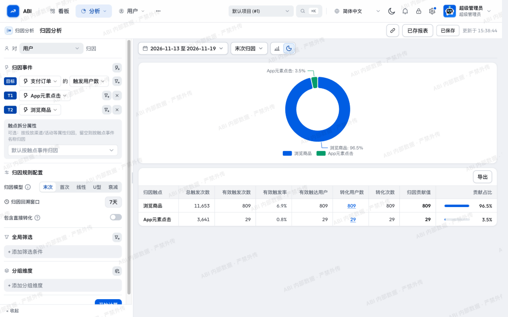
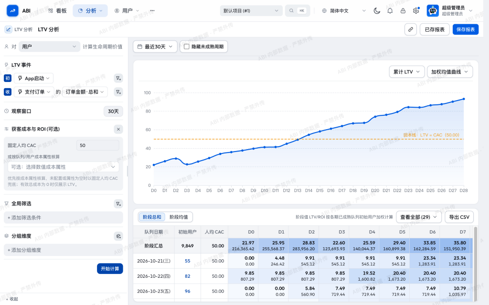
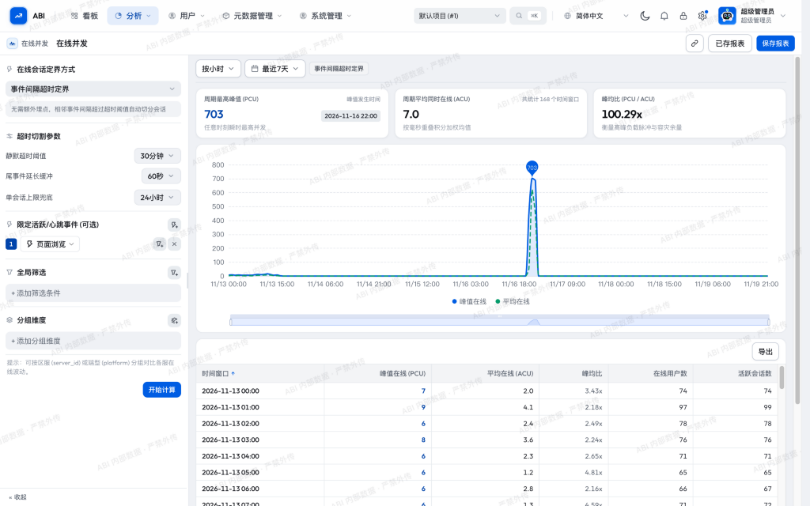
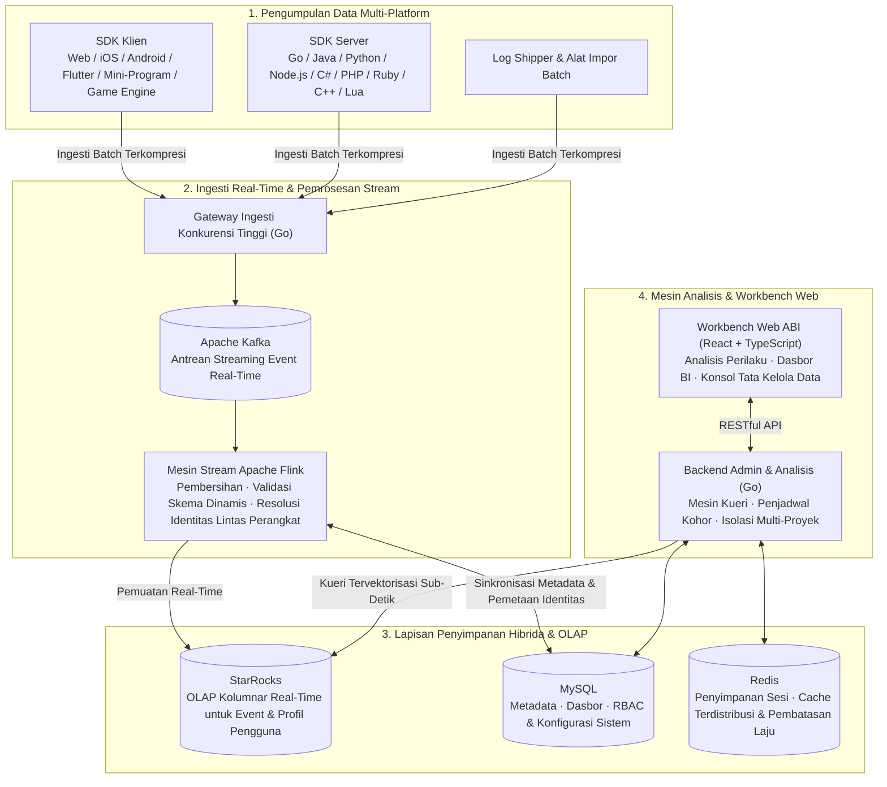

# ABI — Platform Analisis Perilaku Pengguna (UBA) & BI Enterprise

**Platform Terpadu Self-Hosted untuk Product Analytics, Customer 360 & Business Intelligence**

Menyatukan **Pelacakan Event Multi-Platform · Pemrosesan Stream Real-Time · OLAP Sub-Detik · 13 Model Analitik · SQL Layanan Mandiri · Dasbor BI Interaktif · RBAC Enterprise**

  <strong>🌐 ภาษา / Bahasa / Language:</strong>
  <a href="README.md">简体中文</a> ·
  <a href="README.zh-TW.md">繁體中文</a> ·
  <a href="README.en.md">English</a> ·
  <a href="README.ja.md">日本語</a> ·
  <a href="README.ko.md">한국어</a> ·
  <a href="README.es.md">Español</a> ·
  <a href="README.pt.md">Português</a> ·
  <a href="README.de.md">Deutsch</a> ·
  <a href="README.fr.md">Français</a> ·
  <a href="README.ru.md">Русский</a> ·
  <a href="README.vi.md">Tiếng Việt</a> ·
  <a href="README.th.md">ไทย</a> ·
  <a href="README.id.md"><b>Bahasa Indonesia</b></a>

  
  
  
  
  
  
  

  <a href="#features">Fitur Utama</a> •
  <a href="#scenarios">Skenario Penggunaan</a> •
  <a href="#screenshots">Tangkapan Layar Modul</a> •
  <a href="#architecture">Arsitektur Teknis</a> •
  <a href="#sdks">Ekosistem SDK</a> •
  <a href="#contact">Lisensi & Kontak</a>

 

---

## ✨ Fitur Utama

**ABI (AnyLink Behavioral Intelligence)** adalah platform **Analisis Perilaku Pengguna (User Behavior Analytics - UBA) dan Business Intelligence (BI)** enterprise yang dirancang untuk tim pertumbuhan produk (product growth), operasional, dan rekayasa data. Platform ini menyediakan alur kerja terpadu lengkap—mulai dari pengumpulan event multi-platform dan ingesti streaming real-time hingga eksplorasi perilaku mandiri (self-service), segmentasi audiens, dan dasbor eksekutif—dengan dukungan penuh untuk penerapan private / on-premise serta kedaulatan data mutlak.

| Domain Kemampuan | Sorotan Utama |
| :--- | :--- |
| **📊 7 Model Analisis Mandiri (Self-Service)** | Dilengkapi bawaan: **Analisis Event (Event Analysis)** (agregasi multi-metrik, formula kustom, perbandingan periode-ke-periode, perincian multi-dimensi), **Analisis Funnel (Funnel Analysis)** (diagnostik konversi & titik drop-off per tahap), **Analisis Retensi (Retention Analysis)** (matriks kohor harian/mingguan/bulanan), **Analisis Jalur (Path Analysis)** (diagram alur Sankey perjalanan pengguna maju/mundur), **Analisis Distribusi (Distribution Analysis)**, **Analisis Interval (Interval Analysis)** (diagram box-plot waktu konversi), dan **Analisis Atribut Pengguna (User Attribute Analysis)**. |
| **🎯 Customer 360 & Mesin Audiens** | Resolusi identitas lintas perangkat secara real-time yang menghubungkan pengunjung anonim dan akun terautentikasi ke dalam satu profil pengguna terpadu; mencakup **Timeline Perilaku Customer 360 Pengguna Tunggal**, **Pembuat Segmen Berbasis Aturan Visual (Visual Rule-Based Cohorts)**, **Impor Berkas CSV**, **Penyimpanan Segmen Satu-Klik dari Grafik**, serta **Tag Pengguna Terjadwal**. |
| **🧩 Dasbor BI Interaktif** | Mengatur ruang kerja dengan folder multi-ruang, tata letak kisi seret-dan-lepas (drag-and-drop) responsif, widget visualisasi model gabungan, penimpaan tanggal & filter dinamis di seluruh dasbor, serta berbagi akses tim yang fleksibel dan berbutir halus. |
| **🔌 Tata Kelola Metadata & Pelacakan Event** | Mengelola proyek, zona waktu, skema event, kamus properti (property dictionaries), dan metrik bisnis secara terpusat; menghadirkan **Taman Bermain Integrasi SDK Interaktif (Interactive SDK Playground)** (validasi payload langsung tanpa mencemari data produksi) serta log ingesti dan log kesalahan real-time. |
| **🔐 Keamanan Enterprise & Multibahasa Global (13 Bahasa)** | RBAC granular mencakup menu, rute, dan tombol aksi dengan isolasi data tingkat proyek yang ketat serta pencatatan audit log; dukungan native untuk 13 bahasa global (Bahasa Indonesia, Mandarin Sederhana, Mandarin Tradisional, Inggris, Jepang, Korea, Spanyol, Portugis, Jerman, Prancis, Rusia, Vietnam, Thai), tema Terang/Gelap, serta watermark layar anti-kebocoran data. |

---

## 🌍 Skenario Penggunaan Utama

- **Pertumbuhan Produk & Aplikasi Seluler (Web / iOS / Android / Mini-Program)**: Mengukur adopsi fitur baru, mengidentifikasi titik drop-off pada funnel orientasi pengguna, memantau kurva retensi kohor, dan menelusuri rute navigasi pengguna nyata.
- **E-Commerce & Ritel Digital**: Menghubungkan atribusi ujung-ke-ujung mulai dari tayangan produk, penambahan ke keranjang, hingga pembayaran tuntas, sembari menyegmentasikan pembeli VIP ber-LTV tinggi dan pengguna yang berisiko churn.
- **Studio Game & Penerbit Global**: Mengumpulkan telemetri bervolume tinggi di seluruh Unity, Unreal Engine, Cocos, dan server game untuk menganalisis penyelesaian tutorial, interval antar level, retensi harian, serta tingkatan monetisasi.
- **Infrastruktur Data Enterprise Mandiri (Self-Hosted)**: Menerapkan di dalam cloud privat atau lingkungan on-premise perusahaan sendiri untuk kepatuhan privasi data penuh, isolasi antar unit bisnis, serta kolaborasi lintas zona waktu global.

---

## 📸 Tangkapan Layar Modul Produk

### 1. Meja Kerja Analisis Event & Dasbor BI Eksekutif

Ruang kerja eksplorasi no-code intuitif yang dirancang khusus untuk manajer produk dan analis data: konfigurasikan metrik, filter, dan perincian di sisi kiri, periksa grafik interaktif dan tabel perincian di sisi kanan, lalu sematkan wawasan langsung ke dasbor bersama.

<table>
  <tr>
    <td width="50%" valign="top">
      
      
<b>Ruang Kerja Dasbor BI</b>: Tata letak kisi seret-dan-lepas, folder ruang kerja, dan pemfilteran tanggal global

    </td>
    <td width="50%" valign="top">
      
      
<b>Analisis Funnel</b>: Jendela konversi yang dapat dikonfigurasi dengan wawasan konversi & drop-off per langkah

    </td>
  </tr>
</table>

### 2. Retensi Kohor & Analisis Jalur Perjalanan Pengguna

Visualisasi khusus untuk pemantauan retensi dan penemuan alur pengguna, ditenagai oleh mesin OLAP tervektorisasi berkecepatan tinggi.

<table>
  <tr>
    <td width="50%" valign="top">
      
      
<b>Analisis Retensi</b>: Kurva penurunan retensi multi-kohor yang dipadukan dengan matriks heatmap kohor harian

    </td>
    <td width="50%" valign="top">
      
      
<b>Analisis Jalur</b>: Diagram alur Sankey multi-langkah maju & mundur dengan peringkat transisi terpopuler

    </td>
  </tr>
</table>

### 3. Atribusi, LTV & ROI, Siklus Hidup & Peringkat TopN

<table>
  <tr>
    <td width="50%" valign="top">
      
      
<b>Attribution</b>: First-touch, last-touch, linear, U-shaped & decay models

    </td>
    <td width="50%" valign="top">
      
      
<b>LTV & ROI</b>: Cumulative LTV growth curves, CAC payback line & milestone matrix

    </td>
  </tr>
  <tr>
    <td width="50%" valign="top">
      
      
<b>Lifecycle</b>: New, Retained, Resurrected & Churned user stage trends

    </td>
    <td width="50%" valign="top">
      
      
<b>TopN Ranklist</b>: Real-time multi-metric user leaderboard with profile drill-down

    </td>
  </tr>
</table>

### 4. Konkurensi (PCU/ACU) & SQL Layanan Mandiri

<table>
  <tr>
    <td width="50%" valign="top">
      
      
<b>Concurrency (PCU/ACU)</b>: Peak & Average Concurrent Users with peak-to-average ratios

    </td>
    <td width="50%" valign="top">
      
      
<b>Self-Service SQL</b>: Tenant-isolated read-only SQL sandbox, templates & instant charts

    </td>
  </tr>
</table>

### 5. Timeline Customer 360 & Segmentasi Audiens Visual

Telusuri data dengan mulus dari KPI agregat hingga ke aliran event pengguna individual, atau bangun segmen audiens dan tag dinamis untuk analisis lintas model yang terarah.

<table>
  <tr>
    <td width="50%" valign="top">
      
      
<b>Customer 360 & Timeline Event</b>: Identitas tertaut, atribut profil pengguna, dan riwayat perilaku kronologis

    </td>
    <td width="50%" valign="top">
      
      
<b>Segmentasi Audiens</b>: Menggabungkan karakteristik profil & aturan perilaku dengan pratinjau ukuran instan dan pembaruan terjadwal

    </td>
  </tr>
</table>

### 6. Tata Kelola Metadata, Integrasi SDK Langsung & RBAC Granular

Pertahankan kamus data yang bersih, validasi muatan pelacakan event secara interaktif, dan atur akses tim dengan izin keamanan tingkat enterprise.

<table>
  <tr>
    <td width="50%" valign="top">
      
      
<b>Tata Kelola Event & Skema</b>: Kelola nama tampilan, tombol status aktif, dan kamus properti

    </td>
    <td width="50%" valign="top">
      
      
<b>Panduan Integrasi Interaktif</b>: Pratinjau payload JSON dan jalankan validasi langsung dalam hitungan detik

    </td>
  </tr>
</table>

<b>🔍 Klik untuk memperluas: Pohon Izin RBAC Tingkat Peran Enterprise & Menu/Tombol Granular</b>

 

<b>Otorisasi RBAC Granular</b>: Pohon izin visual yang mencakup modul, halaman antarmuka, hingga tombol tindakan di setiap halaman

---

## 🏗️ Arsitektur Teknis

ABI menerapkan **arsitektur platform data 4 lapisan** modern berstandar cloud-native yang menggabungkan gateway ingesti konkurensi tinggi, pemrosesan streaming real-time, mesin OLAP kolumnar tervektorisasi, dan meja kerja web yang terpisah secara modular.

### 1. Diagram Arsitektur Tingkat Tinggi

### 2. Gambaran Lapisan Arsitektur

- **Lapisan Pengumpulan Data (Data Collection Layer)**: SDK kelas produksi di seluruh web, seluler, game engine, dan bahasa backend dengan buffering lokal, kompresi batch, dan alat validasi langsung.
- **Lapisan Ingesti Real-Time & Streaming (Real-Time Ingestion & Streaming Layer)**: Gateway ingesti Go khusus menangani autentikasi dan penyerapan beban lalu lintas ke Kafka, sementara Apache Flink secara kontinu membersihkan event, menegakkan skema dinamis, memperkaya data lokasi GeoIP, dan merekonsiliasi identitas pengguna lintas perangkat.
- **Lapisan Penyimpanan & OLAP (Storage & OLAP Layer)**: StarRocks mendukung kueri analitik sub-detik di atas tabel event raksasa, profil pengguna, dan kohor audiens; MySQL menyimpan metadata, tata letak dasbor, dan konfigurasi RBAC; Redis mengelola sesi aktif dan pembatasan laju (rate limiting).
- **Lapisan Layanan & Aplikasi (Service & Application Layer)**: Backend Go mengompilasi kondisi kueri visual menjadi SQL analitik yang aman dan berparameter dengan isolasi proyek yang ketat, melayani antarmuka analisis dan dasbor React + TypeScript + ECharts yang responsif.

### 5. Ringkasan Tech Stack

| Lapisan | Teknologi Inti | Peran & Tanggung Jawab |
| :--- | :--- | :--- |
| **Frontend Workbench** | React · TypeScript · Vite · Tailwind CSS · ECharts | Penyusun kueri perilaku, grafik interaktif, dasbor kisi seret-dan-lepas & konsol admin |
| **Layanan Backend** | Go · Gin · GORM | API admin, pengompilasi SQL analitik, penjadwal audiens & gateway ingesti throughput tinggi |
| **Pemrosesan Stream** | Java · Apache Flink · Apache Kafka | ETL event real-time, sinkronisasi metadata langsung, resolusi identitas & pengarsipan event mentah |
| **Penyimpanan & OLAP** | StarRocks · MySQL · Redis | Database OLAP kolumnar tervektorisasi, penyimpan metadata relasional & cache terdistribusi |
| **Penerapan Sistem** | Docker · Docker Compose · Nginx | Penerapan kontainerisasi cepat satu perintah atau perluasan kluster cloud privat enterprise |

---

## 📦 Ekosistem SDK Multi-Platform

Rangkaian SDK pengumpulan data yang komprehensif dengan dokumentasi lengkap dan contoh interaktif — jelajahi **[Rangkaian SDK Lengkap & Dokumentasi Integrasi](abi.sdk/README.id.md)**:

- **Web & Lintas Platform**: JavaScript / TypeScript Web SDK, H5 Bridge App-ke-WebView, WeChat Mini-Program, React Native
- **Seluler Native**: iOS (`Swift`), Android (`Kotlin`), Flutter (`Dart`)
- **Game Engine**: Unity (`C#`), Unreal Engine / Cocos2d-x (`C/C++`), Cocos Creator / Egret / LayaAir, Cocos2d-Lua
- **Bahasa Server**: Go, Java, Python, Node.js, C# (`.NET`), PHP, Ruby, Lua
- **HTTP & Ingesti Log**: RESTful HTTP API standar untuk pengiriman batch, alat pengirim file log real-time, dan templat pengumpul log siap pakai

---

## 📬 Lisensi Komersial & Pertanyaan Pembelian

ABI tersedia untuk **lisensi komersial, pengiriman kode sumber penuh, bantuan penerapan privat / on-premise, dan pengembangan kustom enterprise**.  
Jika Anda tertarik untuk membeli lisensi ABI, menjadwalkan demo langsung, atau mendiskusikan opsi lisensi enterprise, silakan hubungi kami melalui email:

- **Kontak Pembelian & Bisnis**: **[baidushanxivip@gmail.com](mailto:baidushanxivip@gmail.com)**

---

**[简体中文](README.md)** · **[繁體中文](README.zh-TW.md)** · **[English](README.en.md)** · **[日本語](README.ja.md)** · **[한국어](README.ko.md)** · **[Español](README.es.md)** · **[Português](README.pt.md)** · **[Deutsch](README.de.md)** · **[Français](README.fr.md)** · **[Русский](README.ru.md)** · **[Tiếng Việt](README.vi.md)** · **[ไทย](README.th.md)** · **[Bahasa Indonesia](README.id.md)**

Kata Kunci: Analisis Perilaku Pengguna, UBA, Product Analytics, Business Intelligence, Dasbor BI, Analisis Self-Hosted, SDK Pelacakan Event, Analisis Funnel, Retensi Kohor, Diagram Jalur Pengguna Sankey, Customer 360, Segmentasi Audiens, CDP, StarRocks OLAP, Apache Flink, RBAC Enterprise

