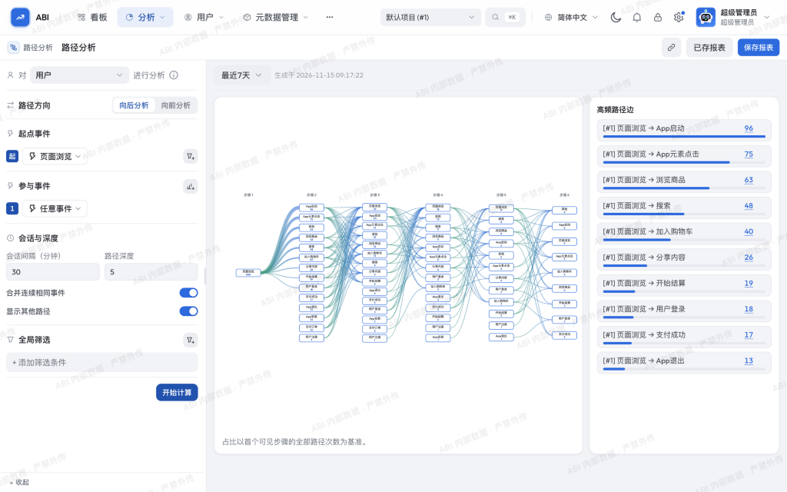
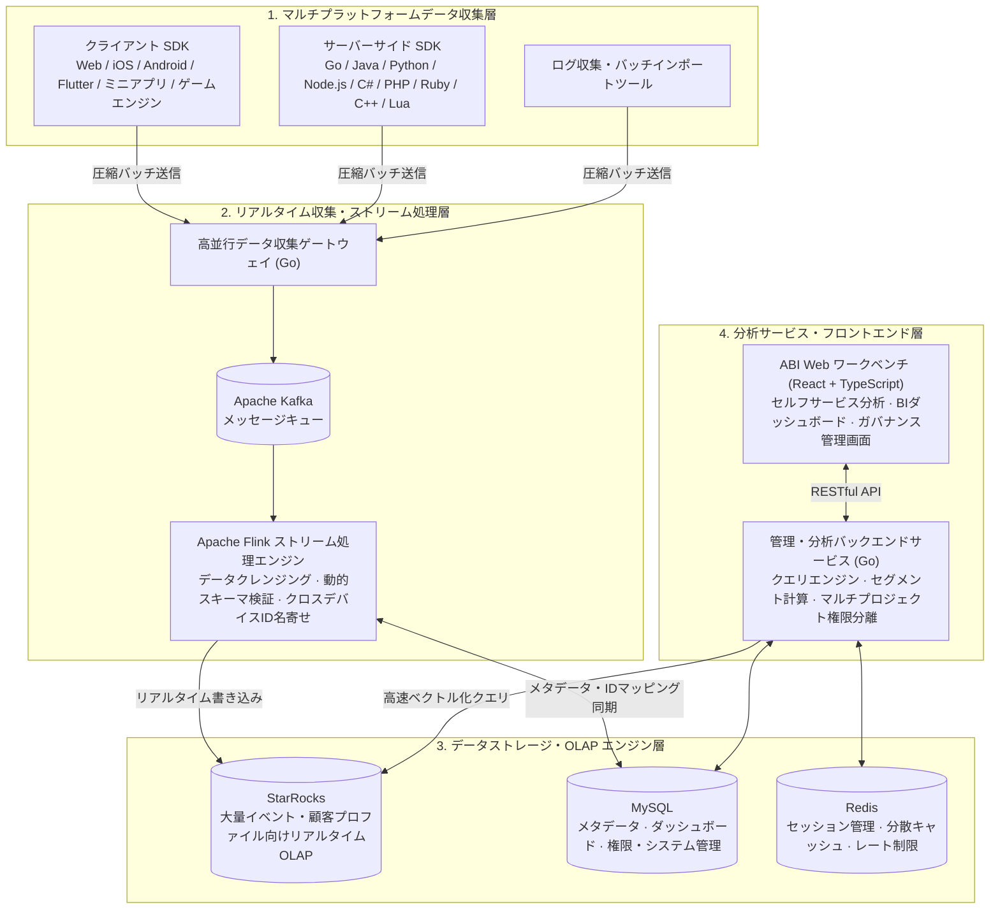

# ABI — エンタープライズ向けユーザー行動分析（UBA）＆ BI プラットフォーム

**プロダクトグロース・マーケティング・データチームのための自社運用対応オールインワン分析基盤**

**マルチプラットフォーム計測 · リアルタイムストリーム処理 · 高速OLAP分析 · 7つの行動分析モデル · 対話型BIダッシュボード · 細粒度RBAC権限管理** を統合

  <strong>🌐 言語 / Language / 语言：</strong>
  <a href="README.md">简体中文</a> ·
  <a href="README.en.md">English</a> ·
  <a href="README.ja.md"><b>日本語</b></a>

  
  
  
  
  
  

  <a href="#features">主な機能</a> •
  <a href="#scenarios">活用シーン</a> •
  <a href="#screenshots">画面紹介</a> •
  <a href="#architecture">技術アーキテクチャ</a> •
  <a href="#sdks">対応SDK</a> •
  <a href="#contact">ご購入・お問い合わせ</a>

 

---

## ✨ 主な機能紹介

**ABI（AnyLink Behavioral Intelligence）** は、プロダクト改善・グロース施策・データドリブン経営を支えるエンタープライズ向けの **ユーザー行動分析（UBA）＆ ビジネスインテリジェンス（BI）統合プラットフォーム** です。「マルチ端末からのイベント収集 → リアルタイムデータ整形・名寄せ → ノーコード多角的分析 → 顧客セグメント抽出・BIダッシュボード共有」までを一気通貫で実現し、オンプレミスやプライベートクラウドでの自社環境構築にも対応しています。

| 機能領域 | 主な特長 |
| :--- | :--- |
| **📊 7種類のセルフサービス行動分析** | **イベント分析**（複数指標集計、四則演算式、前期比、多次元ドリルダウン）、**ファネル分析**（ステップ別転換率・離脱把握）、**リテンション分析**（日次/週次/月次コホート定着率）、**経路分析**（前後方向の行動遷移サンキー図）、**分布分析**、**間隔分析**（所要時間の箱ひげ図統計）、**ユーザー属性分析** を標準搭載。 |
| **🎯 顧客 360° プロファイル＆セグメント** | 未ログイン端末とログイン会員IDをリアルタイムで自動名寄せし、**単一ユーザーの 360° カルテと時系列行動タイムライン** を可視化。**条件ルールによるセグメント抽出**、**CSVリスト取り込み**、**分析結果からのワンクリック集団保存**、**自動更新対応のユーザータグ** を提供。 |
| **🧩 対話型 BI ダッシュボード** | スペース・フォルダ階層管理、ドラッグ＆ドロップによる自由なグリッドレイアウト、複数分析モデルの混在配置、ダッシュボード全体の日付・フィルタ一括連動、チームメンバーへの共有権限設定に対応。 |
| **🔌 データ資産・イベントガバナンス** | 複数プロジェクト・タイムゾーン、イベント定義、プロパティ辞書、ビジネスメトリクスを一元管理。本番データを汚さずに疎通確認できる **オンライン計測テスト画面** や、リアルタイム受信ログ・エラー調査機能を搭載。 |
| **🔐 エンタープライズ権限管理＆多言語** | ユーザー・ロールおよび「メニュー / 画面 / 操作ボタン」単位の細粒度 RBAC 権限ツリー、プロジェクト単位のデータ分離、操作監査ログを完備。**日本語・英語・中国語（簡体字）** の切り替え、ライト/ダークモード、画面透かし（ウォーターマーク）に対応。 |

---

## 🌍 主な活用シーン

- **Webサービス・モバイルアプリのグロース（Web / iOS / Android / ミニアプリ）**：新機能リリース後の効果検証、会員登録・オンボーディングの離脱改善、コホート定着率や画面遷移のボトルネック特定。
- **EC・デジタルリテールのCRM最適化**：「商品閲覧 → 検索 → カート追加 → 決済開始 → 購入完了」までのフルファネル分析と、ロイヤル顧客（VIP）・休眠予備軍のセグメント抽出。
- **ゲーム開発・グローバルパブリッシング**：Unity / Unreal / Cocos などのクライアントやゲームサーバーからイベントを収集し、チュートリアル突破率、ステージ進行時間、継続率、課金階層をリアルタイム監視。
- **自社管理型データ基盤（プライベート環境導入）**：Docker コンテナやプライベートクラウドへの柔軟な導入により、厳格なデータガバナンス・個人情報保護要件や多拠点・複数事業部の権限分離を実現。

---

## 📸 主要機能スクリーンショット

### 1. イベント分析ワークベンチ ＆ BI ダッシュボード

SQL 不要で直感的に操作できる分析画面。左パネルで指標・絞り込み条件・軸を選択するだけで、右側にトレンドチャートと詳細集計テーブルが即座に描画され、そのままダッシュボードへ配置できます。

<table>
  <tr>
    <td width="50%" valign="top">
      
      
<b>BI ダッシュボード</b>：ドラッグ＆ドロップ配置、フォルダ整理、全体期間フィルタ連動

    </td>
    <td width="50%" valign="top">
      
      
<b>ファネル分析</b>：計測ウィンドウを柔軟に指定し、各ステップの転換率と離脱を一目で把握

    </td>
  </tr>
</table>

### 2. コホートリテンション追跡 ＆ ユーザー経路探索

継続率の推移把握やアプリ・サイト内の回遊ルート発見に特化した専用ビジュアライゼーションを提供します。

<table>
  <tr>
    <td width="50%" valign="top">
      
      
<b>リテンション分析</b>：コホート別の定着率減衰カーブと日次ヒートマップマトリクス

    </td>
    <td width="50%" valign="top">
      
      
<b>経路分析</b>：起点・終点からのマルチステップ行動遷移サンキー図と高頻度ルート集計

    </td>
  </tr>
</table>

### 3. ユーザー 360° カルテ ＆ セグメント抽出

全体指標から個別ユーザーの行動履歴へシームレスにドリルダウンでき、条件ビルダーで作成したセグメントをあらゆる分析モデルで再利用できます。

<table>
  <tr>
    <td width="50%" valign="top">
      
      
<b>ユーザー詳細・行動タイムライン</b>：ID名寄せ情報、属性スナップショット、時系列イベント履歴

    </td>
    <td width="50%" valign="top">
      
      
<b>ユーザーセグメント管理</b>：属性と行動条件を組み合わせ、対象人数の即時プレビューと定期更新に対応

    </td>
  </tr>
</table>

### 4. メタデータ管理・オンライン計測テスト・RBAC 権限設定

データ辞書の標準化、ブラウザ上で完結するイベント送信テスト、そしてきめ細かなロール権限管理を備えています。

<table>
  <tr>
    <td width="50%" valign="top">
      
      
<b>イベント・メタデータ管理</b>：表示名、有効/無効ステータス、紐づく属性辞書を一元管理

    </td>
    <td width="50%" valign="top">
      
      
<b>オンライン導入・疎通テスト</b>：JSON ペイロードのプレビューと検証送信で実装ミスを事前に防止

    </td>
  </tr>
</table>

<b>🔍 クリックして表示：ロール管理およびメニュー・ボタン単位の RBAC 権限ツリー</b>

 

<b>ロール・権限ツリー設定</b>：モジュール・画面・個別操作ボタンまで視覚的なツリー形式で権限付与

---

## 🏗️ 技術アーキテクチャ

本プラットフォームは **「高並行収集ゲートウェイ ＋ リアルタイムストリーム処理 ＋ ベクトル化カラムナ OLAP エンジン ＋ モダン Web ワークベンチ」** の4層アーキテクチャを採用し、大量イベントの安定した取り込みとサブ秒級の対話型クエリを両立しています。

### 1. 全体アーキテクチャ図

### 2. 各レイヤーの概要

- **データ収集層**：Web、モバイル、ゲームエンジン、主要バックエンド言語向けの SDK およびログ取り込みツールを提供し、ローカルバッファリング・圧縮送信・疎通検証をサポートします。
- **リアルタイム収集・ストリーム処理層**：独立稼働する Go 製収集ゲートウェイが認証とトラフィック制御を行い Kafka へ中継。Apache Flink がリアルタイムでデータ整形、スキーマ検証、GeoIP 地域付与、および匿名IDと会員IDの名寄せを実行します。
- **ストレージ・OLAP エンジン層**：StarRocks のカラムナストレージとベクトル化実行エンジンにより、大規模イベント集計・リテンション算出・セグメント抽出を高速処理。MySQL が各種設定・メタデータを保持し、Redis がセッションとキャッシュを管理します。
- **分析サービス・フロントエンド層**：Go バックエンドが画面上の分析条件を安全なクエリへ変換しプロジェクト単位の権限分離を実施。React + TypeScript + ECharts フロントエンドが軽快な分析ワークベンチとドラッグ＆ドロップ型 BI ダッシュボードを提供します。

### 3. 技術スタック一覧

| 領域 | 採用技術 | 役割 |
| :--- | :--- | :--- |
| **フロントエンド** | React · TypeScript · Vite · Tailwind CSS · ECharts | 行動分析UI、チャート描画、グリッドダッシュボード、多言語管理コンソール |
| **バックエンド** | Go · Gin · GORM | 管理API、分析クエリエンジン、セグメントスケジューラ、高並行収集ゲートウェイ |
| **ストリーム処理** | Java · Apache Flink · Apache Kafka | リアルタイムETL、メタデータ同期、ID名寄せ、生データアーカイブ |
| **データストア** | StarRocks · MySQL · Redis | リアルタイムOLAP分析DB、リレーショナル管理DB、高速キャッシュ |
| **デプロイ・運用** | Docker · Docker Compose · Nginx | コンテナによる迅速な立ち上げ、およびプライベートクラウドでのスケール構成に対応 |

---

## 📦 マルチプラットフォーム計測 SDK

中国語・英語・日本語の3言語ドキュメントとサンプルコードを備えた充実のデータ収集エコシステムを内蔵しています（詳細は **[SDK スイート＆導入ドキュメント](abi.sdk/README.ja.md)** をご覧ください）：

- **Web・クロスプラットフォーム**：JavaScript / TypeScript Web SDK、アプリ内 WebView（App-H5）連携ブリッジ、ミニアプリ、React Native
- **ネイティブモバイル**：iOS（Swift）、Android（Kotlin）、Flutter（Dart）
- **ゲームエンジン**：Unity（C#）、Unreal Engine / Cocos2d-x（C/C++）、Cocos Creator / Egret / LayaAir、Cocos2d-Lua
- **サーバーサイド言語**：Go、Java、Python、Node.js、C#（.NET）、PHP、Ruby、Lua
- **HTTP API・ログ連携**：標準 HTTP RESTful バッチ送信 API、リアルタイムログファイル監視ツール、主要ログコレクター設定テンプレート

---

## 📬 ご購入・商用ライセンスのお問い合わせ

本プラットフォームは **商用ライセンス提供、フルソースコード納品、自社環境（オンプレミス／プライベートクラウド）への構築支援、および個別カスタマイズ開発** に対応しております。  
製品のデモ依頼、お見積もり、ご購入に関するご相談は、以下のメールアドレスまでお気軽にお問い合わせください：

- **ご購入・ビジネス窓口メール**：**[baidushanxivip@gmail.com](mailto:baidushanxivip@gmail.com)**

---

**[简体中文](README.md)** · **[English](README.en.md)** · **[日本語](README.ja.md)**

Keywords: ユーザー行動分析, UBA, プロダクトアナリティクス, ビジネスインテリジェンス, BIツール, イベント計測, ファネル分析, リテンション分析, 経路分析, 顧客360度分析, セグメント配信, プライベートクラウド分析基盤, StarRocks, Apache Flink, User Behavior Analytics, Self-Hosted BI

