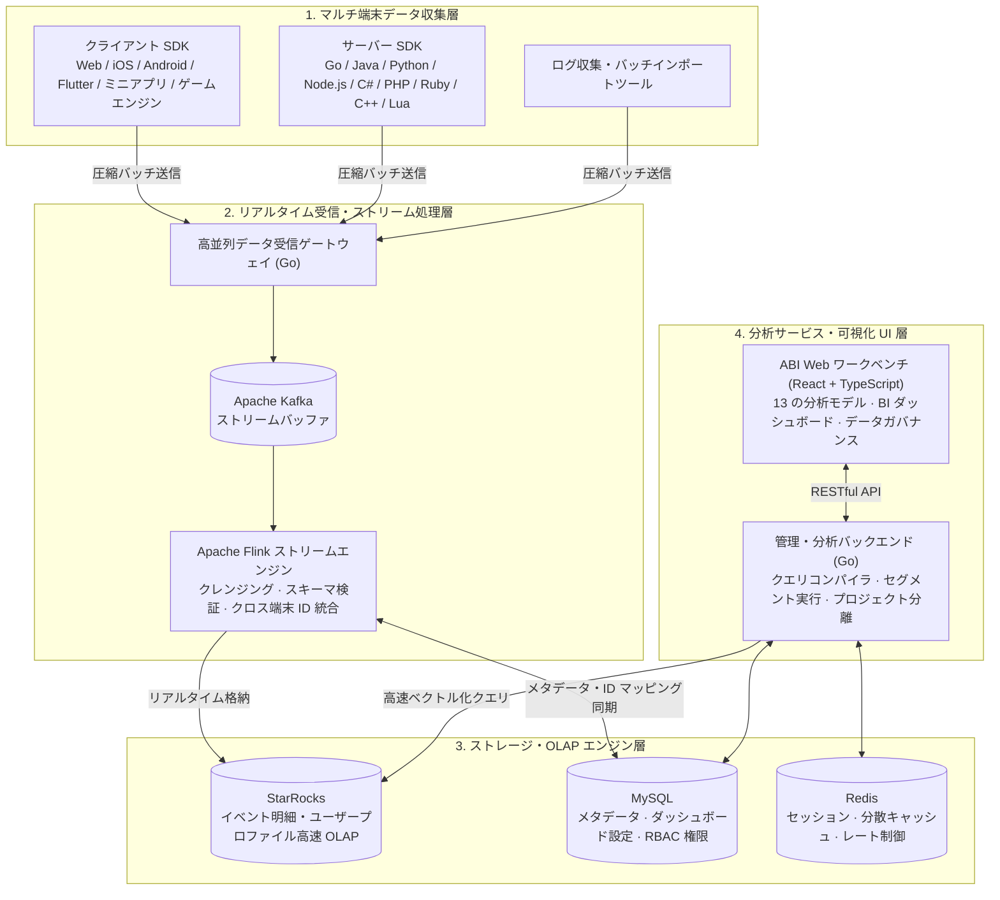

# ABI — エンタープライズ ユーザー行動分析（UBA）& BI プラットフォーム

**プロダクトグロース・CRM 運用・ゲームパブリッシング・データチームのためのオールインワン・オンプレミス分析基盤**

**マルチプラットフォーム計測 · リアルタイムストリーム処理 · 高速 OLAP · 13 の行動・グロース分析モデル · セルフサービス SQL · インタラクティブ BI ダッシュボード · エンタープライズ RBAC** を一体化

  <strong>🌐 言語 / Language / 语言：</strong>
  <a href="README.md">简体中文</a> ·
  <a href="README.zh-TW.md">繁體中文</a> ·
  <a href="README.en.md">English</a> ·
  <a href="README.ja.md"><b>日本語</b></a> ·
  <a href="README.ko.md">한국어</a> ·
  <a href="README.es.md">Español</a> ·
  <a href="README.pt.md">Português</a> ·
  <a href="README.de.md">Deutsch</a> ·
  <a href="README.fr.md">Français</a> ·
  <a href="README.ru.md">Русский</a> ·
  <a href="README.vi.md">Tiếng Việt</a> ·
  <a href="README.th.md">ไทย</a> ·
  <a href="README.id.md">Bahasa Indonesia</a>

  
  
  
  
  
  
  

  <a href="#features">基本機能</a> •
  <a href="#models">13の分析モデル</a> •
  <a href="#scenarios">活用シーン</a> •
  <a href="#screenshots">画面イメージ</a> •
  <a href="#architecture">技術アーキテクチャ</a> •
  <a href="#sdks">マルチ端末 SDK</a> •
  <a href="#contact">ライセンス・お問い合わせ</a>

 

---

## ✨ 基本機能紹介

**ABI（AnyLink Behavioral Intelligence）** は、すぐに導入可能なエンタープライズ向け **ユーザー行動分析（UBA）& ビジネスインテリジェンス（BI）** 統合プラットフォームです。マルチ端末からのイベント計測・リアルタイムストリーム処理から、ノーコードの探索分析、SQL サンドボックス、顧客セグメンテーション、BI ダッシュボードまでを一貫して提供し、プライベートクラウド／オンプレミス環境でのデータ主権と持続的な事業成長を支援します。

| 機能モジュール | 主な機能と特長 |
| :--- | :--- |
| **📊 13 のセルフサービス分析モデル** | **イベント分析**（複合指標計算・前年/前月比・異常検知・4象限ビュー）、**ファネル**、**リテンション**、**ユーザーパス**、**分布**、**間隔**、**ユーザー属性分析** に加え、**アトリビューション分析**、**LTV & ROI 分析**、**ライフサイクル分析**、**同時接続分析（PCU/ACU）**、**TopN ランキング**、**セルフサービス SQL** を搭載。 |
| **🎯 顧客 360° プロファイル & セグメント** | 匿名デバイス ID とログインユーザー ID をクロスプラットフォームで自動統合し、**360° プロファイルと行動タイムライン** を可視化。**ルールベースのセグメント抽出**、**オフライン一括インポート**、**分析結果からのワンクリック保存**、**定時更新型ユーザータグ** に対応。 |
| **🧩 全モデル対応 BI ダッシュボード** | ワークスペース／フォルダ単位の階層管理、**全 13 分析モデル** のドラッグ＆ドロップ混在レイアウト、ダッシュボード全体の期間・フィルタ連動、チーム共有をサポート。 |
| **🔌 メタデータ管理 & 計測検証** | マルチプロジェクト・マルチタイムゾーン対応のイベント辞書・プロパティ定義・指標管理に加え、ペイロードを即座に検証できる **オンライン SDK テストプレイグラウンド** と取り込みエラーログを提供。 |
| **🔐 エンタープライズ RBAC & 多言語 UI** | ユーザー・ロールおよび **メニュー／画面／ボタン単位の RBAC 権限制御**、プロジェクト間の厳格なデータ分離、操作監査ログを完備。**13 言語 UI**・ライト／ダークテーマ・画面透かしに対応。 |

---

## 🧠 13 の行動・データサイエンス分析モデル

| カテゴリ | モデル | 主な分析機能 |
| :--- | :--- | :--- |
| **基本行動インサイト** | **イベント / ユーザー属性分析** | 複数指標の四則演算、前期比・前年比、多次元グループ分解、異常値検知、4象限分析 |
| **コンバージョン・継続率** | **ファネル / リテンション / 間隔分析** | ステップ別転換率・離脱診断、コホートヒートマップ・減衰曲線、転換所要時間の分布分析 |
| **遷移・分布** | **パス / 分布分析** | 順方向・逆方向サンキー遷移図、頻出導線ランキング、回数・金額・滞在時間などの区間分布 |
| **グロース・貢献度** | **アトリビューション / TopN ランキング** | 初回・最終・線形・接点（U字）・減衰モデルによるチャネル貢献評価、リアルタイム TopN ユーザー順位表 |
| **収益化・状態遷移** | **LTV & ROI / ライフサイクル分析** | コホート別累積 LTV 曲線、CAC 回収ラインと ROI 評価；新規・継続・復帰・休眠ユーザー推移 |
| **リアルタイム・SQL** | **同時接続 (PCU/ACU) / セルフサービス SQL** | 最大同時接続数（PCU）・平均同時接続数（ACU）監視；テナント分離型リードオンリー SQL サンドボックスと即時グラフ化 |

---

## 🌍 主な活用シーン

- **Web・モバイルアプリ・ミニアプリのプロダクト成長**：新機能の効果測定、オンボーディングファネルの改善、継続率向上と導線最適化。
- **EC・デジタルリテール運用**：広告・接点ごとのアトリビューション評価、CAC 回収期間（LTV）の把握、優良顧客や離脱予備軍のセグメント抽出。
- **ゲーム開発・グローバルパブリッシング**：ゲームエンジン／サーバー SDK を通じた PCU・ACU 同時接続監視、課金ランキング、チュートリアル離脱と LTV 分析。
- **プライベートクラウドデータ基盤**：コンテナ化された構成により閉域網や自社クラウドへ迅速に構築でき、データガバナンスとグローバル拠点連携を両立。

---

## 📸 主要機能モジュール画面

### 1. イベント分析ワークベンチ & 全モデル対応 BI ダッシュボード

左側のパネルで指標・条件・軸を選択するだけでトレンドグラフとドリルダウン表を即座に表示し、13 種類の分析モデルすべてをビジネス監視ダッシュボードへワンクリックで配置できます。

<table>
  <tr>
    <td width="50%" valign="top">
      
      
<b>BI ダッシュボード</b>：自由なドラッグ＆ドロップ配置、フォルダ管理、一括期間連動

    </td>
    <td width="50%" valign="top">
      
      
<b>ファネル分析</b>：転換ウィンドウを柔軟に設定し、各ステップの通過率と離脱を可視化

    </td>
  </tr>
</table>

### 2. リテンション追跡 & ユーザーパス探索

継続率の推移とユーザー行動の遷移導線を専用ビジュアライゼーションで直感的に把握できます。

<table>
  <tr>
    <td width="50%" valign="top">
      
      
<b>リテンション分析</b>：日次／週次／月次の継続率減衰曲線とコホートヒートマップ

    </td>
    <td width="50%" valign="top">
      
      
<b>パス分析</b>：順方向・逆方向の行動サンキー遷移図と高頻度パス集計

    </td>
  </tr>
</table>

### 3. アトリビューション・LTV & ROI・ライフサイクル・ランキング

広告チャネルの貢献度、LTV による投資回収（CAC ブレークイーブン）、ユーザーの定着フェーズ推移、上位ユーザーランキングを網羅します。

<table>
  <tr>
    <td width="50%" valign="top">
      
      
<b>アトリビューション分析</b>：初回・最終・線形・U字・減衰モデルで各接点の貢献を定量化

    </td>
    <td width="50%" valign="top">
      
      
<b>LTV & ROI 分析</b>：累積 LTV 成長曲線、CAC 回収ライン、コホート別明細マトリクス

    </td>
  </tr>
  <tr>
    <td width="50%" valign="top">
      
      
<b>ライフサイクル分析</b>：新規・継続・復帰・休眠ユーザーのフェーズ別推移と構成比を可視化

    </td>
    <td width="50%" valign="top">
      
      
<b>TopN ランキング分析</b>：複数指標でのリアルタイム順位集計とユーザー詳細へのドリルダウン

    </td>
  </tr>
</table>

### 4. 同時接続監視（PCU/ACU）& セルフサービス SQL サンドボックス

ゲーム・リアルタイムサービスの同時接続監視から、データアナリスト向けの自由な SQL 探索・可視化までを安全にサポートします。

<table>
  <tr>
    <td width="50%" valign="top">
      
      
<b>同時接続分析（PCU/ACU）</b>：瞬時ピーク（PCU）と平均同時接続（ACU）・ピーク平均比を算出

    </td>
    <td width="50%" valign="top">
      
      
<b>セルフサービス SQL</b>：テナント分離リードオンリーサンドボックス、テンプレート集、即時チャート化

    </td>
  </tr>
</table>

### 5. 顧客 360° プロファイル & セグメント作成

集計レポートから個々のユーザー行動タイムラインへシームレスにドリルダウンし、柔軟な条件で抽出したセグメントを全分析モデルで再利用できます。

<table>
  <tr>
    <td width="50%" valign="top">
      
      
<b>ユーザー詳細・行動履歴</b>：統合 ID、属性情報、時系列イベントタイムライン

    </td>
    <td width="50%" valign="top">
      
      
<b>セグメント管理</b>：属性×行動条件による抽出、人数プレビュー、定時自動更新

    </td>
  </tr>
</table>

### 6. メタデータ管理・オンライン計測テスト・RBAC 権限管理

スキーマの統一管理、導入時のリアルタイムテスト検証、企業要件を満たす権限管理機能を備えています。

<table>
  <tr>
    <td width="50%" valign="top">
      
      
<b>メタデータ管理</b>：イベント表示名、有効／無効状態、関連プロパティの一元管理

    </td>
    <td width="50%" valign="top">
      
      
<b>オンライン計測テスト</b>：リクエスト形式のプレビューとテスト送信による即時検証

    </td>
  </tr>
</table>

<b>🔍 クリックして展開：エンタープライズ RBAC ロール・メニュー／ボタン権限ツリー</b>

 

<b>ロール権限管理</b>：モジュール・画面・操作ボタン単位のツリー型チェックボックスによる権限付与

---

## 🏗️ 技術アーキテクチャ

**「高並列収集ゲートウェイ ＋ リアルタイムストリーム処理 ＋ ベクトル化カラム型 OLAP ＋ モダン Web ワークベンチ」** の 4 層構成により、大量データの高速取り込みとサブ秒レベルのインタラクティブ集計を両立しています。

### 1. アーキテクチャ全体像

### 2. 各層の役割

- **データ収集層**：Web・モバイル・ゲームエンジン・サーバー各言語向け SDK およびログ取り込みツールを提供し、ローカルバッファリングと圧縮バッチ送信に対応。
- **リアルタイム受信・ストリーム処理層**：Go 製ゲートウェイが認証とスパイク負荷を吸収して Kafka へ連携し、Apache Flink がデータクレンジング、動的スキーマ検証、GeoIP 付与、クロス端末 ID 統合を実行。
- **ストレージ・OLAP エンジン層**：StarRocks のカラムナストレージとベクトル化エンジンがイベント・リテンション・アトリビューション・LTV・大規模セグメントを高速処理。MySQL がメタデータや権限定義、Redis がセッション・キャッシュを担います。
- **分析サービス・可視化 UI 層**：Go バックエンドが UI の分析条件やリードオンリー SQL サンドボックスをテナント分離された安全・高速なクエリへ変換し、React + TypeScript + ECharts 製フロントエンドで直感的な操作体験を提供します。

### 3. 技術スタック概要

| 領域 | 主な採用技術 | 役割 |
| :--- | :--- | :--- |
| **フロントエンド** | React · TypeScript · Vite · Tailwind CSS · ECharts | 13 の分析モデル画面、可視化チャート、ドラッグ＆ドロップ BI ダッシュボード、13 言語対応 |
| **バックエンド** | Go · Gin · GORM | 管理 API、多モデル分析クエリ生成、セグメントスケジューラ、高並列受信ゲートウェイ |
| **ストリーム処理** | Java · Apache Flink · Apache Kafka | リアルタイム ETL、動的メタデータ同期、ID 統合、生ログアーカイブ |
| **ストレージ・OLAP** | StarRocks · MySQL · Redis | 高速カラム型 OLAP、メタデータ／設定用 RDB、分散キャッシュ |
| **デプロイ** | Docker · Docker Compose · Nginx | コンテナによる迅速な構築およびプライベートクラウドでのスケールアウト |

---

## 📦 マルチプラットフォーム計測 SDK エコシステム

13 言語のドキュメントと実装サンプルを備えたマルチ端末 SDK を標準搭載しています（詳細は **[SDK ドキュメント・ソース一覧](abi.sdk/README.ja.md)** をご覧ください）：

- **Web・クロスプラットフォーム**：JavaScript / TypeScript Web SDK、アプリ内 WebView ブリッジ、WeChat ミニプログラム、React Native
- **ネイティブモバイル**：iOS（Swift）、Android（Kotlin）、Flutter（Dart）
- **ゲームエンジン**：Unity（C#）、Unreal Engine / Cocos2d-x（C/C++）、Cocos Creator / Egret / LayaAir、Cocos2d-Lua
- **サーバーサイド言語**：Go、Java、Python、Node.js、C#（.NET）、PHP、Ruby、Lua
- **汎用 API・インポート**：標準 HTTP RESTful バッチ送信 API、リアルタイムログ監視ツール、各種ログコレクタ連携

---

## 📬 商用ライセンス・導入のご相談

本プラットフォームは **企業向け商用ライセンス、フルソースコード提供、オンプレミス構築支援、カスタマイズ開発** に対応しています。  
デモのご予約、お見積り、導入に関するご相談は下記メールアドレスまでお気軽にお問い合わせください：

- **ご購入・お問い合わせ窓口**：**[baidushanxivip@gmail.com](mailto:baidushanxivip@gmail.com)**

---

**[简体中文](README.md)** · **[繁體中文](README.zh-TW.md)** · **[English](README.en.md)** · **[日本語](README.ja.md)** · **[한국어](README.ko.md)** · **[Español](README.es.md)** · **[Português](README.pt.md)** · **[Deutsch](README.de.md)** · **[Français](README.fr.md)** · **[Русский](README.ru.md)** · **[Tiếng Việt](README.vi.md)** · **[ไทย](README.th.md)** · **[Bahasa Indonesia](README.id.md)**

Keywords: User Behavior Analytics (UBA), Product Analytics, Business Intelligence (BI), Event Tracking, Funnel Analysis, Cohort Retention, Multi-Touch Attribution, LTV & ROI, Lifecycle Analysis, PCU/ACU Concurrency, Self-Service SQL, User Path Sankey, Customer 360, Audience Segmentation, StarRocks OLAP, Apache Flink, ユーザー行動分析, アクセス解析, オンプレミス BI

