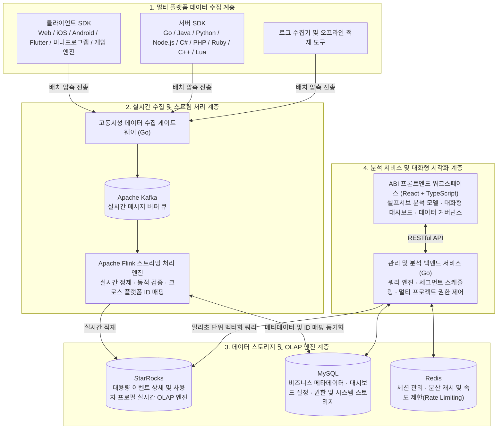

# ABI — 엔터프라이즈 사용자 행동 분석（UBA）및 비즈니스 인텔리전스（BI）플랫폼

**프로덕트 성장, 정밀한 그로스 운영 및 데이터 팀을 위한 올인원 프라이빗 데이터 분석 시스템**

**전 플랫폼 이벤트 수집 · 실시간 스트리밍 처리 · 초고속 대용량 OLAP 분석 · 13대 행동·성장 분석 모델 · 셀프 서비스 SQL · 인터랙티브 BI 대시보드 · 엔터프라이즈 RBAC 권한 거버넌스** 통합 제공

  <strong>🌐 語言 / Language：</strong>
  <a href="README.md">简体中文</a> ·
  <a href="README.zh-TW.md">繁體中文</a> ·
  <a href="README.en.md">English</a> ·
  <a href="README.ja.md">日本語</a> ·
  <a href="README.ko.md"><b>한국어</b></a> ·
  <a href="README.es.md">Español</a> ·
  <a href="README.pt.md">Português</a> ·
  <a href="README.de.md">Deutsch</a> ·
  <a href="README.fr.md">Français</a> ·
  <a href="README.ru.md">Русский</a> ·
  <a href="README.vi.md">Tiếng Việt</a> ·
  <a href="README.th.md">ไทย</a> ·
  <a href="README.id.md">Bahasa Indonesia</a>

  
  
  
  
  
  
  

  <a href="#features">핵심 기능</a> •
  <a href="#scenarios">활용 시나리오</a> •
  <a href="#screenshots">기능 화면</a> •
  <a href="#architecture">기술 아키텍처</a> •
  <a href="#sdks">멀티 플랫폼 수집</a> •
  <a href="#contact">도입 및 문의</a>

 

---

## ✨ 핵심 기능 소개

**ABI(AnyLink Behavioral Intelligence)**는 프로덕트 성장과 데이터 중심 의사결정을 위해 즉시 배포 가능한 엔터프라이즈급 **사용자 행동 분석(User Behavior Analytics, UBA) 및 비즈니스 인텔리전스(Business Intelligence, BI)** 올인원 플랫폼입니다. 전 플랫폼 이벤트 트래킹 데이터 수집부터 실시간 스트리밍 정제·적재, 멀티 모델 셀프서브 탐색 분석, 고객 360° 프로필 및 코호트 세그멘테이션, 경영 대시보드 시각화까지 데이터 라이프사이클의 전 과정을 완벽히 연결합니다. 온프레미스 및 프라이빗 클라우드 구축을 지원하여 기업의 데이터 주권과 지속 가능한 비즈니스 성장을 보장합니다.

| 기능 모듈 | 핵심 역량 설명 |
| :--- | :--- |
| **📊 13대 셀프 서비스 분석 모델** | **이벤트 분석**(다중 지표 수식, YoY/MoM, 이상 탐지, 4분면), **퍼널**, **리텐션**, **유저 패스**, **분포**, **간격**, **유저 속성 분석**과 더불어 **어트리뷰션(기여도)**, **LTV & ROI**, **라이프사이클**, **동시 접속(PCU/ACU)**, **TopN 랭크리스트**, **셀프 서비스 SQL 샌드박스**를 지원합니다.
| **🎯 사용자 360° 프로필 및 고객 코호트 운영** | 익명 방문자 디바이스와 로그인 실명 계정 간의 크로스 디바이스 아이덴티티 매핑을 자동 지원하며, **단일 사용자 360° 프로필 및 행동 타임라인 역추적**을 제공합니다. **조건식 규칙 기반 코호트 생성**, **오프라인 목록 파일 업로드 세그먼트**, **분석 결과 즉시 세그먼트 저장** 및 **동적 사용자 태그 관리**(정기 자동 갱신 지원)를 완벽히 지원합니다. |
| **🧩 인터랙티브 BI 대시보드 워크스페이스** | 멀티 워크스페이스 및 폴더 계층 관리를 지원하며, 자유로운 드래그 앤 드롭 그리드 레이아웃, 다양한 유형의 분석 차트 단일 화면 혼합 배치, 대시보드 단위 글로벌 시간 및 필터 연동, 팀원 간 실시간 공유 협업 기능을 제공합니다. |
| **🔌 데이터 자산 및 이벤트 트래킹 거버넌스** | 멀티 프로젝트, 멀티 타임존, 이벤트 정의, 속성 사전 및 비즈니스 지표를 중앙에서 통합 관리합니다. **온라인 연동 테스트 도구**(가상 전송 및 실시간 스키마 유효성 검증)를 내장하고, 적재 데이터 로그 및 이상 데이터 트러블슈팅 뷰를 제공합니다. |
| **🔐 엔터프라이즈 보안 거버넌스 및 글로벌 다국어 지원** | 사용자, 역할 및 '메뉴 / 페이지 / 버튼' 단위의 세밀한 RBAC 권한 제어, 멀티 프로젝트 데이터 격리 및 감사 로그를 제공합니다. **13개 언어(简体中文 / 繁體中文 / English / 日本語 / 한국어 / Español / Português / Deutsch / Français / Русский / Tiếng Việt / ไทย / Bahasa Indonesia)** 기본 지원, 라이트/다크 듀얼 테마 및 정보 유출 방지 워터마크를 제공합니다. |

---

## 🌍 대표 활용 시나리오

- **웹 / 모바일 앱 / 미니프로그램 제품 성장(Product Growth)**: 신규 기능 배포 성과 평가, 회원가입 및 첫 구매 전환 퍼널 진단, 신규/복귀 유저 리텐션 곡선 및 행동 이동 경로 추적.
- **이커머스 및 리테일 정밀 그로스 운영**: '노출 탐색 → 검색 → 장바구니 담기 → 주문서 작성 → 결제' 전 과정의 기여도 분석 및 고가치 VIP/이탈 위험군 정밀 타겟팅.
- **게임 개발 및 글로벌 퍼블리싱 분석**: 주요 게임 엔진 및 서버 트래킹 지원을 통해 튜토리얼 이탈 구간, 스테이지별 클리어 소요 시간, 잔존율 및 결제 유저 세분화 실시간 모니터링.
- **기업 프라이빗 데이터 플랫폼 구축**: 컨테이너 기반 빠른 배포 및 온프레미스 인프라 환경을 완벽 지원하여 엄격한 데이터 보안 규정 준수, 사업부별 권한 분리 및 글로벌 분산 팀 간 협업 지원.

---

## 📸 주요 기능 화면

### 1. 이벤트 분석 워크스페이스 및 BI 의사결정 대시보드

기획자, 마케터, 데이터 분석가를 위한 노코드 탐색 워크스페이스: 좌측에서 지표, 필터 조건, 분해 차원을 클릭하여 선택하면 우측에 실시간 시각화 트렌드 차트와 드릴다운 가능한 상세 데이터 테이블이 즉시 렌더링되며, 클릭 한 번으로 대시보드에 고정할 수 있습니다.

<table>
  <tr>
    <td width="50%" valign="top">
      
      
<b>BI 대시보드 워크스페이스</b>: 자유로운 드래그 앤 드롭 차트 배치, 공간 디렉터리 관리 및 글로벌 시간 연동

    </td>
    <td width="50%" valign="top">
      
      
<b>퍼널 전환 분석</b>: 유연한 전환 윈도우 기간 설정, 핵심 단계별 전환 및 이탈 직관적 파악

    </td>
  </tr>
</table>

### 2. 리텐션 성과 추적 및 사용자 이동 경로 탐색

사용자 활성 잔존과 페이지/기능 간 이동 흐름을 위한 전용 시각화 모델을 제공하여 고리텐션 유입 채널의 특징과 고빈도 전환 경로를 빠르게 식별합니다.

<table>
  <tr>
    <td width="50%" valign="top">
      
      
<b>리텐션 분석</b>: 기간별 잔존 감쇄 추세 곡선 및 일자별 코호트 히트맵 매트릭스

    </td>
    <td width="50%" valign="top">
      
      
<b>경로 분석</b>: 순방향/역방향 다단계 행동 산키 다이어그램 및 상위 빈도 경로 통계

    </td>
  </tr>
</table>

### 3. 어트리뷰션, LTV & ROI, 라이프사이클 및 TopN 랭크리스트

채널별 전환 기여도, 코호트 누적 LTV 및 CAC 손익분기점(ROI), 사용자 라이프사이클 단계 변화를 심층 분석합니다.

<table>
  <tr>
    <td width="50%" valign="top">
      
      
<b>어트리뷰션 분석</b>: 첫 터치, 마지막 터치, 선형, U자형 및 시간 감쇠 모델 지원

    </td>
    <td width="50%" valign="top">
      
      
<b>LTV & ROI 분석</b>: 누적 LTV 성장 곡선, CAC 손익분기선 및 마일스톤 테이블

    </td>
  </tr>
  <tr>
    <td width="50%" valign="top">
      
      
<b>라이프사이클 분석</b>: 신규, 유지, 복귀 및 이탈 사용자 단계별 추이 시각화

    </td>
    <td width="50%" valign="top">
      
      
<b>TopN 랭크리스트</b>: 다중 지표 실시간 순위 및 사용자 프로필 드릴다운

    </td>
  </tr>
</table>

### 4. 실시간 동시 접속(PCU/ACU) & 셀프 서비스 SQL 샌드박스

게임·실시간 서비스의 동시 접속 모니터링과 테넌트 격리 읽기 전용 SQL 탐색을 모두 지원합니다.

<table>
  <tr>
    <td width="50%" valign="top">
      
      
<b>동시 접속 분석 (PCU/ACU)</b>: 최대 동시 접속(PCU) 및 평균 동시 접속(ACU) 추이 분석

    </td>
    <td width="50%" valign="top">
      
      
<b>셀프 서비스 SQL</b>: 읽기 전용 샌드박스, 프리셋 템플릿 및 원클릭 차트 시각화

    </td>
  </tr>
</table>

### 5. 단일 사용자 360° 프로필 및 타겟 코호트 추출

거시적 집계 지표 보고서에서 미시적 개별 사용자 여정으로 매끄럽게 드릴다운하고, 시각적 규칙을 통해 타겟 고객군을 추출하여 모든 분석 모델에서 교차 비교할 수 있습니다.

<table>
  <tr>
    <td width="50%" valign="top">
      
      
<b>사용자 상세 조회 및 행동 타임라인</b>: 통합 ID 매핑, 사용자 프로필 속성 및 시간순 사용자 행동 궤적

    </td>
    <td width="50%" valign="top">
      
      
<b>사용자 코호트(세그먼트) 관리</b>: 속성 및 행동 조합 기반 타겟 고객군 추출, 실시간 모수 미리보기 및 정기 스케줄 업데이트 지원

    </td>
  </tr>
</table>

### 6. 메타데이터 거버넌스, 온라인 수집 연동 테스트 및 권한 관리

표준화된 데이터 자산 카탈로그, 간편한 온라인 시뮬레이션 전송 검증 도구, 체계적인 엔터프라이즈 관리자 권한 시스템을 제공합니다.

<table>
  <tr>
    <td width="50%" valign="top">
      
      
<b>메타데이터 이벤트 관리</b>: 이벤트 표시명, 활성화 상태 및 연결된 속성 사전의 중앙 관리

    </td>
    <td width="50%" valign="top">
      
      
<b>온라인 연동 테스트 샌드박스</b>: 요청 페이로드 미리보기 및 가상 전송 유효성 검증을 통한 빠른 연동 확인

    </td>
  </tr>
</table>

<b>🔍 클릭하여 펼치기: 엔터프라이즈 역할 및 세분화된 메뉴/버튼 권한 트리 설정 화면</b>

 

<b>역할 권한 관리</b>: 모듈, 페이지 및 세부 작업 버튼 단위의 시각적 트리 체크박스 권한 위임 지원

---

## 🏗️ 프로젝트 기술 아키텍처

플랫폼은 **"고동시성 수집 게이트웨이 + 실시간 스트리밍 연산 + 벡터화 컬럼형 OLAP 분석 엔진 + 모던 프론트엔드/백엔드 분리 아키텍처"**를 채택하여, 대규모 이벤트의 실시간 수집 처리량과 초단위 대화형 다차원 쿼리 성능을 동시에 만족합니다.

### 1. 전체 아키텍처 다이어그램

### 2. 핵심 계층별 아키텍처 설명

- **멀티 플랫폼 데이터 수집 계층**: 주요 클라이언트, 서버 및 게임 엔진을 아우르는 수집 SDK와 로그 파일 적재 도구를 제공하며, 로컬 버퍼링, 배치 압축 전송 및 온라인 스키마 검증을 지원합니다.
- **실시간 수집 및 스트림 처리 계층**: 독립된 고동시성 수집 게이트웨이가 인증 및 트래픽 스파이크 완충을 담당하고, Kafka를 통해 시스템 결합도를 분리합니다. Flink 스트리밍 엔진은 실시간 데이터 정제, 메타데이터 동적 검증, IP 기반 지역 파싱 및 크로스 플랫폼 사용자 식별자 통합(ID-Mapping)을 실시간으로 수행합니다.
- **스토리지 및 분석 엔진 계층**: StarRocks 컬럼형 스토리지와 벡터화 연산 엔진을 통해 대규모 이벤트 분석, 코호트 리텐션 연산 및 대량 사용자 세그멘테이션을 초고속으로 지원합니다. MySQL은 비즈니스 메타데이터, 리포트 구성 및 권한 체계를 저장하며, Redis는 세션 관리와 고빈도 캐싱을 담당합니다.
- **분석 서비스 및 프론트엔드 상호작용 계층**: Go 백엔드는 사용자의 시각적 쿼리 조건을 안전하고 최적화된 SQL로 동적 변환하며 프로젝트 단위 데이터 격리를 보장합니다. React + TypeScript + ECharts 기반 프론트엔드는 직관적인 셀프서브 분석 및 드래그 앤 드롭 BI 대시보드 경험을 선사합니다.

### 5. 기술 스택 개요

| 영역 | 핵심 기술 스택 | 주요 역할 및 책임 |
| :--- | :--- | :--- |
| **프론트엔드 워크스페이스** | React · TypeScript · Vite · Tailwind CSS · ECharts | 셀프서브 행동 분석 UI, 차트 시각화, 드래그 앤 드롭 그리드 대시보드 및 다국어 지원 |
| **백엔드 서비스** | Go · Gin · GORM | 관리 서비스, 다차원 분석 쿼리 컴파일러, 코호트 스케줄러 및 고동시성 수집 게이트웨이 |
| **스트리밍 처리** | Java · Apache Flink · Apache Kafka | 실시간 이벤트 스트림 정제, 동적 메타데이터 동기화, 사용자 식별자 단일화 및 원시 데이터 아카이빙 |
| **스토리지 및 OLAP** | StarRocks · MySQL · Redis | 실시간 컬럼형 OLAP 분석 엔진, 관계형 설정 스토리지 및 고성능 인메모리 캐시 |
| **배포 및 인프라** | Docker · Docker Compose · Nginx | 단일 노드 컨테이너 빠른 배포 및 엔터프라이즈 프라이빗 클라우드 수평 확장 지원 |

---

## 📦 멀티 플랫폼 데이터 수집 생태계

완벽한 크로스 플랫폼 데이터 수집 SDK 제품군을 제공합니다(다국어 연동 문서 및 인터랙티브 예제 포함, 자세한 내용은 **[SDK 연동 가이드 및 소스코드 디렉터리](abi.sdk/README.ko.md)** 참조):

- **웹 및 하이브리드 프레임워크**: JavaScript / TypeScript Web SDK, 앱 내장 H5 WebView 브릿지, 위챗 미니프로그램, React Native
- **네이티브 모바일 클라이언트**: iOS(Swift), Android(Kotlin), Flutter(Dart)
- **게임 클라이언트 엔진**: Unity(C#), Unreal Engine / Cocos2d-x(C/C++), Cocos Creator / Egret / LayaAir, Cocos2d-Lua
- **백엔드 서버 언어**: Go, Java, Python, Node.js, C#(.NET), PHP, Ruby, Lua
- **공통 인터페이스 및 적재 도구**: 표준 HTTP RESTful 배치 수집 API, 실시간 로그 파일 모니터링 수집기 및 주요 로그 수집 템플릿

---

## 📬 상용 라이선스 및 도입 문의

본 프로젝트는 **기업 상용 라이선스, 전체 소스코드 공급, 프라이빗 온프레미스 구축 지원 및 맞춤형 커스텀 개발**을 지원합니다.  
플랫폼 도입 데모 시연 예약, 상용 버전 견적 확인 또는 시스템 라이선스 구매에 관심이 있으시면 언제든지 이메일로 문의해 주시기 바랍니다:

- **도입 및 비즈니스 문의 이메일**: **[baidushanxivip@gmail.com](mailto:baidushanxivip@gmail.com)**

---

**[简体中文](README.md)** · **[繁體中文](README.zh-TW.md)** · **[English](README.en.md)** · **[日本語](README.ja.md)** · **[한국어](README.ko.md)** · **[Español](README.es.md)** · **[Português](README.pt.md)** · **[Deutsch](README.de.md)** · **[Français](README.fr.md)** · **[Русский](README.ru.md)** · **[Tiếng Việt](README.vi.md)** · **[ไทย](README.th.md)** · **[Bahasa Indonesia](README.id.md)**

Keywords: User Behavior Analytics (UBA), Product Analytics, Business Intelligence (BI), Event Tracking, Funnel Analysis, Cohort Retention, Multi-Touch Attribution, LTV & ROI, Lifecycle Analysis, PCU/ACU Concurrency, Self-Service SQL, User Path Sankey, Customer 360, Audience Segmentation, StarRocks OLAP, Apache Flink, Self-Hosted Analytics Platform, 사용자 행동 분석 시스템, 로그 수집 분석 플랫폼, 비즈니스 인텔리전스 대시보드, 온프레미스 데이터 분석

