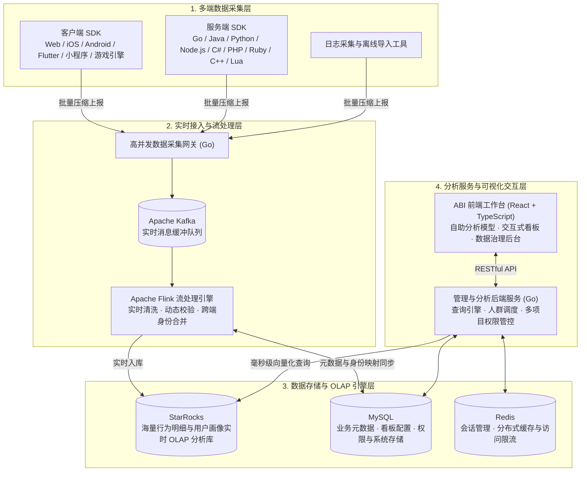

# ABI — 企业级用户行为分析（UBA）与商业智能（BI）平台

**面向产品增长、精细化运营与数据团队打造的一站式私有化数据分析系统**

集 **全端埋点采集 · 实时流式处理 · 海量 OLAP 分析 · 七大行为分析模型 · 交互式 BI 看板 · 企业级权限治理** 于一体

  <strong>🌐 语言 / Language / 言語：</strong>
  <a href="README.md"><b>简体中文</b></a> ·
  <a href="README.zh-TW.md">繁體中文</a> ·
  <a href="README.en.md">English</a> ·
  <a href="README.ja.md">日本語</a> ·
  <a href="README.ko.md">한국어</a> ·
  <a href="README.es.md">Español</a> ·
  <a href="README.pt.md">Português</a> ·
  <a href="README.de.md">Deutsch</a> ·
  <a href="README.fr.md">Français</a> ·
  <a href="README.ru.md">Русский</a> ·
  <a href="README.vi.md">Tiếng Việt</a> ·
  <a href="README.th.md">ไทย</a> ·
  <a href="README.id.md">Bahasa Indonesia</a>

  
  
  
  
  
  

  <a href="#features">基础功能</a> •
  <a href="#scenarios">应用场景</a> •
  <a href="#screenshots">模块截图</a> •
  <a href="#architecture">技术架构</a> •
  <a href="#sdks">多端采集</a> •
  <a href="#contact">购买与联系</a>

 

---

## ✨ 基础功能介绍

**ABI（AnyLink Behavioral Intelligence）** 是一套开箱即用的企业级 **用户行为分析（User Behavior Analytics, UBA）与商业智能（Business Intelligence, BI）** 一体化数据分析平台。系统打通从「全端埋点数据采集 → 实时流式清洗入库 → 多模型自助探索分析 → 用户画像分群与数据看板决策」的完整业务闭环，支持私有化部署，助力企业实现数据自主可控与业务持续增长。

| 功能模块 | 核心能力说明 |
| :--- | :--- |
| **📊 多模型自助行为分析** | 内置 **事件分析**（多指标聚合、公式计算、同比/环比、多维分组）、**漏斗分析**（多步转化与流失拆解）、**留存分析**（日/周/月队列留存追踪）、**路径分析**（用户流转桑基图）、**分布分析**、**间隔分析**（转化耗时统计）及 **用户属性分析**。 |
| **🎯 用户 360° 画像与人群运营** | 自动打通匿名访客设备与实名登录账号的跨端身份，提供 **单用户 360° 档案与行为时间线回溯**；支持 **条件规则圈选分群**、**离线名单导入分群**、**分析结果一键存为分群** 以及 **动态用户标签管理**（支持定时自动更新）。 |
| **🧩 交互式 BI 看板工作台** | 支持多业务空间与文件夹分级管理，提供自由拖拽栅格布局、多类型分析图表同屏混排、看板级全局时间与筛选联动，以及团队成员共享协作。 |
| **🔌 数据资产与埋点治理** | 集中管理多项目、多时区、事件定义、属性字典与业务指标；内置 **在线接入联调工具**（支持模拟上报与实时校验），并提供入库数据日志与异常数据排查视图。 |
| **🔐 企业级权限与国际化体验** | 提供用户、角色及「菜单 / 页面 / 按钮」细粒度 RBAC 权限管控，支持多项目数据隔离与操作审计日志；原生支持 **简体中文 / 繁體中文 / English / 日本語 / 한국어 / Español / Português / Deutsch / Français / Русский / Tiếng Việt / ไทย / Bahasa Indonesia（共 13 种语言）** 切换、亮暗双主题及防泄密界面水印。 |

---

## 🌍 典型应用场景

- **互联网产品与移动应用增长（Web / App / 小程序）**：评估新功能上线效果、诊断注册与激活转化漏斗、追踪新老用户留存曲线与访问路径。
- **电商与数字零售精细化运营**：贯通「曝光浏览 → 搜索 → 加购 → 结算 → 支付」全链路归因，精准圈选高价值 VIP 与潜在流失客群。
- **游戏研发与全球发行分析**：覆盖主流游戏客户端引擎与服务端埋点上报，实时监控新手引导流失、关卡转化耗时、活跃留存及付费分层。
- **企业私有化数据中台建设**：全套系统支持容器化快速交付与私有云部署，满足数据隐私合规、多业务线权限隔离与全球跨时区团队协作需求。

---

## 📸 主要功能模块截图

### 1. 事件分析工作台与 BI 决策看板

面向产品、运营与数据分析人员的零代码探索工作台：左侧点选指标、过滤条件与拆解维度，右侧即时呈现可视化趋势图与可下钻的数据报表，并支持一键挂载至业务监控看板。

<table>
  <tr>
    <td width="50%" valign="top">
      
      
<b>BI 看板工作台</b>：多图表自由拖拽编排、空间目录管理与全局时间联动

    </td>
    <td width="50%" valign="top">
      
      
<b>漏斗转化分析</b>：灵活设定转化窗口期，直观洞察各关键步骤的转化与流失

    </td>
  </tr>
</table>

### 2. 留存表现追踪与用户路径探索

针对用户活跃留存与页面流转提供专项可视化模型，快速识别高留存渠道特征与高频转化路径。

<table>
  <tr>
    <td width="50%" valign="top">
      
      
<b>留存分析</b>：多期留存衰减趋势曲线与每日队列热力矩阵

    </td>
    <td width="50%" valign="top">
      
      
<b>路径分析</b>：正向/逆向多步行为桑基流向图与高频路径统计

    </td>
  </tr>
</table>

### 3. 用户 360° 档案与人群分群圈选

支持从宏观汇总报表无缝下钻至微观个体轨迹，并通过可视化规则圈选目标人群，复用于任意分析模型做交叉对比。

<table>
  <tr>
    <td width="50%" valign="top">
      
      
<b>用户细查与行为序列</b>：统一身份绑定、用户画像属性与按时间展开的行为轨迹

    </td>
    <td width="50%" valign="top">
      
      
<b>用户分群管理</b>：基于属性与行为组合圈选人群，支持人数实时预览与定时更新

    </td>
  </tr>
</table>

### 4. 元数据治理、在线接入联调与权限管理

提供规范化的数据资产目录、低门槛的在线模拟上报校验工具，以及清晰完善的企业后台权限体系。

<table>
  <tr>
    <td width="50%" valign="top">
      
      
<b>元数据事件管理</b>：统一维护事件显示名称、启停状态与关联属性字典

    </td>
    <td width="50%" valign="top">
      
      
<b>在线接入演练</b>：内置报文预览与模拟上报校验，快速验证埋点接入正确性

    </td>
  </tr>
</table>

<b>🔍 点击展开查看：企业级角色与细粒度菜单/按钮权限配置截图</b>

 

<b>角色权限管理</b>：支持按模块、页面及操作按钮进行可视化的树形勾选授权

---

## 🏗️ 项目技术架构

平台采用 **「高并发接入网关 + 实时流式计算 + 向量化列式分析引擎 + 现代化前后端分离工作台」** 的分层架构，兼顾大规模事件实时入库吞吐与秒级交互式多维查询体验。

### 1. 整体架构概览图

### 2. 核心分层说明

- **多端数据采集层**：提供覆盖主流客户端、服务端与游戏引擎的采集 SDK 及日志导入工具，支持本地缓存、批量压缩传输与在线校验。
- **实时接入与流处理层**：独立的高并发采集网关负责接入鉴权与流量削峰，通过 Kafka 解耦上下游；Flink 流处理引擎实时完成数据清洗、元数据动态校验、IP 地域解析及跨端用户身份合并。
- **存储与分析引擎层**：依托 StarRocks 列式存储与向量化引擎支撑海量事件分析、留存计算与大规模人群圈选；MySQL 承载业务元数据、报表配置与权限体系；Redis 负责会话与高频缓存。
- **分析服务与前端交互层**：Go 后端将前端可视化查询条件动态转化为高效安全的分析查询，并实现项目级数据隔离；React + TypeScript + ECharts 前端提供流畅的自助分析工作台与拖拽式 BI 看板。

### 3. 技术栈速览

| 领域 | 核心技术选型 | 职责概述 |
| :--- | :--- | :--- |
| **前端工作台** | React · TypeScript · Vite · Tailwind CSS · ECharts | 自助行为分析界面、图表可视化、拖拽栅格看板与多语言管理端 |
| **后端服务** | Go · Gin · GORM | 后台管理服务、多模型分析查询编译、人群任务调度与高并发采集网关 |
| **流式计算** | Java · Apache Flink · Apache Kafka | 实时埋点流清洗、动态元数据同步、跨端身份归一与原始数据归档 |
| **存储与 OLAP** | StarRocks · MySQL · Redis | 实时列式 OLAP 分析库、关系型配置存储与高性能缓存 |
| **部署交付** | Docker · Docker Compose · Nginx | 支持单机容器化快速部署与企业私有云集群化横向扩展 |

---

## 📦 多端数据采集生态

内置完整的跨平台数据采集 SDK 体系（配套 13 种语言接入文档与交互式示例，详见 **[SDK 接入文档与源码目录](abi.sdk/README.md)**）：

- **Web 与跨端框架**：JavaScript / TypeScript Web SDK、App 内嵌 H5 WebView 桥接、微信小程序、React Native
- **原生移动客户端**：iOS（Swift）、Android（Kotlin）、Flutter（Dart）
- **游戏客户端引擎**：Unity（C#）、Unreal Engine / Cocos2d-x（C/C++）、Cocos Creator / Egret / LayaAir、Cocos2d-Lua
- **后端服务器语言**：Go、Java、Python、Node.js、C#（.NET）、PHP、Ruby、Lua
- **通用接口与导入**：标准 HTTP RESTful 批量上报接口、实时日志文件监听导入工具及主流日志采集模板

---

## 📬 商业授权与购买咨询

本项目支持 **企业商业授权、完整源码交付、私有化部署实施及定制化二次开发**。  
如果您对该平台感兴趣，希望预约演示、了解商业版本报价或购买系统，欢迎随时通过邮件联系：

- **购买与商务联系邮箱**：**[baidushanxivip@gmail.com](mailto:baidushanxivip@gmail.com)**

---

**[简体中文](README.md)** · **[繁體中文](README.zh-TW.md)** · **[English](README.en.md)** · **[日本語](README.ja.md)** · **[한국어](README.ko.md)** · **[Español](README.es.md)** · **[Português](README.pt.md)** · **[Deutsch](README.de.md)** · **[Français](README.fr.md)** · **[Русский](README.ru.md)** · **[Tiếng Việt](README.vi.md)** · **[ไทย](README.th.md)** · **[Bahasa Indonesia](README.id.md)**

Keywords: User Behavior Analytics (UBA), Product Analytics, Business Intelligence (BI), Event Tracking, Funnel Analysis, Cohort Retention, User Path Sankey, Customer 360, Audience Segmentation, StarRocks OLAP, Apache Flink, Self-Hosted Analytics Platform, 用户行为分析系统, 埋点分析平台, 商业智能看板, 私有化数据分析

