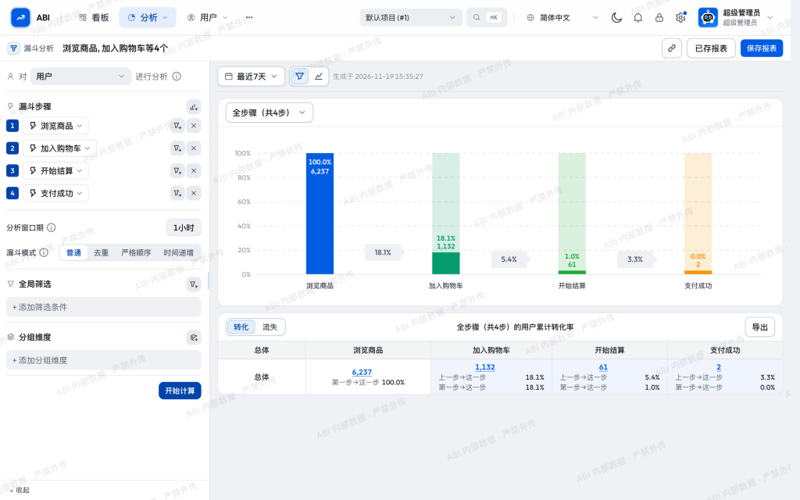
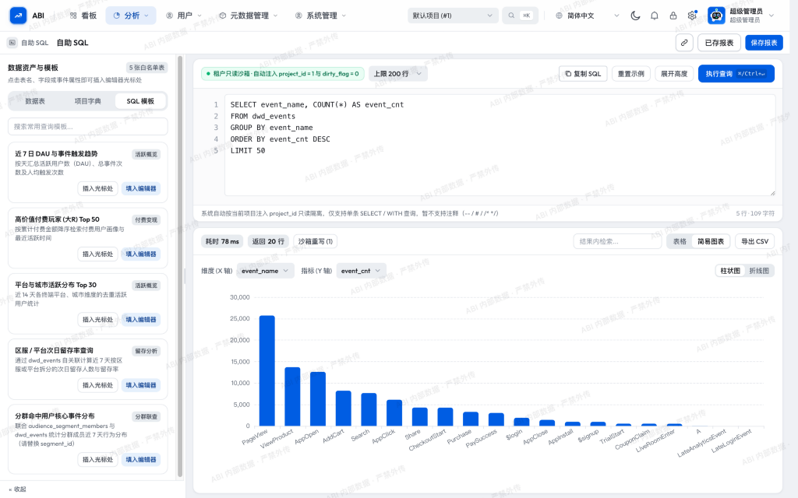
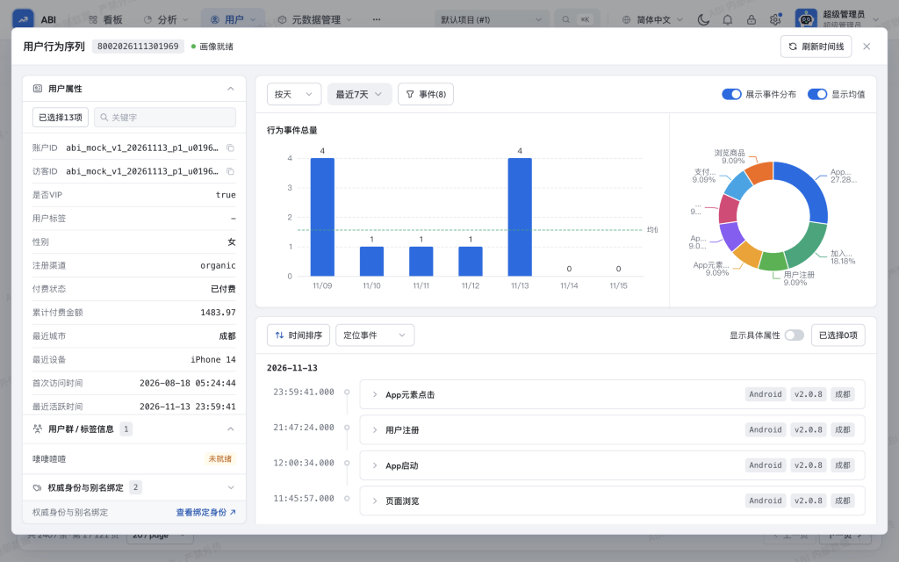
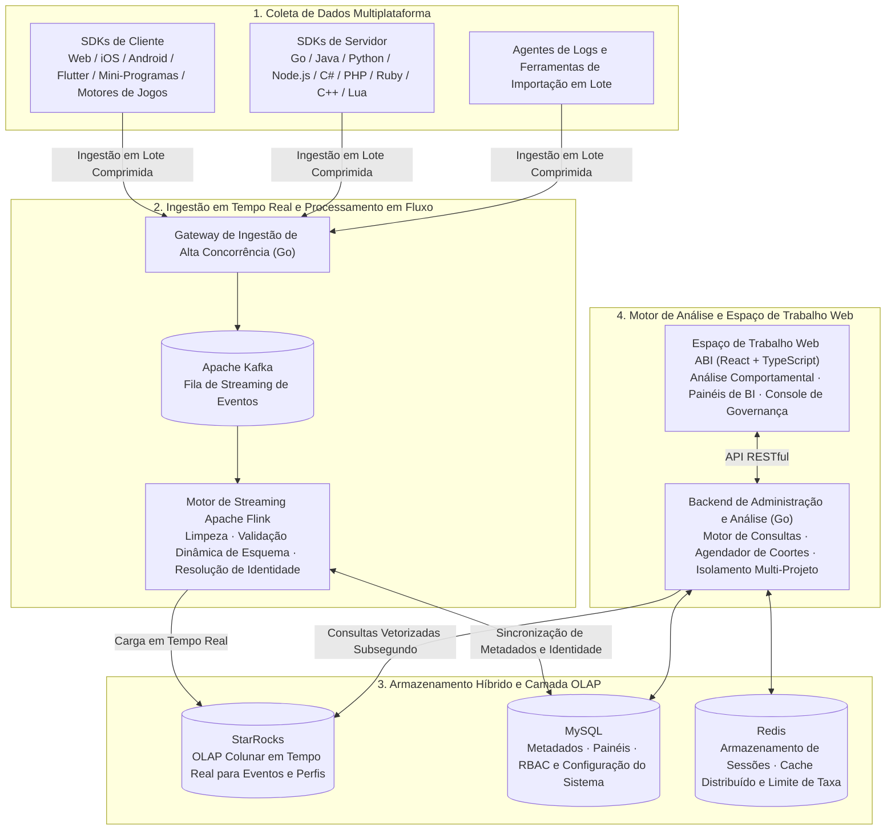

# ABI — Plataforma Empresarial de Análise de Comportamento do Usuário (UBA) e Business Intelligence (BI)

**Plataforma All-in-One Auto-Hospedada para Análise de Produto, Customer 360 e Business Intelligence**

Unificando **Coleta de Eventos Multiplataforma · Processamento em Fluxo em Tempo Real · OLAP Subsegundo · 13 Modelos Analíticos · SQL Self-Service · Painéis de BI Interativos · RBAC Empresarial**

  <strong>🌐 Idioma / Language:</strong>
  <a href="README.md">简体中文</a> ·
  <a href="README.zh-TW.md">繁體中文</a> ·
  <a href="README.en.md">English</a> ·
  <a href="README.ja.md">日本語</a> ·
  <a href="README.ko.md">한국어</a> ·
  <a href="README.es.md">Español</a> ·
  <a href="README.pt.md"><b>Português</b></a> ·
  <a href="README.de.md">Deutsch</a> ·
  <a href="README.fr.md">Français</a> ·
  <a href="README.ru.md">Русский</a> ·
  <a href="README.vi.md">Tiếng Việt</a> ·
  <a href="README.th.md">ไทย</a> ·
  <a href="README.id.md">Bahasa Indonesia</a>

  
  
  
  
  
  

  <a href="#features">Recursos Principais</a> •
  <a href="#scenarios">Casos de Uso</a> •
  <a href="#screenshots">Capturas de Tela</a> •
  <a href="#architecture">Arquitetura</a> •
  <a href="#sdks">Ecossistema de SDKs</a> •
  <a href="#contact">Compra e Contato</a>

 

---

## ✨ Recursos Principais

**ABI (AnyLink Behavioral Intelligence)** é uma plataforma empresarial pronta para produção de **Análise de Comportamento do Usuário (User Behavior Analytics, UBA) e Business Intelligence (BI)** projetada para equipes de crescimento de produto, operações e engenharia de dados. Ela entrega um fluxo de trabalho completo de ciclo fechado: desde a coleta de eventos multiplataforma e ingestão em streaming em tempo real até a exploração comportamental em autoatendimento, segmentação de usuários e painéis executivos — com suporte integral para implantação privada / on-premise e soberania total dos dados.

| Domínio de Capacidade | Destaques Principais |
| :--- | :--- |
| **📊 7 Modelos de Análise em Autoatendimento** | Inclui **Análise de Eventos** (agregação multimétrica, fórmulas personalizadas, comparação período a período, detalhamentos multidimensionais), **Análise de Funil** (diagnóstico de conversão e abandono), **Análise de Retenção** (matrizes de coortes diárias/semanais/mensais), **Análise de Caminhos** (diagramas de Sankey de fluxo de navegação direto e reverso), **Análise de Distribuição**, **Análise de Intervalos** (gráficos box plot de tempo até a conversão) e **Análise de Atributos do Usuário**. |
| **🎯 Customer 360 e Motor de Audiências** | Resolução de identidade multidispositivo em tempo real que unifica visitantes anônimos e contas autenticadas em um perfil consolidado; inclui **Linha do Tempo 360 de Usuário Individual**, **Segmentos de Usuários Baseados em Regras Visuais**, **Importação de Listas CSV**, **Criação de Segmentos com Um Clique a Partir de Gráficos** e **Tags Dinâmicas de Usuário Agendadas**. |
| **🧩 Painéis de BI Interativos** | Organização de espaços de trabalho com diretórios multiespaço, layouts em grade de arrastar e soltar responsivos, widgets visuais multimodelo, substituição dinâmica de datas e filtros globais em todo o painel e compartilhamento granular com a equipe. |
| **🔌 Governança de Metadados e Rastreamento** | Gerenciamento centralizado de projetos, fusos horários, esquemas de eventos, dicionários de propriedades e métricas de negócios; inclui um **Playground Interativo de Onboarding de SDK** (validação de carga útil em tempo real sem poluir dados de produção) e logs de ingestão e erros em tempo real. |
| **🔐 Segurança Empresarial e i18n Global** | Controle de acesso baseado em funções (RBAC) granular em menus, rotas e botões de ação com isolamento rigoroso de dados por projeto e logs de auditoria; suporte nativo a **13 idiomas globais** (incluindo português, espanhol, inglês, chinês simplificado/tradicional, japonês, coreano, alemão, francês, russo, vietnamita, tailandês e indonésio), temas claro/escuro e marcas d'água anti-vazamento em tela. |

---

## 🌍 Principais Casos de Uso

- **Crescimento de Produto e Aplicativos Móveis (Web / iOS / Android / Mini-Programas)**: Avaliar a adoção de recursos, diagnosticar gargalos de conversão em funis de integração, acompanhar curvas de retenção de coortes e explorar fluxos reais de navegação.
- **E-Commerce e Varejo Digital**: Rastrear a atribuição ponta a ponta desde impressões de produto e adições ao carrinho até o checkout e pagamento, segmentando clientes VIP de alto LTV e usuários em risco de cancelamento (churn).
- **Estúdios de Games e Publicadoras Globais**: Coletar telemetria em larga escala em Unity, Unreal, Cocos e servidores de jogos para monitorar a conclusão de tutoriais, intervalos de fases, retenção diária e faixas de monetização.
- **Infraestrutura de Dados Empresarial Auto-Hospedada**: Implantar dentro de sua própria nuvem privada ou ambiente on-premise para total conformidade de privacidade de dados, isolamento entre unidades de negócios e colaboração global entre diferentes fusos horários.

---

## 📸 Capturas de Tela dos Módulos do Produto

### 1. Área de Trabalho de Análise de Eventos e Painéis de BI Executivos

Um ambiente de exploração intuitivo e no-code projetado para gerentes de produto e analistas: configure métricas, filtros e dimensões à esquerda, inspecione gráficos interativos e relatórios detalhados à direita e fixe insights diretamente em painéis compartilhados.

<table>
  <tr>
    <td width="50%" valign="top">
      
      
<b>Área de Trabalho de Painéis de BI</b>: Grade flexível de arrastar e soltar, diretórios de projetos e filtragem global de datas

    </td>
    <td width="50%" valign="top">
      
      
<b>Análise de Funil</b>: Janelas de conversão configuráveis com diagnósticos claros de conversão e abandono em cada etapa

    </td>
  </tr>
</table>

### 2. Retenção de Coortes e Análise de Caminhos de Usuário

Visualizações especializadas para monitoramento de retenção e descoberta de fluxos de navegação, impulsionadas por um motor OLAP colunar vetorizado de alta velocidade.

<table>
  <tr>
    <td width="50%" valign="top">
      
      
<b>Análise de Retenção</b>: Curvas de decaimento de retenção multi-coorte combinadas com matriz em mapa de calor diário

    </td>
    <td width="50%" valign="top">
      
      
<b>Análise de Caminhos</b>: Diagramas de Sankey multietapas diretos e reversos com classificação das principais transições

    </td>
  </tr>
</table>

### 3. Atribuição, LTV & ROI, Ciclo de Vida e Ranking TopN

<table>
  <tr>
    <td width="50%" valign="top">
      
      
<b>Attribution</b>: First-touch, last-touch, linear, U-shaped & decay models

    </td>
    <td width="50%" valign="top">
      
      
<b>LTV & ROI</b>: Cumulative LTV growth curves, CAC payback line & milestone matrix

    </td>
  </tr>
  <tr>
    <td width="50%" valign="top">
      
      
<b>Lifecycle</b>: New, Retained, Resurrected & Churned user stage trends

    </td>
    <td width="50%" valign="top">
      
      
<b>TopN Ranklist</b>: Real-time multi-metric user leaderboard with profile drill-down

    </td>
  </tr>
</table>

### 4. Concorrência (PCU/ACU) e SQL Self-Service

<table>
  <tr>
    <td width="50%" valign="top">
      
      
<b>Concurrency (PCU/ACU)</b>: Peak & Average Concurrent Users with peak-to-average ratios

    </td>
    <td width="50%" valign="top">
      
      
<b>Self-Service SQL</b>: Tenant-isolated read-only SQL sandbox, templates & instant charts

    </td>
  </tr>
</table>

### 5. Linha do Tempo Customer 360 e Segmentação Visual de Usuários

Navegue com facilidade desde KPIs agregados até os fluxos de eventos de usuários individuais, ou construa segmentos dinâmicos e tags para análises cruzadas aprofundadas.

<table>
  <tr>
    <td width="50%" valign="top">
      
      
<b>Usuário 360 e Linha do Tempo de Eventos</b>: Identidades vinculadas, atributos de perfil e fluxo comportamental cronológico

    </td>
    <td width="50%" valign="top">
      
      
<b>Segmentos de Usuários</b>: Combinação de atributos e regras comportamentais com pré-visualização instantânea de tamanho e atualização agendada

    </td>
  </tr>
</table>

### 6. Governança de Metadados, Onboarding Interativo de SDK e RBAC Granular

Mantenha dicionários de dados limpos, valide cargas úteis de rastreamento de eventos interativamente e governe o acesso da equipe com permissões de nível corporativo.

<table>
  <tr>
    <td width="50%" valign="top">
      
      
<b>Governança de Eventos e Esquemas</b>: Gestão de nomes de exibição, alternância de status ativo e dicionários de propriedades

    </td>
    <td width="50%" valign="top">
      
      
<b>Guia Interativo de Onboarding</b>: Pré-visualize cargas úteis JSON e realize testes de validação em segundos

    </td>
  </tr>
</table>

<b>🔍 Clique para expandir: Árvore de Permissões RBAC Empresarial para Funções, Menus e Botões Granulares</b>

 

<b>Autorização RBAC Granular</b>: Árvore visual de permissões cobrindo módulos, páginas e botões de ação em tela

---

## 🏗️ Arquitetura Técnica

O ABI adota uma **arquitetura de plataforma de dados moderna em 4 camadas, nativa em nuvem**, combinando um gateway de ingestão de alta concorrência, processamento em fluxo em tempo real, um motor OLAP colunar vetorizado e uma área de trabalho web desacoplada.

### 1. Diagrama de Arquitetura de Alto Nível

### 2. Visão Geral das Camadas de Arquitetura

- **Camada de Coleta de Dados**: SDKs de nível de produção para ambientes web, móveis, motores de jogos e linguagens de backend com buffer local, compactação em lote e ferramentas de validação em tempo real.
- **Camada de Ingestão e Streaming em Tempo Real**: Um gateway de ingestão dedicado em Go lida com autenticação e buffer de tráfego para o Kafka, enquanto o Apache Flink limpa continuamente os eventos, impõe esquemas dinâmicos, enriquece dados de geolocalização GeoIP e unifica identidades de usuários entre dispositivos.
- **Camada de Armazenamento e OLAP**: O StarRocks viabiliza consultas analíticas subsegundo sobre tabelas massivas de eventos, perfis de usuários e coortes de audiência; o MySQL armazena metadatos, layouts de painéis e configurações de RBAC; o Redis gerencia sessões ativas e limites de taxa de requisições.
- **Camada de Serviços e Aplicação**: O backend em Go compila condições visuais de consulta em SQL analítico seguro e parametrizado com isolamento estrito de projetos, alimentando uma interface ágil de análise e painéis em React + TypeScript + ECharts.

### 5. Resumo da Pilha Tecnológica

| Camada | Tecnologias Principais | Função |
| :--- | :--- | :--- |
| **Área de Trabalho Frontend** | React · TypeScript · Vite · Tailwind CSS · ECharts | Construtor de consultas comportamentais, gráficos interativos, painéis de arrastar e soltar e console de administração |
| **Serviços de Backend** | Go · Gin · GORM | API de administração, compilador de SQL analítico, agendador de audiências e gateway de ingestão de alto rendimento |
| **Processamento em Fluxo** | Java · Apache Flink · Apache Kafka | ETL de eventos em tempo real, sincronização dinâmica de metadatos, unificação de identidades e arquivamento de eventos brutos |
| **Armazenamento e OLAP** | StarRocks · MySQL · Redis | Banco de dados OLAP colunar vetorizado, repositório relacional de metadatos e cache de alta performance |
| **Implantação** | Docker · Docker Compose · Nginx | Implantação em contêineres com um único comando ou expansão escalável em cluster de nuvem privada |

---

## 📦 Ecossistema de SDKs Multiplataforma

SDKs completos de coleta de dados com documentação multilíngue e exemplos interativos — consulte a **[Suite Completa de SDKs e Documentação de Integração](abi.sdk/README.pt.md)**:

- **Web e Multiplataforma**: SDK Web para JavaScript / TypeScript, ponte H5 App-to-WebView, Mini-Programas WeChat, React Native
- **Mobile Nativo**: iOS (`Swift`), Android (`Kotlin`), Flutter (`Dart`)
- **Motores de Jogos**: Unity (`C#`), Unreal Engine / Cocos2d-x (`C/C++`), Cocos Creator / Egret / LayaAir, Cocos2d-Lua
- **Linguagens do Lado do Servidor**: Go, Java, Python, Node.js, C# (`.NET`), PHP, Ruby, Lua
- **Ingestão HTTP e de Logs**: API RESTful HTTP padrão para ingestão em lote, agente de envio de arquivos de log em tempo real e modelos de coletores de logs prontos para uso

---

## 📬 Licenciamento Comercial e Consultas de Compra

O ABI está disponível para **licenciamento comercial, entrega completa de código-fonte, assistência de implantação privada / on-premise e desenvolvimento corporativo personalizado**.  
Se você tiver interesse em adquirir o ABI, solicitar uma demonstração ao vivo ou discutir opções de licenciamento empresarial, entre em contato por e-mail:

- **Contato Comercial e de Vendas**: **[baidushanxivip@gmail.com](mailto:baidushanxivip@gmail.com)**

---

**[简体中文](README.md)** · **[繁體中文](README.zh-TW.md)** · **[English](README.en.md)** · **[日本語](README.ja.md)** · **[한국어](README.ko.md)** · **[Español](README.es.md)** · **[Português](README.pt.md)** · **[Deutsch](README.de.md)** · **[Français](README.fr.md)** · **[Русский](README.ru.md)** · **[Tiếng Việt](README.vi.md)** · **[ไทย](README.th.md)** · **[Bahasa Indonesia](README.id.md)**

Palavras-chave: Análise de Comportamento do Usuário, UBA, Análise de Produto, Business Intelligence, Painéis de BI, Análise Auto-Hospedada, SDK de Rastreamento de Eventos, Análise de Funil, Retenção de Coortes, Caminhos de Usuário Sankey, Customer 360, Segmentação de Usuários, CDP, StarRocks OLAP, Apache Flink, RBAC Empresarial

