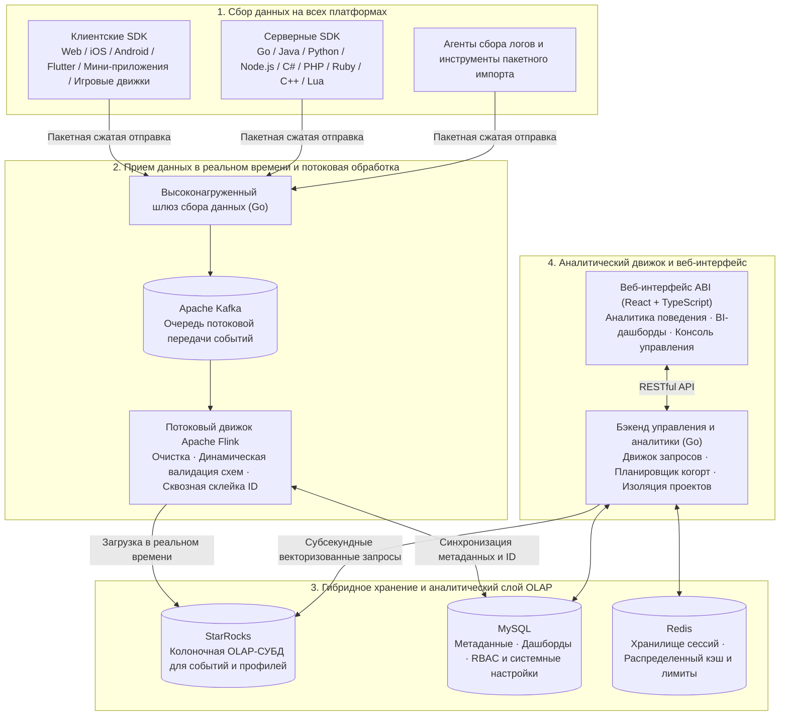

# ABI — Корпоративная платформа продуктовой аналитики поведения пользователей (UBA) и Business Intelligence (BI)

**Универсальная автономная платформа продуктовой аналитики, профилирования клиентов 360° и бизнес-аналитики**

Объединяет **мультиплатформенный трекинг событий · потоковую обработку в реальном времени · субсекундный OLAP · 13 моделей аналитики · Self-Service SQL · интерактивные BI-дашборды · корпоративный RBAC**

  <strong>🌐 Язык / Ngôn ngữ / Language:</strong>
  <a href="README.md">简体中文</a> ·
  <a href="README.zh-TW.md">繁體中文</a> ·
  <a href="README.en.md">English</a> ·
  <a href="README.ja.md">日本語</a> ·
  <a href="README.ko.md">한국어</a> ·
  <a href="README.es.md">Español</a> ·
  <a href="README.pt.md">Português</a> ·
  <a href="README.de.md">Deutsch</a> ·
  <a href="README.fr.md">Français</a> ·
  <a href="README.ru.md"><b>Русский</b></a> ·
  <a href="README.vi.md">Tiếng Việt</a> ·
  <a href="README.th.md">ไทย</a> ·
  <a href="README.id.md">Bahasa Indonesia</a>

  
  
  
  
  
  
  

  <a href="#features">Основные возможности</a> •
  <a href="#scenarios">Сценарии применения</a> •
  <a href="#screenshots">Скриншоты модулей</a> •
  <a href="#architecture">Архитектура</a> •
  <a href="#sdks">Экосистема SDK</a> •
  <a href="#contact">Лицензирование и контакты</a>

 

---

## ✨ Основные возможности

**ABI (AnyLink Behavioral Intelligence)** — это готовая к корпоративной эксплуатации платформа **продуктовой аналитики поведения пользователей (User Behavior Analytics, UBA) и Business Intelligence (BI)**, созданная для команд роста продукта, маркетинга и дата-инженерии. Платформа обеспечивает полный замкнутый цикл: от кроссплатформенного сбора данных и потокового приема в реальном времени до самостоятельного исследования поведения пользователей, сегментации аудитории и построения управленческих дашбордов. Поддерживается полное развертывание в приватном облаке или локальном ЦОД (on-premise) для обеспечения полного суверенитета и безопасности данных.

| Область возможностей | Ключевые особенности |
| :--- | :--- |
| **📊 7 моделей самообслуживаемой аналитики поведения** | Встроенный **Анализ событий** (агрегация нескольких метрик, пользовательские формулы, сравнение периодов год к году / месяц к месяцу, многомерные срезы), **Анализ воронок** (диагностика конверсий и точек оттока), **Анализ удержания (Retention)** (когортные матрицы по дням/неделям/месяцам), **Анализ путей пользователей** (прямые и обратные диаграммы Санки пользовательских маршрутов), **Анализ распределения**, **Анализ интервалов** (статистика времени конверсии в виде диаграмм размаха), и **Анализ атрибутов пользователей**. |
| **🎯 Профиль Клиента 360° и Движок аудиторий** | Сквозная склейка идентификаторов анонимных устройств и авторизованных учетных записей в реальном времени в единый профиль пользователя; включает **Хронологическую шкалу событий пользователя 360°**, **Визуальный конструктор когорт на основе правил**, **Импорт списков из CSV**, **Сохранение когорт в один клик из аналитических отчетов** и **Пользовательские теги с автоматическим обновлением по расписанию**. |
| **🧩 Интерактивные BI-дашборды** | Организация рабочих пространств с многоуровневыми папками, адаптивная сеточная компоновка drag-and-drop, совмещение различных аналитических виджетов на одном экране, глобальные динамические фильтры дат и параметров на уровне дашборда, а также гибкое разграничение прав доступа для совместной работы в команде. |
| **🔌 Управление метаданными и трекингом** | Централизованное управление проектами, часовыми поясами, схемами событий, словарями свойств и бизнес-метриками; включает **Интерактивную песочницу подключения SDK (SDK Playground)** (проверка валидности JSON-запросов в реальном времени без засорения боевых данных), а также журналы приема данных и мониторинг ошибок в реальном времени. |
| **🔐 Корпоративная безопасность и глобальная локализация** | Гранулярный контроль доступа RBAC на уровне меню, маршрутов и кнопок действий со строгой изоляцией данных по проектам и аудиторским журналом; нативная поддержка **13 мировых языков** (включая русский, английский, китайский, японский, вьетнамский и др.), светлая и темная темы оформления, а также экранные водяные знаки для предотвращения утечек данных. |

---

## 🌍 Сценарии применения

- **Рост цифровых продуктов и мобильных приложений (Web / iOS / Android / Мини-приложения)**: оценка эффективности внедрения новых функций, выявление узких мест и точек оттока в воронках онбординга, отслеживание кривых удержания когорт и исследование реальных путей переходов пользователей.
- **Электронная коммерция и цифровой ритейл**: сквозная атрибуция цепочки «просмотр товара → добавление в корзину → оформление заказа → оплата», точная сегментация VIP-покупателей с высоким LTV и пользователей с риском оттока.
- **Игровые студии и глобальные паблишеры**: сбор высоконагруженной телеметрии на движках Unity, Unreal, Cocos и игровых серверах для анализа прохождения туториалов, интервалов прохождения уровней, ежедневного удержания и платящей аудитории.
- **Корпоративная инфраструктура данных On-Premise**: быстрое развертывание в собственном облаке или локальном ЦОД для полного соответствия требованиям к конфиденциальности данных, изоляции бизнес-подразделений и глобальной командной работы в различных часовых поясах.

---

## 📸 Скриншоты функциональных модулей

### 1. Рабочая область анализа событий и управленческие BI-дашборды

Интуитивное рабочее пространство для исследования данных без написания кода, созданное для продакт-менеджеров и аналитиков: настройка метрик, фильтров и группировок слева, интерактивные графики и детализированные таблицы справа, а также сохранение инсайтов на общие дашборды в один клик.

<table>
  <tr>
    <td width="50%" valign="top">
      
      
<b>Рабочее пространство BI-дашбордов</b>: сеточная компоновка drag-and-drop, папки пространств и глобальная фильтрация по датам

    </td>
    <td width="50%" valign="top">
      
      
<b>Анализ воронок</b>: гибко настраиваемые окна конверсии с пошаговой аналитикой переходов и оттока

    </td>
  </tr>
</table>

### 2. Когортное удержание и анализ путей пользователей

Специализированные визуализации для анализа удержания и исследования поведения пользователей, работающие на базе высокоскоростного векторизованного OLAP-движка.

<table>
  <tr>
    <td width="50%" valign="top">
      
      
<b>Анализ удержания</b>: кривые затухания удержания по когортам в сочетании с ежедневной тепловой матрицей

    </td>
    <td width="50%" valign="top">
      
      
<b>Анализ путей</b>: прямые и обратные многошаговые диаграммы Санки с рейтингом наиболее частых переходов

    </td>
  </tr>
</table>

### 3. Атрибуция, LTV и ROI, жизненный цикл и рейтинг TopN

<table>
  <tr>
    <td width="50%" valign="top">
      
      
<b>Attribution</b>: First-touch, last-touch, linear, U-shaped & decay models

    </td>
    <td width="50%" valign="top">
      
      
<b>LTV & ROI</b>: Cumulative LTV growth curves, CAC payback line & milestone matrix

    </td>
  </tr>
  <tr>
    <td width="50%" valign="top">
      
      
<b>Lifecycle</b>: New, Retained, Resurrected & Churned user stage trends

    </td>
    <td width="50%" valign="top">
      
      
<b>TopN Ranklist</b>: Real-time multi-metric user leaderboard with profile drill-down

    </td>
  </tr>
</table>

### 4. Одновременный онлайн (PCU/ACU) и Self-Service SQL

<table>
  <tr>
    <td width="50%" valign="top">
      
      
<b>Concurrency (PCU/ACU)</b>: Peak & Average Concurrent Users with peak-to-average ratios

    </td>
    <td width="50%" valign="top">
      
      
<b>Self-Service SQL</b>: Tenant-isolated read-only SQL sandbox, templates & instant charts

    </td>
  </tr>
</table>

### 5. Хронологический профиль пользователя 360° и визуальная сегментация аудитории

Плавный переход от агрегированных KPI к детальной хронологии событий отдельного пользователя, а также построение динамических сегментов и тегов для глубокого кросс-модельного анализа.

<table>
  <tr>
    <td width="50%" valign="top">
      
      
<b>Профиль 360° и лента событий</b>: связанные идентификаторы, атрибуты профиля и хронологический поток действий

    </td>
    <td width="50%" valign="top">
      
      
<b>Сегментация аудитории</b>: объединение свойств профиля и поведенческих правил с мгновенной оценкой размера и автообновлением

    </td>
  </tr>
</table>

### 6. Управление метаданными, интерактивная отладка SDK и гранулярный RBAC

Поддержание чистоты словарей данных, интерактивная валидация трекинговых событий и управление командным доступом на уровне корпоративных стандартов безопасности.

<table>
  <tr>
    <td width="50%" valign="top">
      
      
<b>Управление событиями и схемами</b>: управление отображаемыми именами, переключателями активности и словарями свойств

    </td>
    <td width="50%" valign="top">
      
      
<b>Интерактивная песочница SDK</b>: предварительный просмотр JSON-запросов и мгновенная проверка валидности за считанные секунды

    </td>
  </tr>
</table>

<b>🔍 Нажмите, чтобы развернуть: корпоративные роли и дерево гранулярных прав RBAC для меню/кнопок</b>

 

<b>Гранулярная авторизация RBAC</b>: визуальное дерево разрешений по модулям, страницам и отдельным кнопкам действий

---

## 🏗️ Проектная архитектура

В платформе ABI реализована современная, облачно-нативная **4-уровневая архитектура данных**, объединяющая высокопроизводительный шлюз приема данных, потоковую обработку в реальном времени, векторизованную колоночную OLAP-СУБД и автономный веб-интерфейс аналитика.

### 1. Обзорная схема архитектуры

### 2. Обзор архитектурных уровней

- **Уровень сбора данных**: готовые к промышленной эксплуатации SDK для веб-, мобильных платформ, игровых движков и серверных языков с локальной буферизацией, пакетным сжатием и инструментами проверки данных в реальном времени.
- **Уровень приема и потоковой обработки в реальном времени**: выделенный шлюз сбора на Go обеспечивает аутентификацию и сглаживание пиковых нагрузок через Kafka, а движок потоковой обработки Apache Flink в реальном времени очищает данные, динамически проверяет схемы, обогащает геоданные по IP и склеивает идентификаторы пользователей между устройствами.
- **Уровень хранения и OLAP-аналитики**: СУБД StarRocks обеспечивает субсекундное выполнение аналитических запросов по миллиардам событий, профилям пользователей и когортам; MySQL хранит метаданные, конфигурации дашбордов и настройки RBAC; Redis управляет активными сессиями и распределенным ограничением частоты запросов.
- **Уровень сервисов и приложений**: бэкенд на Go динамически транслирует визуальные параметры запросов в безопасный параметризованный аналитический SQL со строгой изоляцией проектов, взаимодействуя с производительным интерфейсом аналитики и дашбордов на React + TypeScript + ECharts.

### 5. Сводная таблица технологического стека

| Уровень | Ключевые технологии | Назначение |
| :--- | :--- | :--- |
| **Фронтенд-интерфейс** | React · TypeScript · Vite · Tailwind CSS · ECharts | Конструктор поведенческих запросов, интерактивные графики, drag-and-drop дашборды и панель администрирования |
| **Бэкенд-сервисы** | Go · Gin · GORM | Административный API, компилятор аналитического SQL, планировщик когорт и высоконагруженный шлюз сбора |
| **Потоковая обработка** | Java · Apache Flink · Apache Kafka | Потоковый ETL событий в реальном времени, синхронизация метаданных, склейка ID и архивация сырых событий |
| **Хранилище и OLAP** | StarRocks · MySQL · Redis | Векторизованная колоночная СУБД OLAP, реляционное хранилище конфигураций и распределенный кэш |
| **Развертывание** | Docker · Docker Compose · Nginx | Быстрый запуск в контейнерах одной командой или масштабируемое кластерное развертывание в приватном облаке |

---

## 📦 Мультиплатформенная экосистема SDK

Комплексный набор SDK для сбора данных с интерактивными примерами и подробной документацией — перейдите к **[Полному каталогу SDK и руководствам по интеграции](abi.sdk/README.ru.md)**:

- **Web и кроссплатформенные фреймворки**: JavaScript / TypeScript Web SDK, мост App-to-WebView H5, мини-программы WeChat, React Native
- **Нативные мобильные клиенты**: iOS (`Swift`), Android (`Kotlin`), Flutter (`Dart`)
- **Игровые движки**: Unity (`C#`), Unreal Engine / Cocos2d-x (`C/C++`), Cocos Creator / Egret / LayaAir, Cocos2d-Lua
- **Серверные языки**: Go, Java, Python, Node.js, C# (`.NET`), PHP, Ruby, Lua
- **HTTP и импорт логов**: стандартный RESTful API для пакетной отправки по HTTP, утилита потоковой передачи логов в реальном времени и готовые шаблоны коллекторов логов

---

## 📬 Коммерческое лицензирование и приобретение

Платформа ABI доступна для **коммерческого лицензирования, поставки полного исходного кода, содействия в развертывании в приватном облаке или локальной инфраструктуре (on-premise), а также заказной корпоративной доработки**.  
Если вы заинтересованы в приобретении ABI, запросе демонстрации или обсуждении вариантов корпоративной лицензии, свяжитесь с нами по электронной почте:

- **Контакты для приобретения и деловых вопросов**: **[baidushanxivip@gmail.com](mailto:baidushanxivip@gmail.com)**

---

**[简体中文](README.md)** · **[繁體中文](README.zh-TW.md)** · **[English](README.en.md)** · **[日本語](README.ja.md)** · **[한국어](README.ko.md)** · **[Español](README.es.md)** · **[Português](README.pt.md)** · **[Deutsch](README.de.md)** · **[Français](README.fr.md)** · **[Русский](README.ru.md)** · **[Tiếng Việt](README.vi.md)** · **[ไทย](README.th.md)** · **[Bahasa Indonesia](README.id.md)**

Ключевые слова: Аналитика поведения пользователей, UBA, Продуктовая аналитика, Business Intelligence, BI-дашборды, Self-Hosted аналитика, SDK для трекинга событий, Анализ воронок, Когортное удержание, Санки путей пользователей, Профиль клиента 360, Сегментация аудитории, CDP, StarRocks OLAP, Apache Flink, Корпоративный RBAC

