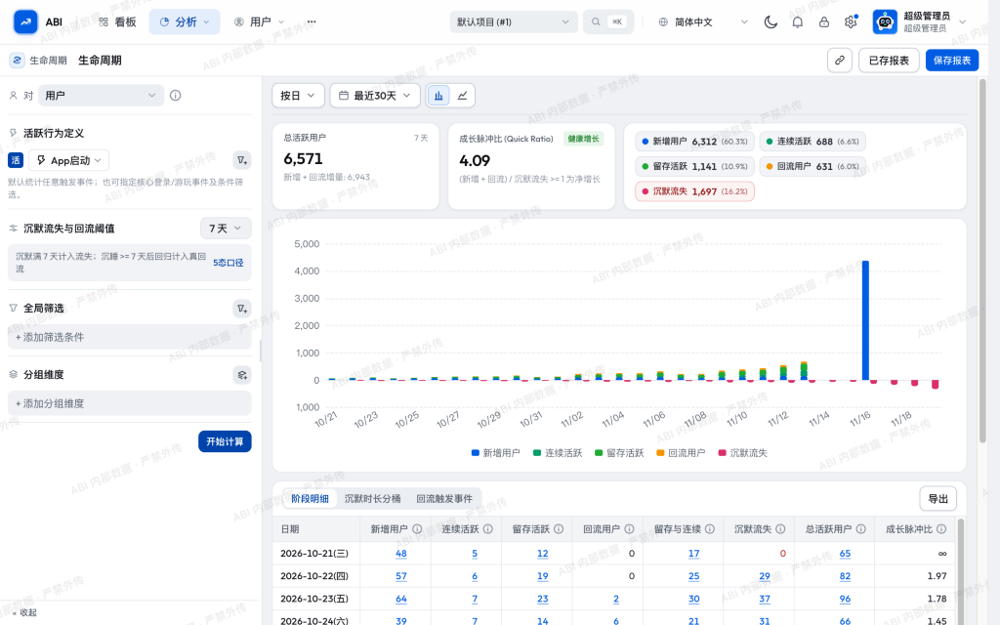
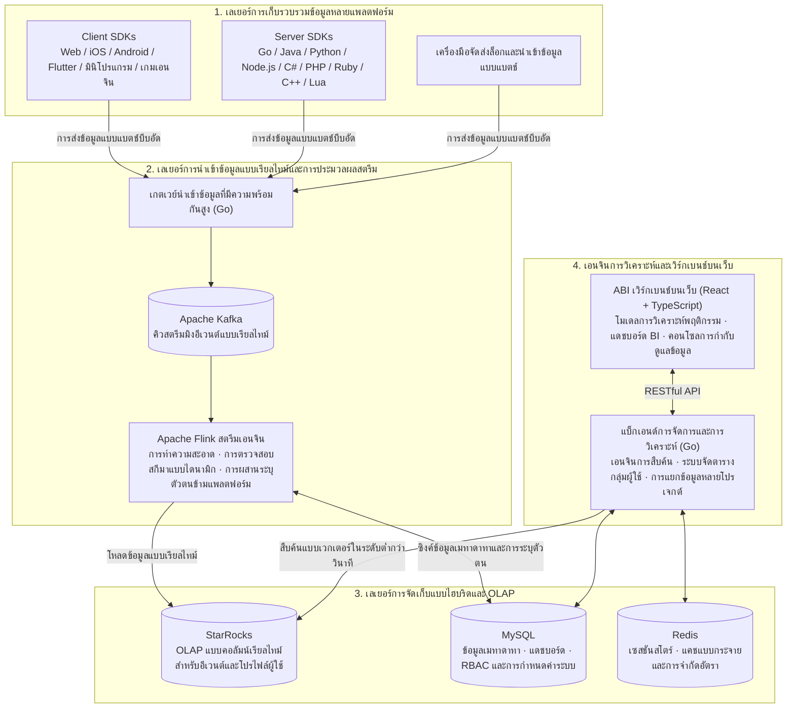

# ABI — แพลตฟอร์มวิเคราะห์พฤติกรรมผู้ใช้ (UBA) และระบบข่าวกรองธุรกิจ (BI) ระดับองค์กร

**แพลตฟอร์มวิเคราะห์ผลิตภัณฑ์, Customer 360 และระบบข่าวกรองธุรกิจแบบติดตั้งในองค์กร (Self-Hosted) ครบวงจรในหนึ่งเดียว**

ผสานรวม **การติดตามอีเวนต์หลายแพลตฟอร์ม · การประมวลผลสตรีมแบบเรียลไทม์ · OLAP วิเคราะห์ในระดับต่ำกว่าวินาที · 13 โมเดลวิเคราะห์ · SQL แบบบริการตนเอง · แดชบอร์ด BI แบบโต้ตอบ · ระบบจัดการสิทธิ์ RBAC ระดับองค์กร**

  <strong>🌐 ภาษา / Bahasa / Language:</strong>
  <a href="README.md">简体中文</a> ·
  <a href="README.zh-TW.md">繁體中文</a> ·
  <a href="README.en.md">English</a> ·
  <a href="README.ja.md">日本語</a> ·
  <a href="README.ko.md">한국어</a> ·
  <a href="README.es.md">Español</a> ·
  <a href="README.pt.md">Português</a> ·
  <a href="README.de.md">Deutsch</a> ·
  <a href="README.fr.md">Français</a> ·
  <a href="README.ru.md">Русский</a> ·
  <a href="README.vi.md">Tiếng Việt</a> ·
  <a href="README.th.md"><b>ไทย</b></a> ·
  <a href="README.id.md">Bahasa Indonesia</a>

  
  
  
  
  
  
  

  <a href="#features">ฟีเจอร์หลัก</a> •
  <a href="#scenarios">กรณีการใช้งาน</a> •
  <a href="#screenshots">ภาพหน้าจอระบบ</a> •
  <a href="#architecture">สถาปัตยกรรมทางเทคนิค</a> •
  <a href="#sdks">ระบบนิเวศ SDK</a> •
  <a href="#contact">การสั่งซื้อและติดต่อเรา</a>

 

---

## ✨ ฟีเจอร์หลัก

**ABI (AnyLink Behavioral Intelligence)** คือแพลตฟอร์ม **การวิเคราะห์พฤติกรรมผู้ใช้ (User Behavior Analytics - UBA) และระบบข่าวกรองธุรกิจ (Business Intelligence - BI)** ระดับองค์กรที่สร้างขึ้นเพื่อทีมการเติบโตของผลิตภัณฑ์ (Product Growth) ทีมปฏิบัติการ และทีมวิศวกรรมข้อมูล มอบเวิร์กโฟลว์แบบครบวงจร—ตั้งแต่การเก็บรวบรวมอีเวนต์หลายแพลตฟอร์มและการนำเข้าข้อมูลสตรีมมิงแบบเรียลไทม์ ไปจนถึงการสำรวจพฤติกรรมแบบบริการตนเอง (Self-Service) การจัดกลุ่มผู้ใช้ (Audience Segmentation) และแดชบอร์ดสำหรับผู้บริหาร—พร้อมการรองรับการติดตั้งแบบส่วนตัว / ในองค์กร (Private / On-Premise) และอธิปไตยเหนือข้อมูลอย่างสมบูรณ์

| ขอบเขตความสามารถ | ไฮไลต์สำคัญ |
| :--- | :--- |
| **📊 7 โมเดลการวิเคราะห์แบบบริการตนเอง** | มาพร้อมโมเดลในตัว: **การวิเคราะห์อีเวนต์ (Event Analysis)** (การรวมหลายตัวชี้วัด, สูตรคำนวณแบบกำหนดเอง, การเปรียบเทียบข้ามช่วงเวลา, การแจกแจงแบบหลายมิติ), **การวิเคราะห์ฟันเนล (Funnel Analysis)** (การวินิจฉัยอัตราการแปลงและการดรอปออฟในแต่ละขั้นตอน), **การวิเคราะห์รีเทนชัน (Retention Analysis)** (เมทริกซ์การคงอยู่ของผู้ใช้แบบรายวัน/รายสัปดาห์/รายเดือน), **การวิเคราะห์เส้นทาง (Path Analysis)** (แผนภาพ Sankey แสดงเส้นทางเดินของผู้ใช้ทั้งแบบไปข้างหน้าและย้อนกลับ), **การกระจาย (Distribution Analysis)**, **ช่วงเวลา (Interval Analysis)** (แผนภาพ Box Plot แสดงเวลาที่ใช้ในการแปลง), และ **การวิเคราะห์แอตทริบิวต์ผู้ใช้ (User Attribute Analysis)** |
| **🎯 Customer 360 และเอนจินกลุ่มเป้าหมาย** | การเชื่อมโยงและระบุตัวตนข้ามอุปกรณ์แบบเรียลไทม์ เชื่อมผู้เยี่ยมชมที่ไม่ระบุชื่อและบัญชีที่เข้าสู่ระบบแล้วเข้าสู่โปรไฟล์ผู้ใช้แบบรวมศูนย์; ประกอบด้วย **ไทม์ไลน์พฤติกรรม Customer 360 ของผู้ใช้รายบุคคล**, **เครื่องมือสร้างกลุ่มผู้ใช้ตามกฎเชิงภาพ (Visual Rule-Based Cohorts)**, **การนำเข้าไฟล์ CSV รายชื่อ**, **การบันทึกกลุ่มผู้ใช้จากแผนภูมิได้ในคลิกเดียว**, และ **การกำหนดแท็กผู้ใช้ตามกำหนดเวลา** |
| **🧩 แดชบอร์ด BI แบบโต้ตอบ** | จัดระเบียบพื้นที่ทำงานด้วยโฟลเดอร์แบบหลายสเปซ, เลย์เอาต์กริดแบบลากและวางที่ตอบสนองตามขนาดหน้าจอ, วิดเจ็ตการแสดงผลแบบหลายโมเดลผสมผสาน, การแทนที่วันที่และตัวกรองแบบไดนามิกทั่วทั้งแดชบอร์ด, และการแชร์กับทีมแบบกำหนดสิทธิ์อย่างละเอียด |
| **🔌 การจัดการข้อมูลเมทาดาทาและธรรมาภิบาลข้อมูล** | บริหารจัดการโปรเจกต์, เขตเวลา, สกีมาของอีเวนต์, พจนานุกรมคุณสมบัติ (Property Dictionaries), และตัวชี้วัดทางธุรกิจแบบรวมศูนย์; มาพร้อม **สนามทดลองเชื่อมต่อ SDK แบบโต้ตอบ (Interactive SDK Playground)** (ตรวจสอบเพย์โหลดแบบเรียลไทม์โดยไม่รบกวนข้อมูลบนโปรดักชัน) พร้อมบันทึกการนำเข้าและบันทึกข้อผิดพลาดแบบเรียลไทม์ |
| **🔐 ความปลอดภัยระดับองค์กรและการรองรับ 13 ภาษาทั่วโลก** | ระบบ RBAC ละเอียดระดับเมนู เส้นทาง และปุ่มการทำงาน พร้อมการแยกข้อมูลระดับโปรเจกต์และการบันทึก Audit Log อย่างเข้มงวด รองรับการแปลภาษาทั่วโลก 13 ภาษาในตัว (ไทย, จีนตัวย่อ, จีนตัวเต็ม, อังกฤษ, ญี่ปุ่น, เกาหลี, สเปน, โปรตุเกส, เยอรมัน, ฝรั่งเศส, รัสเซีย, เวียดนาม, บาฮาซาอินโดนีเซีย) ธีมสว่าง/มืด และลายน้ำป้องกันข้อมูลรั่วไหลบนหน้าจอ |

---

## 🌍 กรณีการใช้งานหลัก

- **การเติบโตของผลิตภัณฑ์และแอปพลิเคชันมือถือ (Web / iOS / Android / มินิโปรแกรม)**: วัดผลการใช้งานฟีเจอร์ใหม่ ระบุจุดดรอปออฟในฟันเนลการเริ่มต้นใช้งาน ติดตามเส้นโค้งการคงอยู่ของผู้ใช้ (Cohort Retention) และสำรวจเส้นทางการใช้งานจริงของผู้ใช้
- **อีคอมเมิร์ซและการค้าปลีกดิจิทัล**: เชื่อมโยงการระบุแหล่งที่มา (Attribution) แบบครบวงจร ตั้งแต่การแสดงสินค้า การเพิ่มลงในตะกร้า ไปจนถึงการชำระเงิน พร้อมแบ่งกลุ่มลูกค้าระดับ VIP ที่มี LTV สูงและผู้ใช้ที่มีความเสี่ยงจะเลิกใช้งาน (Churn)
- **สตูดิโอเกมและผู้เผยแพร่เกมระดับโลก**: รวบรวมข้อมูลเทเลเมทรีปริมาณมหาศาลบน Unity, Unreal Engine, Cocos และเซิร์ฟเวอร์เกม เพื่อวิเคราะห์อัตราการเล่นบทแนะนำสำเร็จ, ช่วงเวลาระหว่างด่าน, รีเทนชันรายวัน, และระดับการสร้างรายได้ (Monetization Tiers)
- **โครงสร้างพื้นฐานข้อมูลระดับองค์กรแบบติดตั้งเอง (Self-Hosted)**: ปรับใช้ภายในคลาวด์ส่วนตัวหรือสภาพแวดล้อม On-Premise ของคุณเอง เพื่อให้เป็นไปตามข้อกำหนดด้านความเป็นส่วนตัวของข้อมูล การแยกส่วนระหว่างหน่วยธุรกิจ และการทำงานร่วมกันระดับโลกข้ามเขตเวลา

---

## 📸 ภาพหน้าจอโมดูลผลิตภัณฑ์

### 1. โต๊ะทำงานวิเคราะห์อีเวนต์และแดชบอร์ด BI สำหรับผู้บริหาร

พื้นที่ทำงานสำรวจข้อมูลแบบ No-Code ที่เข้าใจง่าย ออกแบบมาสำหรับผู้จัดการผลิตภัณฑ์และนักวิเคราะห์: กำหนดค่าตัวชี้วัด ตัวกรอง และการแบ่งกลุ่มย่อยทางด้านซ้าย ตรวจสอบแผนภูมิแบบโต้ตอบและตารางเจาะลึกทางด้านขวา พร้อมปักหมุดข้อมูลเชิงลึกลงบนแดชบอร์ดที่แชร์ร่วมกันได้ทันที

<table>
  <tr>
    <td width="50%" valign="top">
      
      
<b>พื้นที่ทำงานแดชบอร์ด BI</b>: เลย์เอาต์กริดแบบลากและวาง, โฟลเดอร์แยกพื้นที่ทำงาน, และตัวกรองวันที่ครอบคลุมทั่วโลก

    </td>
    <td width="50%" valign="top">
      
      
<b>การวิเคราะห์ฟันเนล</b>: หน้าต่างเวลาการแปลงที่ปรับแต่งได้ พร้อมข้อมูลเชิงลึกการแปลงและการดรอปออฟทีละขั้นตอน

    </td>
  </tr>
</table>

### 2. การวิเคราะห์รีเทนชันตามกลุ่มผู้ใช้และเส้นทางพฤติกรรมผู้ใช้

การแสดงผลเชิงภาพที่สร้างขึ้นโดยเฉพาะสำหรับการติดตามการคงอยู่ของผู้ใช้และการค้นพบโฟลว์ของผู้ใช้ ขับเคลื่อนด้วยเอนจิน OLAP แบบเวกเตอร์ความเร็วสูง

<table>
  <tr>
    <td width="50%" valign="top">
      
      
<b>การวิเคราะห์รีเทนชัน</b>: เส้นโค้งการลดลงของการคงอยู่หลายกลุ่ม ควบคู่กับเมทริกซ์ฮีตแมปกลุ่มผู้ใช้รายวัน

    </td>
    <td width="50%" valign="top">
      
      
<b>การวิเคราะห์เส้นทาง</b>: แผนภาพ Sankey หลายขั้นตอนทั้งแบบเดินหน้าและย้อนกลับ พร้อมการจัดอันดับการเปลี่ยนผ่านยอดนิยม

    </td>
  </tr>
</table>

### 3. การระบุแหล่งที่มา (Attribution), LTV & ROI, วงจรชีวิต และ TopN Ranklist

<table>
  <tr>
    <td width="50%" valign="top">
      
      
<b>Attribution</b>: First-touch, last-touch, linear, U-shaped & decay models

    </td>
    <td width="50%" valign="top">
      
      
<b>LTV & ROI</b>: Cumulative LTV growth curves, CAC payback line & milestone matrix

    </td>
  </tr>
  <tr>
    <td width="50%" valign="top">
      
      
<b>Lifecycle</b>: New, Retained, Resurrected & Churned user stage trends

    </td>
    <td width="50%" valign="top">
      
      
<b>TopN Ranklist</b>: Real-time multi-metric user leaderboard with profile drill-down

    </td>
  </tr>
</table>

### 4. ผู้ใช้งานพร้อมกัน (PCU/ACU) และ Self-Service SQL

<table>
  <tr>
    <td width="50%" valign="top">
      
      
<b>Concurrency (PCU/ACU)</b>: Peak & Average Concurrent Users with peak-to-average ratios

    </td>
    <td width="50%" valign="top">
      
      
<b>Self-Service SQL</b>: Tenant-isolated read-only SQL sandbox, templates & instant charts

    </td>
  </tr>
</table>

### 5. ไทม์ไลน์ Customer 360 และการแบ่งกลุ่มเป้าหมายเชิงภาพ

เจาะลึกได้อย่างราบรื่นจาก KPI ภาพรวมลงสู่สตรีมอีเวนต์ของผู้ใช้รายบุคคล หรือสร้างกลุ่มผู้ใช้และแท็กแบบไดนามิกสำหรับการวิเคราะห์ข้ามโมเดลอย่างตรงเป้าหมาย

<table>
  <tr>
    <td width="50%" valign="top">
      
      
<b>Customer 360 และไทม์ไลน์อีเวนต์</b>: ข้อมูลระบุตัวตนที่เชื่อมโยง, แอตทริบิวต์โปรไฟล์, และสตรีมพฤติกรรมตามลำดับเวลา

    </td>
    <td width="50%" valign="top">
      
      
<b>การแบ่งกลุ่มเป้าหมาย</b>: รวมคุณลักษณะโปรไฟล์และกฎเชิงพฤติกรรม พร้อมพรีวิวขนาดกลุ่มทันทีและตั้งเวลาอัปเดตอัตโนมัติ

    </td>
  </tr>
</table>

### 6. ธรรมาภิบาลข้อมูลเมทาดาทา, การทดสอบ SDK แบบสด และสิทธิ์ RBAC แบบละเอียด

ดูแลพจนานุกรมข้อมูลให้สะอาดและเป็นระเบียบ ตรวจสอบความถูกต้องของเพย์โหลดการติดตามอีเวนต์แบบโต้ตอบ และควบคุมการเข้าถึงของทีมด้วยระบบสิทธิ์ระดับองค์กร

<table>
  <tr>
    <td width="50%" valign="top">
      
      
<b>ธรรมาภิบาลอีเวนต์และสกีมา</b>: จัดการชื่อที่แสดง, สลับสถานะเปิดใช้งาน, และพจนานุกรมคุณสมบัติ

    </td>
    <td width="50%" valign="top">
      
      
<b>คู่มือการเชื่อมต่อแบบโต้ตอบ</b>: พรีวิวเพย์โหลด JSON และทำการตรวจสอบความถูกต้องแบบสดได้ในไม่กี่วินาที

    </td>
  </tr>
</table>

<b>🔍 คลิกเพื่อขยาย: โครงสร้างต้นไม้สิทธิ์ RBAC ระดับบทบาทองค์กรและเมนู/ปุ่มแบบละเอียด</b>

 

<b>การอนุญาตสิทธิ์ RBAC แบบละเอียด</b>: แผนผังต้นไม้สิทธิ์เชิงภาพครอบคลุมโมดูล หน้าจอ และปุ่มการทำงานในแต่ละหน้า

---

## 🏗️ สถาปัตยกรรมทางเทคนิค

ABI ใช้สถาปัตยกรรมแพลตฟอร์มข้อมูลแบบ Cloud-Native **4 เลเยอร์** ที่ทันสมัย โดยผสานรวมเกตเวย์นำเข้าข้อมูลที่รองรับการทำงานพร้อมกันสูง, การประมวลผลสตรีมมิงแบบเรียลไทม์, เอนจิน OLAP แบบคอลัมน์ที่มีการประมวลผลแบบเวกเตอร์, และเวิร์กเบนช์บนเว็บที่แยกส่วนการทำงาน

### 1. แผนภาพสถาปัตยกรรมระดับสูง

### 2. ภาพรวมเลเยอร์สถาปัตยกรรม

- **เลเยอร์การเก็บรวบรวมข้อมูล (Data Collection Layer)**: SDK เกรดโปรดักชันครอบคลุมแพลตฟอร์มเว็บ, มือถือ, เกมเอนจิน และภาษาแบ็กเอนด์ พร้อมระบบแคชในเครื่อง (Local Buffering), การบีบอัดแบบแบตช์, และเครื่องมือตรวจสอบความถูกต้องสด
- **เลเยอร์การนำเข้าข้อมูลแบบเรียลไทม์และสตรีมมิง (Real-Time Ingestion & Streaming Layer)**: เกตเวย์การนำเข้าข้อมูลที่พัฒนาด้วย Go ทำหน้าที่ตรวจสอบสิทธิ์และรับโหลดทราฟฟิกเข้าสู่ Kafka ขณะที่ Apache Flink ทำความสะอาดอีเวนต์อย่างต่อเนื่อง ตรวจสอบสกีมาแบบไดนามิก เติมข้อมูล GeoIP ตามที่อยู่ IP และผสานข้อมูลระบุตัวตนผู้ใช้ข้ามอุปกรณ์
- **เลเยอร์การจัดเก็บข้อมูลและ OLAP (Storage & OLAP Layer)**: StarRocks มอบประสิทธิภาพการสืบค้นเชิงวิเคราะห์ในระดับต่ำกว่าวินาทีสำหรับตารางอีเวนต์ขนาดมหึมา โปรไฟล์ผู้ใช้ และกลุ่มเป้าหมาย; MySQL จัดเก็บข้อมูลเมทาดาทา เลย์เอาต์แดชบอร์ด และการตั้งค่า RBAC; Redis จัดการเซสชันที่ใช้งานอยู่และการจำกัดอัตราการเรียกใช้
- **เลเยอร์บริการและแอปพลิเคชัน (Service & Application Layer)**: แบ็กเอนด์ Go แปลงเงื่อนไขการสืบค้นจากหน้าจอให้เป็น SQL วิเคราะห์ที่ปลอดภัยและมีพารามิเตอร์ พร้อมการแยกข้อมูลระดับโปรเจกต์อย่างเข้มงวด ให้บริการแก่ฟรอนต์เอนด์ React + TypeScript + ECharts สำหรับการวิเคราะห์และแดชบอร์ดที่ตอบสนองอย่างรวดเร็ว

### 5. สรุปเทคโนโลยีที่ใช้ (Tech Stack)

| เลเยอร์ | เทคโนโลยีหลัก | บทบาทและหน้าที่ |
| :--- | :--- | :--- |
| **ฟรอนต์เอนด์เวิร์กเบนช์** | React · TypeScript · Vite · Tailwind CSS · ECharts | เครื่องมือสร้างคิวรีพฤติกรรม, แผนภูมิแบบโต้ตอบ, แดชบอร์ดแบบกริดลากและวาง & คอนโซลผู้ดูแลระบบ |
| **บริการแบ็กเอนด์** | Go · Gin · GORM | API ผู้ดูแลระบบ, คอมไพเลอร์ SQL วิเคราะห์, ระบบจัดตารางกลุ่มเป้าหมาย & เกตเวย์นำเข้าข้อมูลทรูพุตสูง |
| **การประมวลผลสตรีม** | Java · Apache Flink · Apache Kafka | ETL อีเวนต์แบบเรียลไทม์, ซิงค์เมทาดาทาสด, การผสานระบุตัวตน & จัดเก็บอีเวนต์ดิบ |
| **การจัดเก็บข้อมูลและ OLAP** | StarRocks · MySQL · Redis | ฐานข้อมูล OLAP แบบคอลัมน์เวกเตอร์, ฐานข้อมูลเชิงสัมพันธ์สำหรับเมทาดาทา & แคชแบบกระจาย |
| **การปรับใช้ระบบ** | Docker · Docker Compose · Nginx | ติดตั้งสะดวกรวดเร็วด้วยคอนเทนเนอร์คำสั่งเดียว หรือขยายคลัสเตอร์บนคลาวด์ส่วนตัวระดับองค์กร |

---

## 📦 ระบบนิเวศ SDK หลายแพลตฟอร์ม

ชุด SDK สำหรับเก็บรวบรวมข้อมูลที่ครอบคลุม พร้อมเอกสารและตัวอย่างการใช้งานแบบโต้ตอบ — ดูรายละเอียดได้ที่ **[ชุด SDK และคู่มือการผสานการทำงานฉบับสมบูรณ์](abi.sdk/README.th.md)**:

- **เว็บและข้ามแพลตฟอร์ม**: JavaScript / TypeScript Web SDK, สะพานเชื่อม App-to-WebView H5 Bridge, WeChat Mini-Program, React Native
- **เนทีฟโมบายล์**: iOS (`Swift`), Android (`Kotlin`), Flutter (`Dart`)
- **เกมเอนจิน**: Unity (`C#`), Unreal Engine / Cocos2d-x (`C/C++`), Cocos Creator / Egret / LayaAir, Cocos2d-Lua
- **ภาษาเซิร์ฟเวอร์**: Go, Java, Python, Node.js, C# (`.NET`), PHP, Ruby, Lua
- **HTTP และการนำเข้าล็อก**: RESTful HTTP API สำหรับส่งข้อมูลแบบแบตช์ตามมาตรฐาน, เครื่องมือจัดส่งล็อกไฟล์แบบเรียลไทม์, และเทมเพลตตัวรวบรวมล็อกพร้อมใช้งาน

---

## 📬 การอนุญาตใช้งานเชิงพาณิชย์และติดต่อสั่งซื้อ

ABI พร้อมสำหรับการ **อนุญาตใช้งานเชิงพาณิชย์ (Commercial Licensing), การส่งมอบซอร์สโค้ดฉบับสมบูรณ์, การสนับสนุนการติดตั้งแบบ Private / On-Premise, และการพัฒนาต่อยอดแบบปรับแต่งเฉพาะสำหรับองค์กร**  
หากท่านสนใจสั่งซื้อ ABI ต้องการนัดหมายเพื่อชมการสาธิตระบบสด หรือสอบถามเกี่ยวกับตัวเลือกสิทธิ์การใช้งานระดับองค์กร โปรดติดต่อเราทางอีเมล:

- **อีเมลติดต่อสั่งซื้อและธุรกิจ**: **[baidushanxivip@gmail.com](mailto:baidushanxivip@gmail.com)**

---

**[简体中文](README.md)** · **[繁體中文](README.zh-TW.md)** · **[English](README.en.md)** · **[日本語](README.ja.md)** · **[한국어](README.ko.md)** · **[Español](README.es.md)** · **[Português](README.pt.md)** · **[Deutsch](README.de.md)** · **[Français](README.fr.md)** · **[Русский](README.ru.md)** · **[Tiếng Việt](README.vi.md)** · **[ไทย](README.th.md)** · **[Bahasa Indonesia](README.id.md)**

คำสำคัญ: แพลตฟอร์มวิเคราะห์พฤติกรรมผู้ใช้, UBA, การวิเคราะห์ผลิตภัณฑ์, ระบบข่าวกรองธุรกิจ, แดชบอร์ด BI, การวิเคราะห์ข้อมูลแบบติดตั้งในองค์กร (Self-Hosted), SDK ติดตามอีเวนต์, การวิเคราะห์ฟันเนล, การวิเคราะห์รีเทนชัน, แผนภาพเส้นทางผู้ใช้ Sankey, Customer 360, การแบ่งกลุ่มผู้ใช้, CDP, StarRocks OLAP, Apache Flink, ระบบความปลอดภัยและสิทธิ์ RBAC ระดับองค์กร

