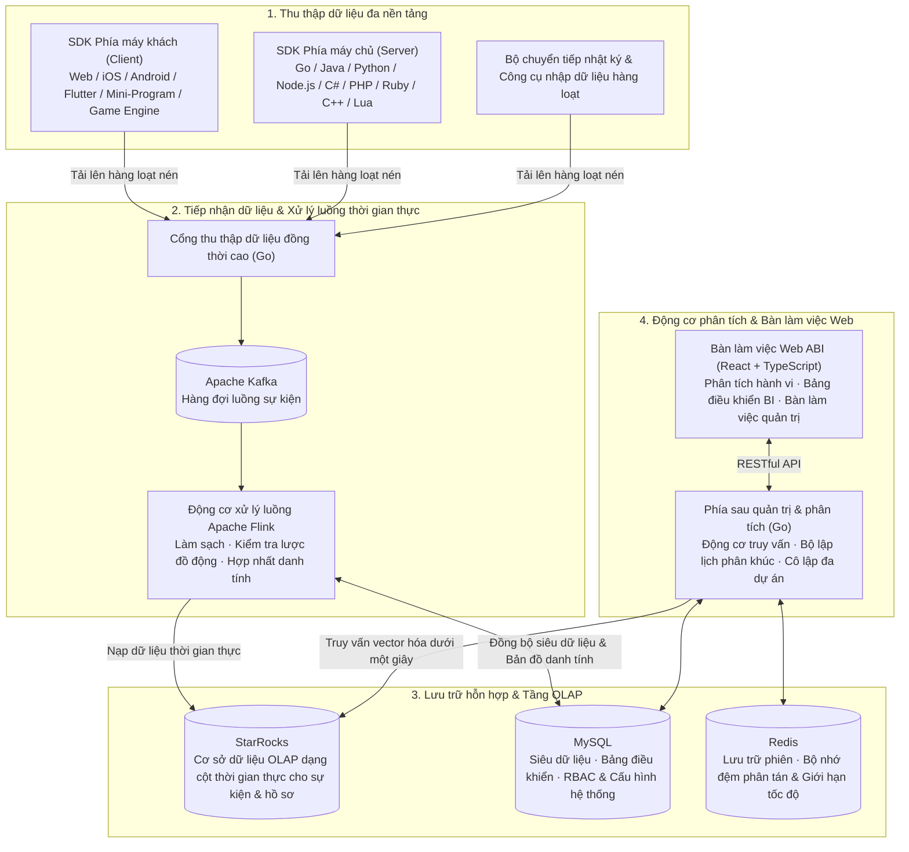

# ABI — Nền tảng Phân tích Hành vi Người dùng (UBA) & Business Intelligence (BI) Doanh nghiệp

**Nền tảng Tất-cả-trong-Một Tự Lưu trữ (Self-Hosted) cho Phân tích Sản phẩm, Chân dung Khách hàng 360° & Business Intelligence**

Hợp nhất **Theo dõi sự kiện Đa nền tảng · Xử lý luồng Thời gian thực · Phân tích OLAP Dưới một giây · 7 Mô hình Phân tích Hành vi · Bảng điều khiển BI Tương tác · Phân quyền RBAC Doanh nghiệp**

  <strong>🌐 Язык / Ngôn ngữ / Language:</strong>
  <a href="README.md">简体中文</a> ·
  <a href="README.zh-TW.md">繁體中文</a> ·
  <a href="README.en.md">English</a> ·
  <a href="README.ja.md">日本語</a> ·
  <a href="README.ko.md">한국어</a> ·
  <a href="README.es.md">Español</a> ·
  <a href="README.pt.md">Português</a> ·
  <a href="README.de.md">Deutsch</a> ·
  <a href="README.fr.md">Français</a> ·
  <a href="README.ru.md">Русский</a> ·
  <a href="README.vi.md"><b>Tiếng Việt</b></a> ·
  <a href="README.th.md">ไทย</a> ·
  <a href="README.id.md">Bahasa Indonesia</a>

  
  
  
  
  
  

  <a href="#features">Tính năng cốt lõi</a> •
  <a href="#scenarios">Kịch bản ứng dụng</a> •
  <a href="#screenshots">Hình ảnh giao diện</a> •
  <a href="#architecture">Kiến trúc kỹ thuật</a> •
  <a href="#sdks">Hệ sinh thái SDK</a> •
  <a href="#contact">Bản quyền & Liên hệ</a>

 

---

## ✨ Tính năng cốt lõi

**ABI (AnyLink Behavioral Intelligence)** là nền tảng **Phân tích Hành vi Người dùng (User Behavior Analytics, UBA) và Business Intelligence (BI)** sẵn sàng cho doanh nghiệp, được thiết kế chuyên biệt cho đội ngũ tăng trưởng sản phẩm, vận hành kinh doanh và kỹ thuật dữ liệu. Hệ thống mang lại quy trình khép kín toàn diện: từ thu thập sự kiện đa nền tảng, xử lý luồng dữ liệu thời gian thực đến tự do khám phá hành vi, phân khúc đối tượng và xây dựng bảng điều khiển quản trị — hỗ trợ triển khai on-premise hoặc đám mây riêng nhằm đảm bảo chủ quyền và bảo mật dữ liệu tuyệt đối.

| Lĩnh vực chức năng | Điểm nổi bật chính |
| :--- | :--- |
| **📊 7 mô hình phân tích hành vi tự phục vụ** | Tích hợp sẵn **Phân tích sự kiện** (tổng hợp đa chỉ số, công thức tùy chỉnh, so sánh cùng kỳ/liên kỳ, phân tích đa chiều), **Phân tích phễu** (chẩn đoán tỷ lệ chuyển đổi & điểm rơi rớt), **Phân tích giữ chân (Retention)** (ma trận đoàn hệ theo ngày/tuần/tháng), **Phân tích đường dẫn** (biểu đồ Sankey luồng hành trình người dùng thuận/nghịch), **Phân tích phân bổ**, **Phân tích khoảng thời gian** (biểu đồ hộp thời gian chuyển đổi) và **Phân tích thuộc tính người dùng**. |
| **🎯 Chân dung Khách hàng 360° & Động cơ đối tượng** | Hợp nhất danh tính xuyên thiết bị theo thời gian thực giữa khách truy cập ẩn danh và tài khoản đã xác thực thành hồ sơ người dùng duy nhất; bao gồm **Dòng thời gian sự kiện Người dùng 360°**, **Bộ tạo phân khúc đối tượng trực quan theo quy tắc**, **Nhập danh sách tệp CSV**, **Lưu phân khúc một cú nhấp từ biểu đồ phân tích** và **Thẻ người dùng động tự động cập nhật theo lịch trình**. |
| **🧩 Bảng điều khiển BI tương tác** | Tổ chức không gian làm việc với cấu trúc thư mục đa cấp, bố cục lưới kéo-thả thích ứng, hiển thị kết hợp nhiều mô hình biểu đồ trên cùng màn hình, bộ lọc ngày & điều kiện đồng bộ trên toàn bảng điều khiển và phân quyền chia sẻ cộng tác nhóm linh hoạt. |
| **🔌 Quản trị siêu dữ liệu & Giám sát theo dõi** | Quản lý tập trung nhiều dự án, múi giờ, lược đồ sự kiện, từ điển thuộc tính và chỉ số kinh doanh; tích hợp **Sân chơi tích hợp SDK tương tác** (xác thực dữ liệu tải lên trực tiếp mà không làm bẩn dữ liệu sản xuất) cùng nhật ký tiếp nhận & điều tra lỗi thời gian thực. |
| **🔐 Bảo mật doanh nghiệp & Đa ngôn ngữ toàn cầu** | Phân quyền RBAC chi tiết theo menu, tuyến đường và nút hành động với cơ chế cô lập dữ liệu cấp dự án nghiêm ngặt cùng nhật ký kiểm toán; hỗ trợ bản địa hóa gốc **13 ngôn ngữ toàn cầu** (bao gồm Tiếng Việt, Tiếng Anh, Tiếng Trung, Tiếng Nhật, Tiếng Nga, v.v.), giao diện Sáng/Tối và hình mờ chống rò rỉ dữ liệu trên màn hình. |

---

## 🌍 Kịch bản ứng dụng chính

- **Tăng trưởng sản phẩm số & Ứng dụng di động (Web / iOS / Android / Mini-Program)**: Đánh giá hiệu quả tính năng mới, xác định chính xác điểm rơi rớt trong phễu chuyển đổi ban đầu, theo dõi đường cong giữ chân theo đoàn hệ và khám phá luồng điều hướng thực tế của người dùng.
- **Thương mại điện tử & Bán lẻ kỹ thuật số**: Kết nối quy kết khép kín từ ấn tượng sản phẩm, thêm vào giỏ hàng đến đặt hàng và thanh toán, đồng thời phân khúc khách hàng VIP có LTV cao và người dùng có nguy cơ rời bỏ.
- **Phát triển game & Phát hành toàn cầu**: Thu thập dữ liệu đo từ xa khối lượng lớn trên Unity, Unreal, Cocos và máy chủ trò chơi để phân tích tỷ lệ hoàn thành hướng dẫn tân thủ, khoảng thời gian qua màn, tỷ lệ giữ chân hàng ngày và phân tầng doanh thu.
- **Hạ tầng dữ liệu doanh nghiệp tự lưu trữ (Self-Hosted)**: Triển khai linh hoạt trong đám mây riêng hoặc môi trường on-premise đáp ứng tuân thủ quyền riêng tư dữ liệu, cô lập đa đơn vị kinh doanh và cộng tác toàn cầu xuyên múi giờ.

---

## 📸 Hình ảnh giao diện các mô-đun chức năng

### 1. Không gian phân tích sự kiện & Bảng điều khiển BI quản trị

Không gian làm việc trực quan không cần viết mã dành cho giám đốc sản phẩm và chuyên viên phân tích: định cấu hình chỉ số, bộ lọc và chiều phân tích ở bên trái, kiểm tra biểu đồ tương tác và bảng dữ liệu chi tiết ở bên phải, đồng thời ghim thông tin chuyên sâu trực tiếp lên bảng điều khiển chung.

<table>
  <tr>
    <td width="50%" valign="top">
      
      
<b>Không gian bảng điều khiển BI</b>: Bố cục lưới kéo thả, thư mục không gian làm việc và đồng bộ lọc thời gian toàn cục

    </td>
    <td width="50%" valign="top">
      
      
<b>Phân tích phễu</b>: Cửa sổ chuyển đổi linh hoạt với thông tin chi tiết từng bước chuyển đổi và rơi rớt

    </td>
  </tr>
</table>

### 2. Phân tích giữ chân đoàn hệ & Khám phá đường dẫn hành trình người dùng

Các mô hình trực quan hóa chuyên dụng để theo dõi tỷ lệ giữ chân và khám phá luồng điều hướng của người dùng, được hỗ trợ bởi công cụ OLAP dạng cột được vector hóa tốc độ cao.

<table>
  <tr>
    <td width="50%" valign="top">
      
      
<b>Phân tích giữ chân</b>: Đường cong suy giảm giữ chân nhiều đoàn hệ kết hợp ma trận nhiệt đoàn hệ hàng ngày

    </td>
    <td width="50%" valign="top">
      
      
<b>Phân tích đường dẫn</b>: Biểu đồ Sankey nhiều bước theo hướng thuận & nghịch với bảng xếp hạng đường dẫn phổ biến

    </td>
  </tr>
</table>

### 3. Dòng thời gian Khách hàng 360° & Phân khúc đối tượng trực quan

Xem chi tiết liền mạch từ các chỉ số KPI tổng hợp đến luồng sự kiện của từng người dùng cụ thể, hoặc xây dựng các phân khúc và thẻ người dùng động để phân tích chéo đa mô hình.

<table>
  <tr>
    <td width="50%" valign="top">
      
      
<b>Hồ sơ 360° & Dòng thời gian sự kiện</b>: Danh tính hợp nhất, thuộc tính hồ sơ và luồng hành vi theo trình tự thời gian

    </td>
    <td width="50%" valign="top">
      
      
<b>Phân khúc đối tượng</b>: Kết hợp đặc điểm hồ sơ & quy tắc hành vi với bản xem trước quy mô tức thì và tự động làm mới

    </td>
  </tr>
</table>

### 4. Quản trị siêu dữ liệu, Kết nối thử nghiệm SDK trực tiếp & Phân quyền RBAC chi tiết

Duy trì từ điển dữ liệu chuẩn hóa, xác thực tải trọng theo dõi sự kiện trực tiếp và quản trị quyền truy cập nhóm với các cấp phân quyền chuẩn doanh nghiệp.

<table>
  <tr>
    <td width="50%" valign="top">
      
      
<b>Quản trị sự kiện & lược đồ</b>: Quản lý tên hiển thị, bật/tắt trạng thái và từ điển thuộc tính

    </td>
    <td width="50%" valign="top">
      
      
<b>Hướng dẫn tích hợp tương tác</b>: Xem trước gói tin JSON và chạy thử nghiệm xác thực trong vài giây

    </td>
  </tr>
</table>

<b>🔍 Bấm để mở rộng: Cây phân quyền RBAC chi tiết theo vai trò doanh nghiệp và menu/nút bấm</b>

 

<b>Phân quyền RBAC chi tiết</b>: Cây phân quyền trực quan trên toàn bộ mô-đun, trang và từng nút hành động trong trang

---

## 🏗️ Kiến trúc kỹ thuật

ABI áp dụng **kiến trúc nền tảng dữ liệu 4 tầng** hiện đại chuẩn đám mây, kết hợp cổng tiếp nhận dữ liệu đồng thời cao, xử lý luồng thời gian thực, công cụ OLAP dạng cột được vector hóa và không gian làm việc web độc lập.

### 1. Sơ đồ kiến trúc tổng thể

### 2. Tổng quan các tầng kiến trúc

- **Tầng thu thập dữ liệu**: Bộ SDK chuẩn sản xuất bao phủ web, di động, game engine và các ngôn ngữ máy chủ backend với khả năng đệm cục bộ, nén dữ liệu hàng loạt và các công cụ xác thực kiểm tra trực tiếp.
- **Tầng tiếp nhận dữ liệu & Xử lý luồng thời gian thực**: Cổng thu thập chuyên dụng viết bằng Go xử lý xác thực và điều tiết lưu lượng đỉnh vào Kafka, trong khi Apache Flink liên tục làm sạch sự kiện, thực thi lược đồ động, làm giàu vị trí GeoIP và hợp nhất danh tính người dùng xuyên thiết bị.
- **Tầng lưu trữ & OLAP**: StarRocks cung cấp sức mạnh cho các truy vấn phân tích dưới một giây trên các bảng sự kiện khổng lồ, hồ sơ người dùng và các nhóm đối tượng; MySQL lưu trữ siêu dữ liệu, bố cục bảng điều khiển và cấu hình RBAC; Redis quản lý phiên đăng nhập và giới hạn tốc độ truy cập.
- **Tầng dịch vụ & Ứng dụng**: Phía sau viết bằng Go biên dịch các điều kiện truy vấn trực quan thành SQL phân tích an toàn, được tham số hóa với cơ chế cô lập dự án nghiêm ngặt, phục vụ giao diện người dùng phân tích và bảng điều khiển nhạy bén bằng React + TypeScript + ECharts.

### 3. Tóm tắt ngăn xếp công nghệ

| Tầng | Công nghệ cốt lõi | Vai trò |
| :--- | :--- | :--- |
| **Giao diện làm việc Web** | React · TypeScript · Vite · Tailwind CSS · ECharts | Trình tạo truy vấn hành vi, biểu đồ tương tác, bảng điều khiển kéo-thả & bàn làm việc quản trị |
| **Dịch vụ Backend** | Go · Gin · GORM | API quản trị, trình biên dịch SQL phân tích, bộ lập lịch đối tượng & cổng thu thập thông lượng cao |
| **Xử lý luồng** | Java · Apache Flink · Apache Kafka | ETL sự kiện theo thời gian thực, đồng bộ siêu dữ liệu, hợp nhất danh tính & lưu trữ dữ liệu sự kiện thô |
| **Lưu trữ & OLAP** | StarRocks · MySQL · Redis | Cơ sở dữ liệu OLAP dạng cột được vector hóa, lưu trữ siêu dữ liệu quan hệ & bộ nhớ đệm phân tán |
| **Triển khai vận hành** | Docker · Docker Compose · Nginx | Triển khai container hóa với một lệnh duy nhất hoặc cụm mở rộng trong đám mây riêng của doanh nghiệp |

---

## 📦 Hệ sinh thái SDK đa nền tảng

Bộ SDK thu thập dữ liệu toàn diện kèm tài liệu đa ngôn ngữ và các ví dụ tương tác trực quan — xem chi tiết tại **[Danh mục trọn bộ SDK & Tài liệu tích hợp](abi.sdk/README.vi.md)**:

- **Web & Nền tảng lai (Cross-Platform)**: JavaScript / TypeScript Web SDK, cầu nối App-to-WebView H5 Bridge, WeChat Mini-Program, React Native
- **Ứng dụng di động gốc (Native Mobile)**: iOS (`Swift`), Android (`Kotlin`), Flutter (`Dart`)
- **Game Engine**: Unity (`C#`), Unreal Engine / Cocos2d-x (`C/C++`), Cocos Creator / Egret / LayaAir, Cocos2d-Lua
- **Ngôn ngữ phía máy chủ (Server-Side)**: Go, Java, Python, Node.js, C# (`.NET`), PHP, Ruby, Lua
- **Giao diện HTTP & Thu thập nhật ký**: Giao diện HTTP RESTful API tải lên hàng loạt tiêu chuẩn, công cụ theo dõi gửi tệp nhật ký thời gian thực và các mẫu cấu hình thu thập nhật ký sẵn sàng sử dụng

---

## 📬 Bản quyền thương mại & Liên hệ mua

ABI sẵn sàng cho **cấp phép bản quyền thương mại, bàn giao toàn bộ mã nguồn, hỗ trợ triển khai on-premise / đám mây riêng và phát triển tính năng tùy chỉnh cho doanh nghiệp**.  
Nếu bạn quan tâm đến việc mua ABI, yêu cầu bản demo trực tiếp hoặc thảo luận về các tùy chọn cấp phép cho doanh nghiệp, vui lòng liên hệ qua email:

- **Liên hệ mua & Hợp tác kinh doanh**: **[baidushanxivip@gmail.com](mailto:baidushanxivip@gmail.com)**

---

**[简体中文](README.md)** · **[繁體中文](README.zh-TW.md)** · **[English](README.en.md)** · **[日本語](README.ja.md)** · **[한국어](README.ko.md)** · **[Español](README.es.md)** · **[Português](README.pt.md)** · **[Deutsch](README.de.md)** · **[Français](README.fr.md)** · **[Русский](README.ru.md)** · **[Tiếng Việt](README.vi.md)** · **[ไทย](README.th.md)** · **[Bahasa Indonesia](README.id.md)**

Từ khóa: Phân tích hành vi người dùng, UBA, Phân tích sản phẩm, Business Intelligence, Bảng điều khiển BI, Nền tảng phân tích Self-Hosted, SDK theo dõi sự kiện, Phân tích phễu, Giữ chân đoàn hệ, Biểu đồ luồng Sankey người dùng, Chân dung khách hàng 360, Phân khúc đối tượng, CDP, StarRocks OLAP, Apache Flink, RBAC doanh nghiệp

