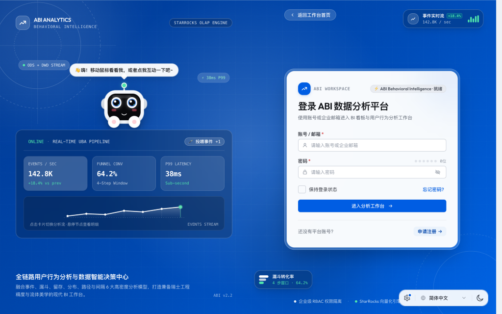
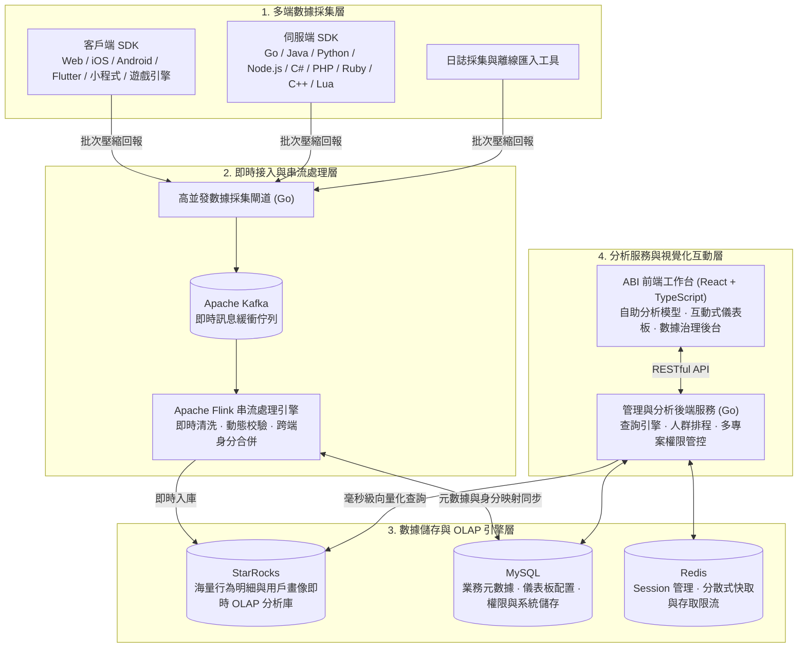

# ABI — 企業級用戶行為分析（UBA）與商業智慧（BI）平台

**面向產品增長、精細化營運與數據團隊打造的一站式私有化數據分析系統**

集 **全端埋點採集 · 即時串流處理 · 海量 OLAP 分析 · 七大行為分析模型 · 互動式 BI 儀表板 · 企業級權限治理** 於一體

  <strong>🌐 語言 / Language：</strong>
  <a href="README.md">简体中文</a> ·
  <a href="README.zh-TW.md"><b>繁體中文</b></a> ·
  <a href="README.en.md">English</a> ·
  <a href="README.ja.md">日本語</a> ·
  <a href="README.ko.md">한국어</a> ·
  <a href="README.es.md">Español</a> ·
  <a href="README.pt.md">Português</a> ·
  <a href="README.de.md">Deutsch</a> ·
  <a href="README.fr.md">Français</a> ·
  <a href="README.ru.md">Русский</a> ·
  <a href="README.vi.md">Tiếng Việt</a> ·
  <a href="README.th.md">ไทย</a> ·
  <a href="README.id.md">Bahasa Indonesia</a>

  
  
  
  
  
  

  <a href="#features">核心功能</a> •
  <a href="#scenarios">應用場景</a> •
  <a href="#screenshots">模組截圖</a> •
  <a href="#architecture">技術架構</a> •
  <a href="#sdks">多端採集</a> •
  <a href="#contact">購買與諮詢</a>

 

---

## ✨ 核心功能介紹

**ABI（AnyLink Behavioral Intelligence）** 是一套開箱即用的企業級 **用戶行為分析（User Behavior Analytics, UBA）與商業智慧（Business Intelligence, BI）** 一體化數據分析平台。系統打通從「全端埋點數據採集 → 即時串流清洗入庫 → 多模型自助探索分析 → 用戶畫像分群與數據儀表板決策」的完整業務閉環，支援私有化部署，助力企業實現數據自主可控與業務持續增長。

| 功能模組 | 核心能力說明 |
| :--- | :--- |
| **📊 多模型自助行為分析** | 內建 **事件分析**（多指標聚合、公式計算、同環比、多維分組）、**漏斗分析**（多步驟轉化與流失拆解）、**留存分析**（日/週/月隊列留存追蹤）、**路徑分析**（用戶流轉桑基圖）、**分佈分析**、**間隔分析**（轉化耗時統計）及 **用戶屬性分析**。 |
| **🎯 用戶 360° 畫像與人群營運** | 自動打通匿名訪客設備與實名登入帳號的跨端身分，提供 **單用戶 360° 檔案與行為時間線回溯**；支援 **條件規則圈選分群**、**離線名單匯入分群**、**分析結果一鍵存為分群** 以及 **動態用戶標籤管理**（支援定時自動更新）。 |
| **🧩 互動式 BI 儀表板工作台** | 支援多業務空間與資料夾分級管理，提供自由拖曳格線佈局、多類型分析圖表同屏混排、儀表板級全域時間與篩選聯動，以及團隊成員共享協作。 |
| **🔌 數據資產與埋點治理** | 集中管理多專案、多時區、事件定義、屬性字典與業務指標；內建 **線上接入聯調工具**（支援模擬回報與即時校驗），並提供入庫數據日誌與異常數據排查視圖。 |
| **🔐 企業級權限與國際化體驗** | 提供用戶、角色及「選單 / 頁面 / 按鈕」細粒度 RBAC 權限管控，支援多專案數據隔離與操作稽核日誌；原生支援 **13 種語言切換（简体中文 / 繁體中文 / English / 日本語 / 한국어 / Español / Português / Deutsch / Français / Русский / Tiếng Việt / ไทย / Bahasa Indonesia）**、亮暗雙主題及防洩密介面浮水印。 |

---

## 🌍 典型應用場景

- **網路產品與行動應用增長（Web / App / 小程式）**：評估新功能上線成效、診斷註冊與啟用轉化漏斗、追蹤新舊用戶留存曲線與造訪路徑。
- **電商與數位零售精細化營運**：貫通「曝光瀏覽 → 搜尋 → 加入購物車 → 結帳 → 支付」全鏈路歸因，精準圈選高價值 VIP 與潛在流失客群。
- **遊戲研發與全球發行分析**：涵蓋主流遊戲客戶端引擎與伺服端埋點回報，即時監控新手教學流失、關卡轉化耗時、活躍留存及付費分層。
- **企業私有化數據中台建設**：全套系統支援容器化快速交付與私有雲部署，滿足數據隱私合規、多業務線權限隔離與全球跨時區團隊協作需求。

---

## 📸 主要功能模組截圖

### 1. 事件分析工作台與 BI 決策儀表板

面向產品、營運與數據分析人員的零程式碼探索工作台：左側點選指標、過濾條件與拆解維度，右側即時呈現視覺化趨勢圖與可下鑽的數據報表，並支援一鍵掛載至業務監控儀表板。

<table>
  <tr>
    <td width="50%" valign="top">
      
      
<b>BI 儀表板工作台</b>：多圖表自由拖曳編排、空間目錄管理與全域時間聯動

    </td>
    <td width="50%" valign="top">
      
      
<b>漏斗轉化分析</b>：靈活設定轉化視窗期，直觀洞察各關鍵步驟的轉化與流失

    </td>
  </tr>
</table>

### 2. 留存表現追蹤與用戶路徑探索

針對用戶活躍留存與頁面流轉提供專項視覺化模型，快速識別高留存管道特徵與高頻轉化路徑。

<table>
  <tr>
    <td width="50%" valign="top">
      
      
<b>留存分析</b>：多期留存衰減趨勢曲線與每日隊列熱力矩陣

    </td>
    <td width="50%" valign="top">
      
      
<b>路徑分析</b>：正向/逆向多步行為桑基流向圖與高頻路徑統計

    </td>
  </tr>
</table>

### 3. 用戶 360° 檔案與人群分群圈選

支援從宏觀匯總報表無縫下鑽至微觀個體軌跡，並透過視覺化規則圈選目標人群，複用於任意分析模型做交叉對比。

<table>
  <tr>
    <td width="50%" valign="top">
      
      
<b>用戶細查與行為序列</b>：統一身分綁定、用戶畫像屬性與按時間展開的行為軌跡

    </td>
    <td width="50%" valign="top">
      
      
<b>用戶分群管理</b>：基於屬性與行為組合圈選人群，支援人數即時預覽與定時更新

    </td>
  </tr>
</table>

### 4. 元數據治理、線上接入聯調與權限管理

提供規範化的數據資產目錄、低門檻的線上模擬回報校驗工具，以及清晰完善的企業後台權限體系。

<table>
  <tr>
    <td width="50%" valign="top">
      
      
<b>元數據事件管理</b>：統一維護事件顯示名稱、啟停狀態與關聯屬性字典

    </td>
    <td width="50%" valign="top">
      
      
<b>線上接入演練</b>：內建封包預覽與模擬回報校驗，快速驗證埋點接入正確性

    </td>
  </tr>
</table>

<b>🔍 點擊展開查看：企業級角色與細粒度選單/按鈕權限配置截圖</b>

 

<b>角色權限管理</b>：支援按模組、頁面及操作按鈕進行視覺化的樹狀勾選授權

---

## 🏗️ 專案技術架構

平台採用 **「高並發接入閘道 + 即時串流計算 + 向量化列式分析引擎 + 現代化前後端分離工作台」** 的分層架構，兼顧大規模事件即時入庫吞吐量與秒級互動式多維查詢體驗。

### 1. 整體架構概覽圖

### 2. 核心分層說明

- **多端數據採集層**：提供涵蓋主流客戶端、伺服端與遊戲引擎的採集 SDK 及日誌匯入工具，支援本地快取、批次壓縮傳輸與線上校驗。
- **即時接入與串流處理層**：獨立的高並發採集閘道負責接入鑑權與流量削峰，透過 Kafka 解耦上下游；Flink 串流處理引擎即時完成數據清洗、元數據動態校驗、IP 地域解析及跨端用戶身分合併。
- **儲存與分析引擎層**：依託 StarRocks 列式儲存與向量化引擎支撐海量事件分析、留存計算與大規模人群圈選；MySQL 承載業務元數據、報表配置與權限體系；Redis 負責 Session 與高頻快取。
- **分析服務與前端互動層**：Go 後端將前端視覺化查詢條件動態轉化為高效安全的分析查詢，並實現專案級數據隔離；React + TypeScript + ECharts 前端提供流暢的自助分析工作台與拖曳式 BI 儀表板。

### 3. 技術棧速覽

| 領域 | 核心技術選型 | 職責概述 |
| :--- | :--- | :--- |
| **前端工作台** | React · TypeScript · Vite · Tailwind CSS · ECharts | 自助行為分析介面、圖表視覺化、拖曳格線儀表板與多語言管理端 |
| **後端服務** | Go · Gin · GORM | 後台管理服務、多模型分析查詢編譯、人群任務排程與高並發採集閘道 |
| **串流計算** | Java · Apache Flink · Apache Kafka | 即時埋點串流清洗、動態元數據同步、跨端身分歸一與原始數據歸檔 |
| **儲存與 OLAP** | StarRocks · MySQL · Redis | 即時列式 OLAP 分析庫、關聯式配置儲存與高效能快取 |
| **部署交付** | Docker · Docker Compose · Nginx | 支援單機容器化快速部署與企業私有雲叢集化橫向擴充 |

---

## 📦 多端數據採集生態

內建完整的跨平台數據採集 SDK 體系（配套多語言接入文件與互動式範例，詳見 **[SDK 接入文件與原始碼目錄](abi.sdk/README.zh-TW.md)**）：

- **Web 與跨端框架**：JavaScript / TypeScript Web SDK、App 內嵌 H5 WebView 橋接、微信小程式、React Native
- **原生行動客戶端**：iOS（Swift）、Android（Kotlin）、Flutter（Dart）
- **遊戲客戶端引擎**：Unity（C#）、Unreal Engine / Cocos2d-x（C/C++）、Cocos Creator / Egret / LayaAir、Cocos2d-Lua
- **後端伺服器語言**：Go、Java、Python、Node.js、C#（.NET）、PHP、Ruby、Lua
- **通用介面與匯入**：標準 HTTP RESTful 批次回報介面、即時日誌檔案監聽匯入工具及主流日誌採集範本

---

## 📬 商業授權與購買諮詢

本專案支援 **企業商業授權、完整原始碼交付、私有化部署實施及客製化二次開發**。  
如果您對該平台感興趣，希望預約展示、了解商業版本報價或購買系統，歡迎隨時透過電子郵件聯絡：

- **購買與商務聯絡信箱**：**[baidushanxivip@gmail.com](mailto:baidushanxivip@gmail.com)**

---

**[简体中文](README.md)** · **[繁體中文](README.zh-TW.md)** · **[English](README.en.md)** · **[日本語](README.ja.md)** · **[한국어](README.ko.md)** · **[Español](README.es.md)** · **[Português](README.pt.md)** · **[Deutsch](README.de.md)** · **[Français](README.fr.md)** · **[Русский](README.ru.md)** · **[Tiếng Việt](README.vi.md)** · **[ไทย](README.th.md)** · **[Bahasa Indonesia](README.id.md)**

Keywords: User Behavior Analytics (UBA), Product Analytics, Business Intelligence (BI), Event Tracking, Funnel Analysis, Cohort Retention, User Path Sankey, Customer 360, Audience Segmentation, StarRocks OLAP, Apache Flink, Self-Hosted Analytics Platform, 用戶行為分析系統, 埋點分析平台, 商業智慧儀表板, 私有化數據分析

